# Архитектурная спецификация — Единый студенческий портал (Student Super-App)

| Поле | Значение |
|---|---|
| Статус | **DRAFT — на согласование** |
| Версия | 0.1 |
| Автор | agent-arch (senior software architect) |
| Дата | 2026-11-17 |
| Базируется на | `docs/00-adr.md` (ADR-001…ADR-010) |
| Стек | NestJS (TypeScript), PostgreSQL 16, Redis, MinIO (S3), OpenSearch, RabbitMQ → Kafka, Keycloak (OIDC), Next.js (Web PWA), React Native/Flutter, Kubernetes + OpenTelemetry |

> **Важное соглашение о гранулярности (см. ADR-001).** Настоящая спецификация описывает **целевую** декомпозицию, где каждый bounded context является логическим контейнером (будущим микросервисом). На этапах 0–2 (MVP Academic + IAM, заселение) эти модули разворачиваются как **модульный монолит** — единый деплоябельный артефакт NestJS со строгими границами модулей и запретом межмодульных импортов «в обход» публичных портов. Эволюция к отдельным контейнерам происходит по мере роста нагрузки (заселение, сессия) без изменения контрактов: контейнеры уже сейчас проектируются «по швам» будущих микросервисов. Поэтому в C4 Level 2 и далее модули показаны как отдельные контейнеры, а физическое слияние на старте отражено отдельной пометкой «(модульный монолит)».

---

## 1. Обзор и цели архитектуры

### 1.1 Назначение системы

«Единый студенческий портал» — личный кабинет студента Республики Казахстан, полностью исключающий бумажный документооборот в вузе. Система рождает, подписывает (ЭЦП) и хранит все юридически значимые документы (заявления, договоры, справки), автоматизирует бытовые и социальные процессы (заселение в общежитие, льготное питание, пропускной режим), закрывает академические потребности (расписание, успеваемость, GPA, транскрипт, элективы, ДЗ, тесты, апелляции, чат, оплата) и интегрируется с государственными базами данных РК по ИИН.

### 1.2 Цели архитектуры

1. **Юридическая значимость ЭДО** — каждое действие студента/вуза фиксируется в неизменяемом аудит-логе и, где требуется, подтверждается ЭЦП (пользовательской через NCALayer/eGov Mobile или серверной ЭЦП вуза через HSM). Целостность архива гарантируется hash-chain.
2. **Изоляция ненадёжных внешних интеграций** — все межсистемные мутации проходят через Integration Hub с очередями, ретраями, идемпотентностью и DLQ; сбой внешней системы не блокирует пользователя и не теряет данные.
3. **Горизонтальное масштабирование** — пики нагрузки (начало семестра, заселение, сессия) поглощаются горизонтальным масштабированием stateless-сервисов; состояние вынесено в PostgreSQL/Redis/MinIO.
4. **Соответствие законодательству РК** — ЗРК «О персональных данных и их защите» (2013), ЗРК «Об информатизации» (2015), ЗРК «Об электронном документе и электронной цифровой подписи» (2003); хранение ПДн на серверах РК, согласие на обработку, маскирование в логах, полный аудит-трейл.
5. **Наблюдаемость и отказоустойчивость** — OpenTelemetry (traces/metrics/logs), единый корреляционный идентификатор на всём пути запроса, SLO 99.9% с деградацией интеграций без потери данных.

### 1.3 Ключевые архитектурные принципы

- **Bounded contexts как границы владения данными** — каждый модуль владеет своей схемой БД и является источником истины для своих сущностей (раздел 8).
- **Синхронное для пользовательских сценариев, асинхронное для межсистемных мутаций** (ADR-003).
- **Порты и адаптеры (hexagonal)** внутри каждого сервиса: домен не зависит от транспорта и внешних SDK.
- **Outbox + idempotency-key** для гарантии согласованности «БД → очередь → внешняя система» (ADR-007).
- **Zero-trust на периметре, TLS 1.3 in-transit, AES-256 at-rest** (ADR-008).
- **Версионирование API и событий** (`/v1`, `v1` в routing key), обратная совместимость в рамках минорной версии.

### 1.4 Словарь терминов

| Термин | Значение |
|---|---|
| BFF | Backend-for-Frontend; шлюз-адаптер под конкретный клиент (web/mobile) |
| ИИН | Индивидуальный идентификационный номер (12 цифр, РК) |
| ЭЦП | Электронная цифровая подпись |
| CAdES / XAdES / PAdES | Форматы ЭЦП: CMS/PKCS#7, XML DSig, подписанный PDF |
| НУЦ | Национальный удостоверяющий центр РК (OCSP/CRL, цепочки доверия) |
| СКУД | Система контроля и управления доступом |
| DLQ | Dead-letter queue |
| Outbox | Таблица исходящих событий, гарантирующая атомарность «транзакция БД + публикация события» |

---

## 2. C4 Model

### 2.1 Level 1 — System Context

#### Диаграмма (Mermaid `flowchart`)

```mermaid
flowchart TB
    %% ---------- Акторы ----------
    STUDENT["🧑‍🎓 Студент"]
    LECTURER["👩‍🏫 Преподаватель"]
    DEANERY["🏛️ Деканат / приёмная комиссия"]
    STAFF["🧑‍💼 Сотрудники вуза<br/>(бухгалтерия, юристы, ИТ)"]
    DORM["🏢 Администрация общежития"]
    CANTEEN["🍽️ Администрация столовой"]

    %% ---------- Наша система ----------
    subgraph SP["Единый студенческий портал (Student Super-App)"]
        direction TB
        WEB["Web PWA (Next.js / React)"]
        MOBILE["Mobile App (React Native / Flutter)"]
        BACKEND["Backend-сервисы (NestJS) + BFF/Gateway"]
        STORAGE["Хранилища: PostgreSQL, Redis,<br/>MinIO (S3), OpenSearch"]
    end

    %% ---------- Внешние системы ----------
    subgraph GOV["Государственные системы РК"]
        EGOV["eGov Mobile<br/>(QR-авторизация)"]
        NCALAYER["NCALayer<br/>(локальное ЭЦП)"]
        ESH_EP["ЕШЭП / ШЭП<br/>(SOAP-шина ЭП)"]
        SMART_DATA["Smart Data Ukimet /<br/>Smart Bridge"]
        NOBD["НОБД<br/>(МП РК, контингент)"]
        GB["ГБД ФЛ (МВД) / ГБД РН /<br/>МЗ / МТСЗН"]
        NUC["НУЦ РК<br/>(OCSP / CRL)"]
    end

    subgraph EDU["Системы вуза и партнёров"]
        LMS["Platonus / 1С:Университет<br/>(LMS)"]
        SKUD["СКУД общежития"]
        CANTEEN_SYS["Учётная система столовой"]
        PAY["Платёжный шлюз<br/>(Halyk / eGov Pay)"]
    end

    %% ---------- Связи акторов ----------
    STUDENT --> WEB
    STUDENT --> MOBILE
    LECTURER --> WEB
    LECTURER --> MOBILE
    DEANERY --> WEB
    STAFF --> WEB
    DORM --> WEB
    CANTEEN --> WEB

    %% ---------- Связи с ядром ----------
    WEB --> BACKEND
    MOBILE --> BACKEND
    BACKEND --> STORAGE

    %% ---------- Внешние связи ----------
    BACKEND -->|QR challenge / verify| EGOV
    BACKEND -->|локальный API подписания| NCALAYER
    BACKEND -->|SOAP + ЭЦП вуза| ESH_EP
    BACKEND -->|REST/gRPC + oAuth| SMART_DATA
    BACKEND -->|SOAP/REST| NOBD
    BACKEND -->|OCSP/CRL проверка| NUC
    SMART_DATA --> GB

    BACKEND -->|REST/SOAP/DB-адаптер| LMS
    BACKEND -->|REST/SDK/вебхуки| SKUD
    BACKEND -->|REST/SDK| CANTEEN_SYS
    BACKEND -->|REST + 3-D Secure| PAY
```

#### Диаграмма (PlantUML)

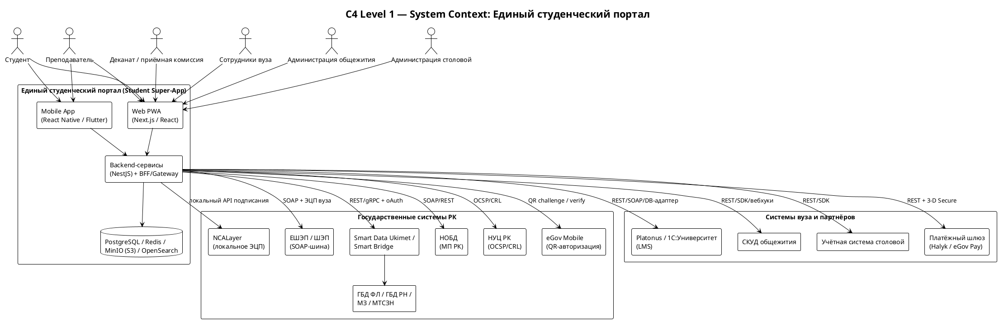

#### Список акторов

| Актор | Роль | Основные сценарии |
|---|---|---|
| Студент | Основной пользователь | авторизация, расписание, заселение, льготное питание, справки, оплата, ЭЦП-подписание |
| Преподаватель | Академический процесс | журнал, ДЗ, тесты, чат со студентами |
| Деканат / приёмная комиссия | Управление контингентом | подтверждение заявлений, распределение, апелляции |
| Сотрудники вуза (бухгалтерия, юристы, ИТ) | Операционные и административные функции | выдача справок (ЭЦП вуза), оплата, аудит |
| Администрация общежития | Заселение и пропускной режим | подтверждение заявлений, управление комнатами, СКУД |
| Администрация столовой | Льготное питание | синхронизация статусов льготников |

#### Список внешних систем

| Внешняя система | Назначение | Протокол (контракт) | Примечание |
|---|---|---|---|
| eGov Mobile | QR-авторизация и подписание действий | REST + QR-флоу, ЭЦП | URL фиксируется по договору с АО «НИТ»; плейсхолдер `{EGOV_BASE_URL}` |
| NCALayer | Локальное подписание документов (ПК/моб.) | Локальный API (WebSocket/REST на localhost) | Запускается на машине пользователя |
| ЕШЭП / ШЭП | Шина электронного правительства | SOAP/XML + ЭЦП-подпись | `{ESH_EP_BASE_URL}`, WSDL по техпаспорту |
| Smart Data Ukimet / Smart Bridge | Платформа обмена данными между ГБ | REST/gRPC + oAuth | `{SMART_DATA_URL}` |
| НОБД (МП РК) | Национальная образовательная БД (контингент) | SOAP/REST | `{NOBD_URL}` |
| ГБД ФЛ (МВД), ГБД РН (адрес), МЗ (мед), МТСЗН (льготы) | Источники персональных/социальных данных | через Smart Data Ukimet | доступ опосредованно |
| Platonus / 1С:Университет | LMS, академические данные | REST/SOAP/DB-адаптер | `{LMS_BASE_URL}` |
| СКУД общежития | Пропускной режим | REST/SDK/вебхуки | `{SKUD_BASE_URL}` |
| Учётная система столовой | Статус льготника | REST/SDK | `{CANTEEN_BASE_URL}` |
| Платёжный шлюз (Halyk / eGov Pay) | Оплата обучения | REST + 3-D Secure | `{PAY_GATEWAY_URL}` |
| НУЦ РК | OCSP/CRL, цепочки доверия сертификатов | OCSP/CRL | `{NUC_OCSP_URL}`, `{NUC_CRL_URL}` |

> Все URL государственных систем вводятся как конфигурационные плейсхолдеры и заполняются на этапе Discovery (Фаза 0) по договору с оператором (АО «НИТ», НУЦ РК, МП РК). Архитектура зависит только от **контрактной модели** интеграционного слоя (раздел 5), а не от конкретных адресов.

---

### 2.2 Level 2 — Container

#### Перечень контейнеров

| # | Контейнер | Технология | Обязанности |
|---|---|---|---|
| C1 | **Web PWA** | Next.js + React + TypeScript, PWA (Service Worker) | ЛК студента/сотрудника в браузере; офлайн-кэш расписания; резервный канал при недоступности мобильного приложения |
| C2 | **Mobile App** | React Native (альтернатива — Flutter) | Мобильный ЛК; push-уведомления (FCM/APNs); биометрия; интеграция с NCALayer-mobile / eGov Mobile |
| C3 | **API Gateway / BFF** | NestJS (gateway) + Keycloak-адаптер | Единая точка входа; маршрутизация по контексту; аутентификация на периметре (JWT validation); rate limiting; агрегация ответов для клиентов |
| C4 | **Keycloak** | Keycloak (OIDC/OAuth2) | IAM: выдача/верификация JWT, refresh, федерация внешних IdP (eGov/ЭЦП через bridge), управление ролями, сессии |
| C5 | **iam-profile-svc** | NestJS + TypeScript | Профиль, импорт по ИИН, согласие на ПДн, оркестрация eGov QR-авторизации |
| C6 | **document-signature-svc** | NestJS + TypeScript + криптобиблиотеки (PKCS#7/XML DSig) | Генерация пакетов документов, пакетное ЭЦП, проверка ЭЦП (OCSP/CRL), hash-chain, хранение в MinIO |
| C7 | **accommodation-svc** | NestJS + TypeScript | Распределение/выбор комнат, договор найма, акт приёма-передачи, статус в СКУД |
| C8 | **social-benefits-svc** | NestJS + TypeScript | Проверка права на льготу, заявление на питание, синхронизация со столовой |
| C9 | **academic-svc** | NestJS + TypeScript | Расписание, журнал, GPA, транскрипт, элективы, ДЗ, тесты, апелляции, чат |
| C10 | **university-services-svc** | NestJS + TypeScript | Справки с места учёбы (ЭЦП вуза), баланс и оплата обучения |
| C11 | **integration-hub-svc** | NestJS (адаптеры; допустим Node/Go для тяжёлых) | Единая точка внешних вызовов, адаптеры per-система, нормализация, ретраи, идемпотентность, DLQ |
| C12 | **notification-svc** | NestJS + TypeScript | E-mail / SMS / push (FCM/APNs), шаблоны, приоритеты, подтверждение доставки |
| C13 | **ops-audit-svc** | NestJS + TypeScript + OpenTelemetry | Централизованный аудит-лог, сбор метрик/трасс/логов, экспорт в Grafana/Loki/Prometheus/Tempo, SIEM |
| C14 | **PostgreSQL 16** | PostgreSQL (логически per-service schema) | OLTP источник истины; JSONB справочники; outbox-таблицы |
| C15 | **Redis** | Redis 7 (Cluster/Sentinel) | Кэш, сессии, rate limiting, краткоживущие состояния подписания (challenge) |
| C16 | **MinIO** | MinIO (S3-совместимый) | Файлы, скан-образы, подписанные PDF, объекты документов |
| C17 | **OpenSearch** | OpenSearch 2.x | Полнотекстовый поиск по документам и событиям, аналитика аудит-лога |
| C18 | **RabbitMQ → Kafka** | RabbitMQ 3.x (старт) → Kafka (рост) | Асинхронная шина событий, DLQ, гарантия доставки |

> **Физическое развёртывание (ADR-001).** На Фазах 0–2 контейнеры C5–C13 реализуются как модули **единого** NestJS-приложения (`backend-monolith`) с раздельными модулями и зависимостями только через публичные порты; БД — единый кластер PostgreSQL со schema-per-module. Переход к отдельным контейнерам выполняется позже без изменения контрактов.

#### Диаграмма (Mermaid `flowchart`)

```mermaid
flowchart TB
    subgraph CLIENTS["Клиенты"]
        WEB["C1 Web PWA\n(Next.js)"]
        MOBILE["C2 Mobile App\n(RN/Flutter)"]
    end

    subgraph EDGE["Периметр"]
        GW["C3 API Gateway / BFF\n(NestJS)"]
        KC["C4 Keycloak\n(OIDC)"]
    end

    subgraph CORE["Backend-сервисы (NestJS)"]
        IAM["C5 iam-profile-svc"]
        DOC["C6 document-signature-svc"]
        ACC["C7 accommodation-svc"]
        SOC["C8 social-benefits-svc"]
        ACAD["C9 academic-svc"]
        UNI["C10 university-services-svc"]
        HUB["C11 integration-hub-svc"]
        NOTIF["C12 notification-svc"]
        OPS["C13 ops-audit-svc"]
    end

    subgraph DATA["Хранилища"]
        PG[("C14 PostgreSQL 16")]
        REDIS[("C15 Redis")]
        MINIO[("C16 MinIO (S3)")]
        OS[("C17 OpenSearch")]
        MQ[["C18 RabbitMQ → Kafka"]]
    end

    WEB -->|HTTPS/JWT| GW
    MOBILE -->|HTTPS/JWT| GW
    GW -->|OIDC validate| KC
    GW -->|REST| IAM
    GW -->|REST| DOC
    GW -->|REST| ACC
    GW -->|REST| SOC
    GW -->|REST| ACAD
    GW -->|REST| UNI
    GW -->|REST| NOTIF

    IAM --> PG
    IAM --> REDIS
    DOC --> PG
    DOC --> MINIO
    ACC --> PG
    SOC --> PG
    ACAD --> PG
    UNI --> PG
    NOTIF --> PG
    HUB --> PG
    HUB --> REDIS
    OPS --> OS

    DOC -->|OCSP/CRL| KC
    ACC -->|REST| DOC
    SOC -->|REST| DOC
    UNI -->|REST| DOC

    IAM -->|events| MQ
    DOC -->|events| MQ
    ACC -->|events| MQ
    SOC -->|events| MQ
    ACAD -->|events| MQ
    HUB -->|events| MQ
    MQ --> NOTIF
    MQ --> HUB
    MQ --> OPS

    HUB -->|SOAP/REST| KC
    OPS -->|OTel export| KC

    ACAD -->|REST (через HUB)| HUB
    HUB -->|SOAP/REST| KC
```

> Примечание: рёбра `→ KC` в конце диаграммы условно обозначают «внешние системы/экспорт наблюдаемости»; фактические внешние связи Integration Hub показаны на Level 1 и в разделе 5.

#### Диаграмма (PlantUML)

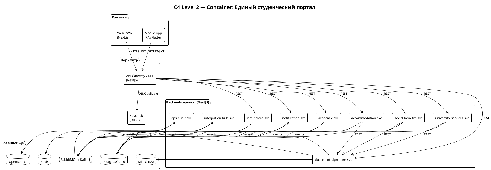

---

### 2.3 Level 3 — Component (для ключевых сервисов)

#### 2.3.1 Document & Signature Service (document-signature-svc)

Архитектурный стиль: **порты и адаптеры (hexagonal)**. Домен ЭЦП/ЭДО изолирован от конкретных SDK (NCALayer, HSM) и форматов.

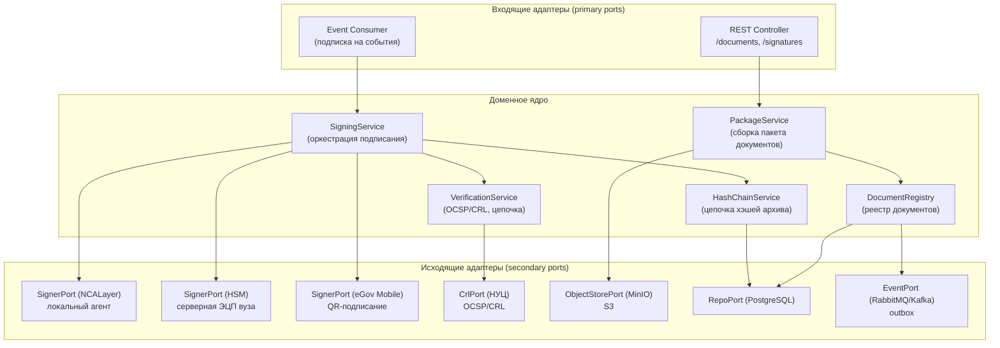

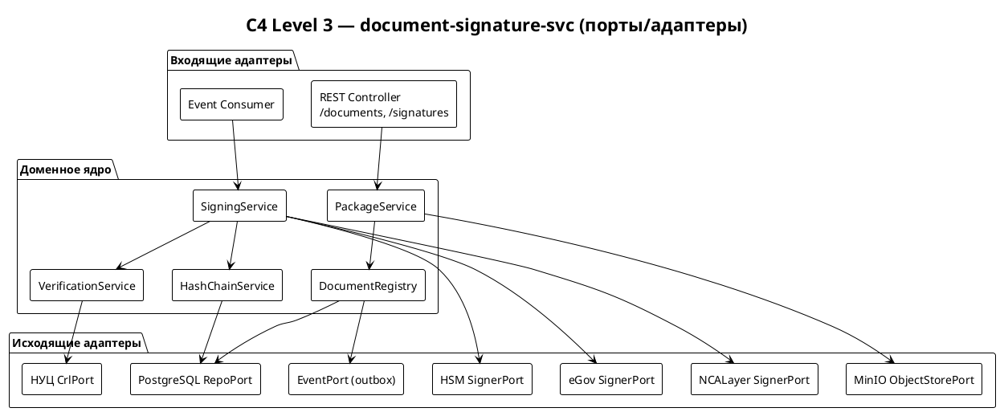

#### 2.3.2 Academic (LMS) Service (academic-svc)

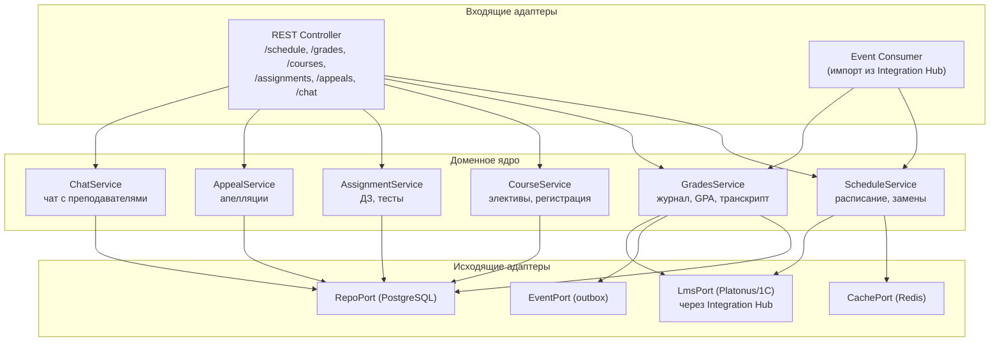

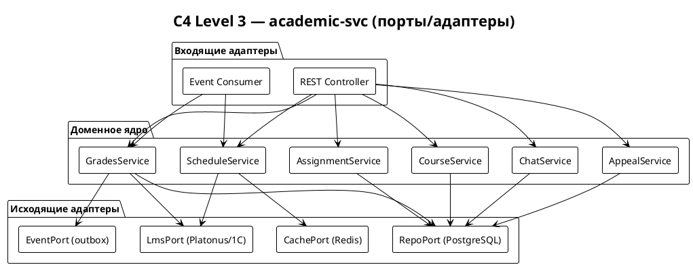

#### 2.3.3 Integration Hub (integration-hub-svc)

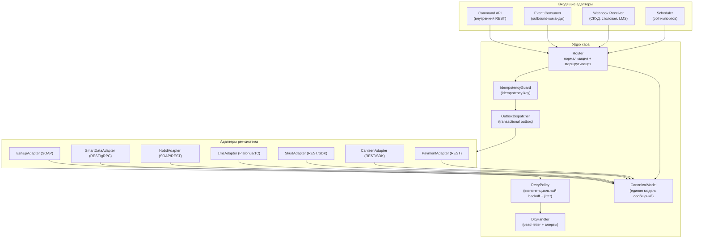

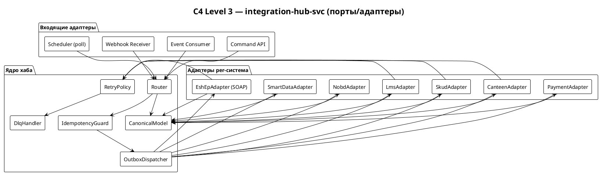

---

## 3. Детальное описание микросервисов/модулей

Каждый сервис описывается по схеме: назначение → API-операции → внутренние компоненты → зависимости.

### 3.1 IAM & Profile (iam-profile-svc)

**Назначение.** Идентификация пользователей, профиль, импорт персональных данных по ИИН, управление согласием на обработку ПДн, оркестрация QR-авторизации eGov Mobile. Выдачу токенов выполняет Keycloak; сервис хранит профиль и согласия.

**API-операции (за BFF/Gateway, префикс `/api/v1`):**

| Метод | Эндпоинт | Описание |
|---|---|---|
| POST | `/auth/qr/challenge` | Создать challenge авторизации, вернуть QR-пейлоад + `challengeId` (TTL 60 c) |
| POST | `/auth/qr/verify` | Проверить подписанный challenge; при успехе — обменять на JWT через Keycloak |
| POST | `/auth/ncalayer/login` | Вход по ЭЦП через NCALayer (authData → Keycloak) |
| POST | `/auth/refresh` | Обновить access-token по refresh-token |
| POST | `/auth/logout` | Завершить сессию (Keycloak + отзыв refresh) |
| GET | `/iam/users/me` | Текущий профиль |
| PATCH | `/iam/users/me` | Обновить профиль (контакты, аватар) |
| GET | `/iam/users/{id}` | Профиль по id (по ролям) |
| GET | `/iam/users/by-iin/{iin}` | Поиск профиля по ИИН |
| POST | `/iam/import/iin` | Запустить асинхронный импорт ПДн по ИИН из Smart Data Ukimet |
| GET | `/iam/import/{importId}` | Статус импорта |
| POST | `/iam/consent` | Зафиксировать согласие на обработку ПДн (версия политики) |
| GET | `/iam/consent/me` | Текущее согласие пользователя |
| GET | `/iam/roles` | Список ролей пользователя |

**Внутренние компоненты:** `ProfileController`, `AuthFlowController`, `ConsentService`, `IinImportService`, `UserRepository`, порты `SmartDataPort` (через Integration Hub) и `IdpPort` (Keycloak).

**Зависимости:** Keycloak (OIDC), PostgreSQL (профили, согласия, импорты), Redis (challenge-состояния), Integration Hub (импорт по ИИН), Notification (события).

### 3.2 Document & Signature (document-signature-svc)

**Назначение.** Ядро юридической значимости: сборка пакетов документов, пакетное ЭЦП (NCALayer/eGov Mobile/HSM), проверка подписей (OCSP/CRL НУЦ), hash-chain архива, хранение подписанных PDF в MinIO.

**API-операции:**

| Метод | Эндпоинт | Описание |
|---|---|---|
| POST | `/documents/packages` | Создать пакет документов (список шаблонов + данные) |
| GET | `/documents/packages/{id}` | Получить пакет (статусы вложений) |
| POST | `/documents/packages/{id}/sign-request` | Сформировать запрос на подписание (NCALayer/eGov/HSM) |
| POST | `/documents/packages/{id}/sign-result` | Принять результат подписания, верифицировать ЭЦП |
| POST | `/documents/signatures/verify` | Проверить ЭЦП документа (CAdES/XAdES/PAdES) |
| POST | `/documents/{id}/hash` | Получить hash-chain для документа |
| GET | `/documents/{id}` | Метаданные документа |
| GET | `/documents/{id}/content` | Скачать подписанный PDF (presigned S3 URL) |
| POST | `/documents/templates` | Управление шаблонами (для юристов) |
| GET | `/documents/certificates/vuza` | Сертификат серверной ЭЦП вуза (публичная часть) |

**Внутренние компоненты:** `PackageService`, `SigningService`, `VerificationService`, `HashChainService`, `DocumentRegistry`, `TemplateRenderer` (PDF/A), адаптеры `NCALayerSigner`, `HsmSigner`, `EgovSigner`, `NucCrlClient`, `MinioStore`, `OutboxPublisher`.

**Зависимости:** PostgreSQL (реестр документов, hash-chain), MinIO (файлы), Redis (состояния подписания), НУЦ (OCSP/CRL), NCALayer/eGov/HSM, RabbitMQ (события `sp.doc.*`).

### 3.3 Accommodation (accommodation-svc)

**Назначение.** Заселение: выбор/распределение комнат с учётом льгот, договор найма, акт приёма-передачи, синхронизация статуса пропуска со СКУД.

**API-операции:**

| Метод | Эндпоинт | Описание |
|---|---|---|
| GET | `/accommodation/rooms` | Список доступных комнат (фильтры: корпус, тип, льгота) |
| GET | `/accommodation/rooms/{id}` | Детали комнаты (места, занятость) |
| POST | `/accommodation/bookings` | Создать заявку на заселение |
| GET | `/accommodation/bookings/me` | Мои заявки |
| POST | `/accommodation/bookings/{id}/select-room` | Выбор конкретной комнаты |
| POST | `/accommodation/bookings/{id}/confirm` | Подтверждение деканатом/администрацией |
| POST | `/accommodation/bookings/{id}/documents` | Сгенерировать пакет документов (договор + акт) через Signature |
| POST | `/accommodation/bookings/{id}/checkin` | Завершить заселение после подписания |
| GET | `/accommodation/contracts/{id}` | Договор найма |
| POST | `/accommodation/rooms/{id}/skud/sync` | Ручная синхронизация со СКУД |

**Внутренние компоненты:** `RoomService`, `BookingService`, `ContractService`, `CheckinService`, порты `SignaturePort` (document-signature-svc), `SkudPort` (через Integration Hub).

**Зависимости:** PostgreSQL, document-signature-svc (генерация и подписание пакета), Integration Hub → СКУД, RabbitMQ (`sp.accommodation.*`), Notification.

### 3.4 Social Benefits (social-benefits-svc)

**Назначение.** Проверка права на льготу (МТСЗН через Smart Data Ukimet), заявление на льготное питание, синхронизация статуса льготника с учётной системой столовой.

**API-операции:**

| Метод | Эндпоинт | Описание |
|---|---|---|
| GET | `/social/eligibility/me` | Проверить право на льготу (кэш + фоновое обновление) |
| POST | `/social/eligibility/check` | Принудительная проверка права (асинхронный запрос в МТСЗН) |
| POST | `/social/meal/applications` | Подать заявление на льготное питание |
| GET | `/social/meal/applications/me` | Мои заявления |
| GET | `/social/meal/applications/{id}` | Детали заявления |
| POST | `/social/meal/applications/{id}/submit` | Отправить на подписание (через Signature) |
| GET | `/social/meal/status` | Текущий статус льготника (столовая) |
| POST | `/social/meal/sync` | Ручная синхронизация со столовой |

**Внутренние компоненты:** `EligibilityService`, `MealApplicationService`, порты `SignaturePort`, `SmartDataPort` (через Hub), `CanteenPort` (через Hub).

**Зависимости:** PostgreSQL, document-signature-svc, Integration Hub → Smart Data Ukimet / столовая, RabbitMQ (`sp.social.*`), Notification.

### 3.5 Academic (academic-svc)

**Назначение.** Академический контур: расписание, журнал, GPA/транскрипт, элективы, ДЗ, тесты, апелляции, чат. На переходный период источником истины остаётся Platonus/1С (ADR: стратегия миграции «в обратную сторону»).

**API-операции:**

| Метод | Эндпоинт | Описание |
|---|---|---|
| GET | `/academic/schedule?week=` | Расписание студента/группы/преподавателя |
| GET | `/academic/grades/me` | Мои оценки за семестр |
| GET | `/academic/grades/transcript` | Транскрипт (с возможностью ЭЦП вуза) |
| GET | `/academic/gpa/me` | Текущий GPA |
| GET | `/academic/courses` | Каталог курсов/элективов |
| POST | `/academic/courses/elective/enroll` | Запись на электив |
| GET | `/academic/assignments` | Домашние задания |
| POST | `/academic/assignments/{id}/submission` | Сдать работу |
| GET | `/academic/tests` | Тесты |
| POST | `/academic/tests/{id}/answer` | Отправить ответ |
| POST | `/academic/appeals` | Подать апелляцию |
| GET | `/academic/appeals/me` | Мои апелляции |
| GET | `/academic/chat/threads` | Чаты (студент ↔ преподаватель/деканат) |
| POST | `/academic/chat/threads/{id}/messages` | Отправить сообщение |

**Внутренние компоненты:** `ScheduleService`, `GradesService`, `CourseService`, `AssignmentService`, `AppealService`, `ChatService`, порт `LmsPort` (через Integration Hub).

**Зависимости:** PostgreSQL, Redis (кэш расписания), Integration Hub → Platonus/1С и НОБД, RabbitMQ (`sp.academic.*`), document-signature-svc (транскрипт с ЭЦП), Notification.

### 3.6 University Services (university-services-svc)

**Назначение.** Справки с места учёбы (с серверной ЭЦП вуза), баланс и оплата обучения.

**API-операции:**

| Метод | Эндпоинт | Описание |
|---|---|---|
| GET | `/services/certificates/types` | Доступные типы справок |
| POST | `/services/certificates` | Заказать справку |
| GET | `/services/certificates/me` | Мои справки |
| GET | `/services/certificates/{id}` | Детали справки |
| GET | `/services/certificates/{id}/download` | Скачать подписанную справку |
| GET | `/services/finance/balance` | Баланс оплаты обучения |
| GET | `/services/finance/invoices` | Счета/начисления |
| POST | `/services/finance/payments` | Создать платёж (платёжный шлюз) |
| POST | `/services/finance/payments/{id}/callback` | Callback платёжного шлюза |

**Внутренние компоненты:** `CertificateService`, `FinanceService`, `PaymentService`, порты `SignaturePort` (серверная ЭЦП), `PaymentGatewayPort` (через Hub).

**Зависимости:** PostgreSQL, document-signature-svc (серверная ЭЦП вуза), Integration Hub → платёжный шлюз, RabbitMQ, Notification.

### 3.7 Integration Hub (integration-hub-svc)

**Назначение.** Единая точка всех внешних вызовов; адаптеры per-система; нормализация в каноническую модель; ретраи; идемпотентность; DLQ; подпись гос. запросов ЭЦП вуза.

**API-операции (внутренний Command API, не наружу):**

| Метод | Эндпоинт | Описание |
|---|---|---|
| POST | `/hub/commands` | Выполнить исходящую команду к внешней системе (idempotency-key) |
| GET | `/hub/commands/{id}` | Статус команды |
| POST | `/hub/webhooks/{system}` | Приём входящего вебхука (СКУД, столовая, LMS) |
| POST | `/hub/imports` | Запустить импорт (НОБД, LMS) |
| GET | `/hub/imports/{id}` | Статус импорта |
| GET | `/hub/adapters/{system}/health` | Health-check адаптера |

**Внутренние компоненты:** `Router`, `CanonicalModel`, `IdempotencyGuard`, `OutboxDispatcher`, `RetryPolicy`, `DlqHandler`, адаптеры: `EshEpAdapter` (SOAP+ЭЦП), `SmartDataAdapter`, `NobdAdapter`, `LmsAdapter`, `SkudAdapter`, `CanteenAdapter`, `PaymentAdapter`.

**Зависимости:** PostgreSQL (outbox, идемпотентность, статусы), Redis (дедупликация), RabbitMQ/Kafka, внешние системы, document-signature-svc (подпись SOAP-запросов ЭЦП вуза).

### 3.8 Notification (notification-svc)

**Назначение.** Доставка уведомлений по каналам (e-mail, SMS, push FCM/APNs), шаблоны, приоритеты, подтверждение доставки, отписки.

**API-операции:**

| Метод | Эндпоинт | Описание |
|---|---|---|
| POST | `/notifications` | Отправить уведомление (или через событие `sp.notification.send.requested.v1`) |
| GET | `/notifications/me` | Мои уведомления |
| PATCH | `/notifications/{id}/read` | Пометить прочитанным |
| GET | `/notifications/preferences` | Настройки каналов |
| PATCH | `/notifications/preferences` | Обновить настройки |

**Внутренние компоненты:** `ChannelRouter`, `TemplateRenderer`, `EmailProviderAdapter`, `SmsProviderAdapter`, `PushProviderAdapter`, `DeliveryTracker`.

**Зависимости:** PostgreSQL, RabbitMQ (очереди `q.notification.email/sms/push`), почтовый/SMS-провайдер, FCM/APNs.

### 3.9 API Gateway / BFF (api-gateway)

**Назначение.** Единая точка входа: JWT-валидация на периметре, маршрутизация по bounded context, rate limiting, агрегация ответов под клиента, версионирование. Не содержит бизнес-логики.

**Маршруты:**

| Префикс | Назначение |
|---|---|
| `/api/v1/auth/**` | Аутентификация (Keycloak bridge через IAM) |
| `/api/v1/iam/**` | IAM & Profile |
| `/api/v1/documents/**` | Document & Signature |
| `/api/v1/accommodation/**` | Accommodation |
| `/api/v1/social/**` | Social Benefits |
| `/api/v1/academic/**` | Academic |
| `/api/v1/services/**` | University Services |
| `/api/v1/notifications/**` | Notification |

**Внутренние компоненты:** `JwtAuthGuard`, `RateLimiter`, `Router`, `Aggregator`, `CircuitBreaker` (на downstream).

**Зависимости:** Keycloak (JWKS), Redis (rate limiting), все backend-сервисы.

### 3.10 Ops / Audit (ops-audit-svc)

**Назначение.** Централизованный аудит-лог юридически значимых действий, сбор и экспорт метрик/трасс/логов (OpenTelemetry), SIEM-интеграция, алерты DLQ.

**API-операции:**

| Метод | Эндпоинт | Описание |
|---|---|---|
| POST | `/audit/events` | Записать аудит-событие (или через очередь) |
| GET | `/audit/events?filter=` | Поиск аудит-событий (OpenSearch) |
| GET | `/audit/events/{id}` | Детали аудит-события |
| GET | `/audit/trail/{entityType}/{entityId}` | Полный трейл по сущности |
| GET | `/ops/health` | Агрегированный health-check |

**Внутренние компоненты:** `AuditWriter`, `AuditQuery`, `OtelCollector`, `AlertManager`, `DlqMonitor`.

**Зависимости:** OpenSearch (индекс `audit-events-*`), RabbitMQ (`q.ops-audit.events`), Grafana/Loki/Prometheus/Tempo, SIEM.

---

## 4. Sequence-диаграммы ключевых сценариев

### 4.1 Авторизация через eGov Mobile QR

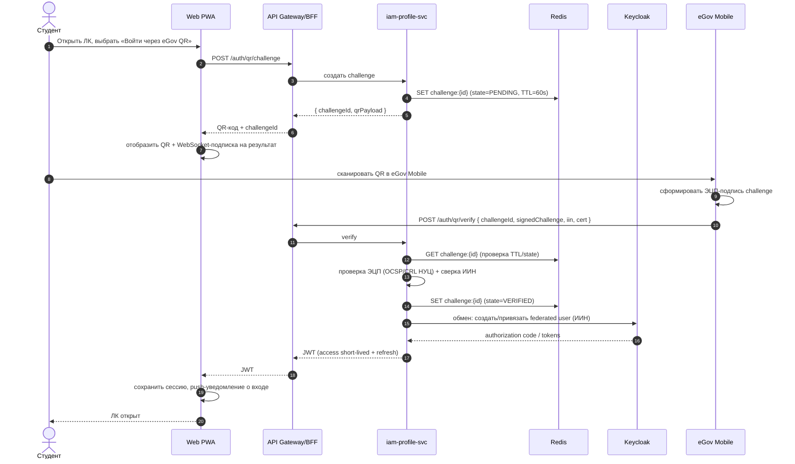

### 4.2 Подписание пакета документов через NCALayer

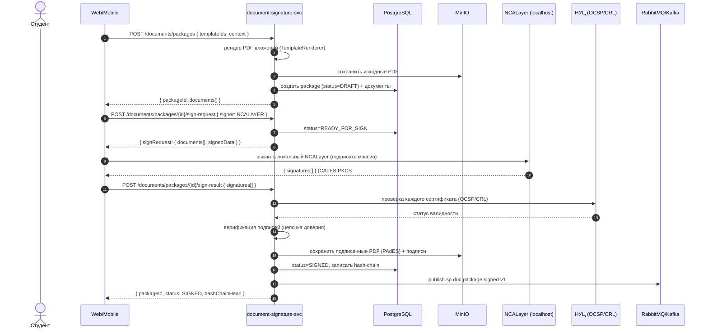

### 4.3 Заселение в общежитие

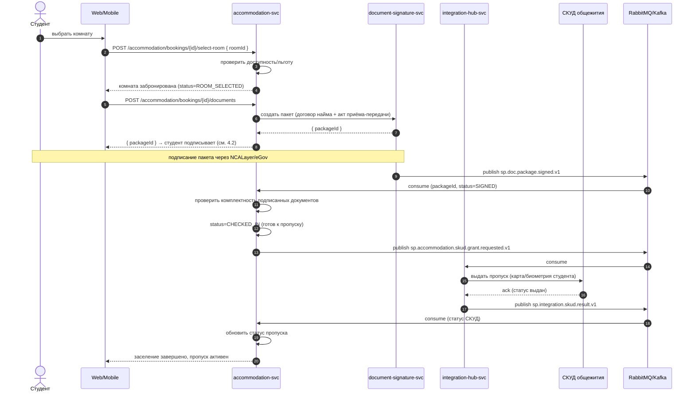

### 4.4 Заявление на льготное питание

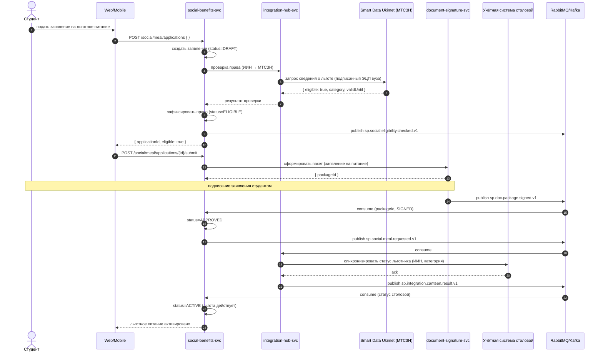

### 4.5 Синхронизация академических данных с Platonus/1С

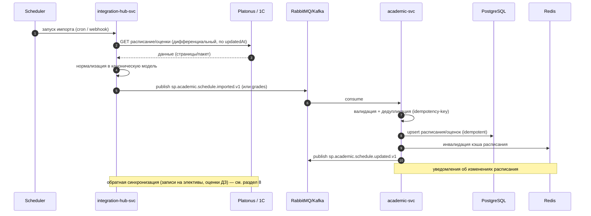

---

## 5. Модель коммуникации

### 5.1 Принципы

- **UI → BFF → сервисы** — синхронно, REST/JSON (OpenAPI 3.1). Для горячих внутренних вызовов допускается gRPC (решение по мере роста).
- **Межсистемные мутации** (СКУД, столовая, НОБД, LMS, статусы) — **асинхронно через очередь** (ADR-003). Очередь даёт гарантию доставки, ретраи, DLQ, идемпотентность.
- **Внешние гос. вызовы** — всегда через Integration Hub, подписываются ЭЦП вуза (для SOAP/ЕШЭП) и логируются в аудит.

### 5.2 Формат событий (CloudEvents-стиль)

Все события — JSON-объекты в стиле CloudEvents 1.0. Заголовки (routing key) несут `type`, тело — `data`.

```json
{
  "specversion": "1.0",
  "id": "7f6b8c2e-...-uuid",
  "type": "student.academic.grades.imported.v1",
  "source": "/academic-svc",
  "time": "2026-11-17T07:23:04Z",
  "subject": "student/12345/term/2026-1",
  "datacontenttype": "application/json",
  "traceparent": "00-4bf9...-trace-01",
  "idempotencyKey": "imp-2026-11-17T07:23:04Z-abc",
  "data": {
    "studentId": "...",
    "term": "2026-1",
    "grades": []
  }
}
```

### 5.3 Имена топиков/очередей

**Exchange (RabbitMQ):** `sp.events` (тип `topic`). **DLX:** `sp.events.dlx`.

**Routing key / CloudEvents type — соглашение:** `student.<context>.<entity>.<event>.<version>`.

| Событие (type / routing key) | Продюсер | Консьюмеры |
|---|---|---|
| `student.iam.profile.updated.v1` | iam-profile-svc | notification-svc, ops-audit-svc |
| `student.iam.consent.recorded.v1` | iam-profile-svc | ops-audit-svc |
| `student.iam.import.iin.completed.v1` | integration-hub-svc | iam-profile-svc |
| `student.doc.package.signed.v1` | document-signature-svc | accommodation-svc, social-benefits-svc, university-services-svc, notification-svc |
| `student.doc.signature.verified.v1` | document-signature-svc | ops-audit-svc |
| `student.accommodation.booking.created.v1` | accommodation-svc | notification-svc |
| `student.accommodation.checkin.completed.v1` | accommodation-svc | notification-svc |
| `student.accommodation.skud.grant.requested.v1` | accommodation-svc | integration-hub-svc |
| `student.social.eligibility.checked.v1` | social-benefits-svc | ops-audit-svc |
| `student.social.meal.requested.v1` | social-benefits-svc | integration-hub-svc |
| `student.academic.schedule.imported.v1` | integration-hub-svc | academic-svc |
| `student.academic.grades.imported.v1` | integration-hub-svc | academic-svc |
| `student.academic.schedule.updated.v1` | academic-svc | notification-svc |
| `student.notification.send.requested.v1` | любой сервис | notification-svc |
| `student.integration.<system>.result.v1` | integration-hub-svc | инициатор команды |
| `student.integration.<system>.failed.v1` | integration-hub-svc | ops-audit-svc (алерты) |

**Очереди:**

| Очередь | Назначение |
|---|---|
| `q.notification.email` | e-mail-доставка |
| `q.notification.sms` | SMS-доставка |
| `q.notification.push` | push-доставка (FCM/APNs) |
| `q.integration-hub.skud.out` | исходящие команды СКУД |
| `q.integration-hub.canteen.out` | исходящие команды столовой |
| `q.integration-hub.nobd.import` | импорт контингента НОБД |
| `q.integration-hub.lms.import` | импорт расписания/оценок LMS |
| `q.integration-hub.eshep.out` | исходящие SOAP-запросы ЕШЭП |
| `q.ops-audit.events` | поток аудит-событий |
| `q.<имя>.dlq` | DLQ каждой очереди (общий паттерн) |

> Переход RabbitMQ → Kafka (ADR-004): при росте объёма событий topic-обмен сохраняется; в Kafka каждый `type` становится топиком (`student.doc.package.signed.v1`), консьюмер-группы сохраняют имена очередей.

---

## 6. Deployment view (Kubernetes)

### 6.1 Namespaces

| Namespace | Назначение |
|---|---|
| `sp-ingress` | Ingress Controller (nginx/traefik), cert-manager, WAF |
| `sp-core` | backend-сервисы, BFF, Keycloak |
| `sp-data` | PostgreSQL (StatefulSet + Operator), Redis, MinIO, OpenSearch, RabbitMQ/Kafka |
| `sp-integration` | integration-hub-svc (выделен для сетевой изоляции внешних вызовов) |
| `sp-observability` | OpenTelemetry Collector, Grafana, Loki, Prometheus, Tempo |
| `sp-ci` | ArgoCD, build-раннеры |

### 6.2 Ключевые Deployment/Service

| Deployment | Реплики (база) | HPA | Примечание |
|---|---|---|---|
| `api-gateway` | 2–3 | CPU 70% / 2–10 | stateless |
| `backend-monolith` (Фаза 0–2) / per-service | 2 | CPU 70% / 2–20 | при микросервисной эволюции — отдельные Deployment |
| `keycloak` | 2 | — | StatefulSet, Infinispan-кэш |
| `postgresql` | 1 primary + 2 replica | — | Patroni/Operator, PITR |
| `redis` | Sentinel/Cluster | — | 3+ ноды |
| `minio` | 4 (erasure coding) | — | StatefulSet |
| `opensearch` | 3 data + 2 master | — | StatefulSet |
| `rabbitmq` | 3 (quorum queues) | — | StatefulSet |
| `integration-hub` | 2 | по глубине очереди | изоляция egress |

### 6.3 Горизонтальное масштабирование

- Все сервисы **stateless** (состояние — в PostgreSQL/Redis/MinIO), масштабируются HPA по CPU/RPS и **глубине очередей** (KEDA для `q.integration-hub.*`).
- Пики (заселение, сессия): предсказуемо поднимаем реплики `accommodation-svc`, `academic-svc`, `document-signature-svc`; БД масштабируется репликами чтения (read-replicas) для транскриптов/справок.
- Ограничения: подписание через NCALayer/eGov не масштабируется сервером (клиентская операция); HSM-подписание вуза имеет пропускную способность — вводим rate limit на серверную ЭЦП.

---

## 7. Нефункциональные характеристики

### 7.1 Масштабируемость

- Горизонтальное масштабирование stateless-сервисов; шардирование данных по `studentId` (hash) в PostgreSQL при росте; реплики чтения для отчётности.
- Redis Cluster для кэша/сессий; MinIO с erasure coding; OpenSearch с шардированием по дате (`audit-events-YYYY.MM`).
- KEDA-скейлинг по метрикам очередей (заселение/импорт LMS).

### 7.2 Отказоустойчивость

- **SLO 99.9%**; деградация интеграций без потери данных (очередь + ретраи + DLQ).
- Circuit breaker на каждый внешний адаптер (fail-fast, fallback на кэш/статус «синхронизируется»).
- Паттерн **Transactional Outbox**: публикация события атомарна с транзакцией БД — исключает потерю событий при сбое между «записать БД» и «опубликовать».
- Репликация PostgreSQL (Patroni), PITR-бэкапы, cross-AZ; RabbitMQ quorum queues; MinIO erasure coding.
- Graceful shutdown + readiness/liveness probes; двойной запуск (rolling update) без даунтайма.

### 7.3 Наблюдаемость (OpenTelemetry)

- **Traces:** каждый запрос несёт `traceparent` (W3C Trace Context) от BFF через все сервисы до внешних вызовов; экспорт в Tempo.
- **Metrics:** RED (Rate/Error/Duration) на каждый сервис, бизнес-метрики (число подписаний, заселений, импортов) → Prometheus → Grafana.
- **Logs:** структурированные JSON, единый `trace_id`/`span_id`/`studentId`; **маскирование ПДн** (ИИН, контакты) на уровне OTel Collector; Loki.
- Алерты: SLI-бюджеты, глубина DLQ, латентность внешних адаптеров, ошибки ЭЦП-верификации.

### 7.4 Идемпотентность и ретраи

- **Идемпотентность:** заголовок `Idempotency-Key` на всех мутирующих REST-операциях; уникальный ключ в таблице `idempotency_keys` (PostgreSQL) с TTL; повторный запрос возвращает сохранённый результат.
- **Ретраи:** экспоненциальный backoff с jitter (например, 1с → 2с → 4с → … до 60с), максимум N попыток (конфигурируется per-адаптер, по умолчанию 5); после исчерпания — DLQ + алерт.
- **Дедупликация событий:** консьюмеры проверяют `idempotencyKey`/`eventId` перед применением (at-least-once → effectively-once).
- **Идемпотентность внешних вызовов:** каждая команда Integration Hub несёт `commandId`, адаптер передаёт его внешней системе (где поддерживается) или фиксирует статус в outbox.

---

## 8. Потоки данных и владение данными (источник истины)

| Сущность | Источник истины (владелец) | Потребители / чтение | Синхронизация |
|---|---|---|---|
| Профиль пользователя, согласие на ПДн | iam-profile-svc (PostgreSQL) | все сервисы (JWT claims + REST) | импорт по ИИН из Smart Data Ukimet (односторонний) |
| Роли/сессии | Keycloak | BFF, все сервисы | — |
| Документы, подписи, hash-chain | document-signature-svc (PostgreSQL + MinIO) | accommodation, social, university-services, ops-audit | события `sp.doc.*` |
| Комнаты, заявки, договоры найма, статус пропуска | accommodation-svc | СКУД (через Hub), notification | событие `sp.accommodation.skud.grant.requested.v1` → СКУД |
| Право на льготу, заявления на питание | social-benefits-svc | столовая (через Hub) | проверка из МТСЗН; `sp.social.meal.requested.v1` → столовая |
| Расписание, оценки, GPA, транскрипт, ДЗ, тесты, апелляции, чат | **на переходный период — Platonus/1С** (master); academic-svc — проекция/кэш | студенты, преподаватели | импорт `sp.academic.*.imported.v1`; обратная запись элективов/оценок ДЗ — через Hub (стратегия миграции «в обратную сторону») |
| Контингент студента | НОБД (внешний master) | academic-svc, iam-profile-svc | импорт через Hub |
| Справки, баланс, платежи | university-services-svc | студенты, бухгалтерия | платёжный шлюз (callback) |
| Аудит-события | ops-audit-svc (OpenSearch) | SIEM, юристы, ИТ | очередь `q.ops-audit.events` |

**Правила владения:**
1. Только владелец пишет в свою таблицу; другие сервисы читают через REST или получают события.
2. Внешняя система-мастер (НОБД, Platonus/1С) обновляет локальную проекцию только через Integration Hub с идемпотентностью.
3. Юридически значимые изменения фиксируются только в аудит-логе (append-only, hash-chain).

---

## 9. Открытые вопросы

1. **Доступ к тестовым контурам гос. систем** (АО «НИТ», НУЦ, МП РК) — критический путь; без договоров невозможна сквозная интеграция и валидация контрактной модели.
2. **Выбор LMS как источника истины** — на переходный период Platonus/1С остаётся мастером данных; не определён срок и механика полной миграции данных в academic-svc («обратная» синхронизация: кто пишет оценки ДЗ/элективов — LMS или портал?).
3. **Серверная ЭЦП вуза** — требуется HSM или защищённое хранилище ключей; не решена процедура закупки/сертификации и пропускная способность HSM-подписания под пиковой нагрузкой.
4. **Юридический UX согласия на ПДн** — обязательный флоу согласия при первом входе; требуется согласование текста политики и версионирования с юристами.
5. **Точный формат ЕШЭП/НОБД/МТСЗН** — уточняется по техпаспорту оператора; в спеке заложена контрактная модель с версионированием, но конкретные WSDL/JSON-схемы не утверждены.
6. **Пакетное ЭЦП одной операцией** — необходимо подтвердить поддержку массового подписания массивом в целевых версиях NCALayer и eGov Mobile; иначе — fallback на последовательное подписание (ухудшает UX).
7. **Гранулярность выхода из монолита** — критерии (нагрузочные пороги) и порядок выноса первых сервисов из модульного монолита в отдельные контейнеры не зафиксированы.
8. **Момент перехода RabbitMQ → Kafka** — порог объёма событий и ретро-совместимость консьюмеров при миграции шины.
9. **Мобильная платформа** — React Native vs Flutter (ADR-009 допускает обе); решение влияет на интеграцию NCALayer-mobile и биометрии.
10. **Хранение ПДн и география** — точные требования к размещению (серверы РК) и DPA-соглашения с провайдерами облака/курьерских сервисов ещё не закрыты.
