# Спецификация схемы базы данных — Единый студенческий портал (Student Super-App)

| Поле | Значение |
|---|---|
| Статус | **DRAFT — на согласование** |
| Версия | 0.1 |
| Автор | DB Architect (agent-db) |
| Дата | 2026-11-17 |
| СУБД | **PostgreSQL 16** (источник истины, OLTP) |
| Согласовано с | `docs/00-adr.md` (ADR-001 … ADR-010) |

> Связанные документы: `00-adr.md` (архитектурные решения), `01-architecture.md` (C4/sequence), `03-integrations-kz.md` (пейлоады интеграций), `04-stack-and-security.md` (безопасность, ключи ЭЦП, соответствие РК).

---

## 1. Обзор и принципы проектирования

### 1.1. Цель документа

Настоящий документ задаёт **каноническую реляционную модель** портала: полный набор схем, типов, таблиц, ограничений целостности, индексов и политик партиционирования. Все DDL-скрипты рассчитаны на **PostgreSQL 16** и готовы к исполнению. Модель покрывает модули: **IAM & Profile, Document & Signature, Accommodation, Social Benefits, Academic (LMS), University Services, Notification, Audit**.

### 1.2. Соответствие ADR

| ADR | Требование | Отражение в схеме |
|---|---|---|
| ADR-001 | Модульный монолит → микросервисы | Отдельная PostgreSQL-схема на каждый модуль (`iam`, `doc`, `acc`, `social`, `acad`, `svc`, `notif`, `ops`) — границы «по швам» будущих сервисов |
| ADR-003 | Sync REST + async события | Таблицы `ops.outbox_events` (transactional outbox) и `ops.idempotency_keys` |
| ADR-004 | PG16 = источник истины, JSONB для справочников | JSONB только для гибких/полуструктурных данных (пейлоады импорта, метаданные, контекст аудита); бинарные файлы — в MinIO |
| ADR-005 | Keycloak как IAM | В БД хранятся **проекции** пользователя и привязка к `subject` Keycloak (таблица `iam.user_identities`); пароли/сессии в БД **не хранятся** |
| ADR-006 | ЭЦП (CAdES/XAdES/PAdES), hash-chain | `doc.document_signatures`, `doc.hash_chain`; подписанные PDF — только метаданные + хэши, файлы в MinIO |
| ADR-007 | Outbox + idempotency-key, ретраи, DLQ | `ops.outbox_events` (статусы `PENDING/PUBLISHED/FAILED/DLQ`), `ops.idempotency_keys` |
| ADR-008 | AES-256 at-rest, маскирование ПДн, аудит-трейл | Шифрование ИИН на уровне приложения + HMAC-токен для поиска; `ops.audit_log`; маскирование в логах |

### 1.3. Принципы нормализации

- **3НФ как базовый уровень** для всех «транзакционных» сущностей (пользователи, документы, заявки, оценки, платежи).
- **Осознанная денормализация** допускается только там, где это даёт выигрыш и не порождает аномалий: счётчики (`users`/`course_instances` могут держать кэш-поля), снапшоты имён/статусов в журнальных таблицах (`audit_log`, `outbox_events`) для иммутабельности журнала.
- **Без хранимых «сырых» дубликатов ключевых данных**: персональные данные живут в одном месте (`iam.users` / `iam.user_profiles`), остальные модули ссылаются по `user_id`.

### 1.4. JSONB-политика

JSONB используется **только** для:

1. Пейлоадов внешних систем (`external_data_imports.payload`, `outbox_events.payload`).
2. Гибких/полуструктурных метаданных (`documents.metadata`, `document_signatures.certificate_info`, `notifications.payload`).
3. Ответов тестов (`quiz_answers.answer`), контекста аудита (`audit_log.context`).

JSONB **запрещён** для: ключей, внешних ключей, полей с частой фильтрацией/сортировкой, денежных сумм, дат (для них — типизированные колонки). Для каждого JSONB-поля, по которому возможен поиск, создаётся **GIN-индекс** (`jsonb_path_ops`).

### 1.5. Naming conventions

- **Схемы** — короткие имена модулей в нижнем регистре: `iam, doc, acc, social, acad, svc, notif, ops`.
- **Таблицы** — `snake_case`, во множественном числе (`room_allocations`).
- **Столбцы** — `snake_case` (`created_at`, `public_id`).
- **Первичные ключи** — `id` (суррогатный `BIGINT`).
- **Внешние ключи** — `<ссылочная_таблица_в_ед.числе>_id`, например `user_id`, `course_instance_id`.
- **Ограничения** — префикс по типу: `pk_`, `fk_`, `uq_`, `ck_`, `chk_` (см. ниже).
- **Индексы** — префикс `idx_` + таблица + колонки/назначение: `idx_users_iin`.
- **Триггеры** — префикс `trg_` + таблица + назначение: `trg_users_updated_at`.
- **ENUM-типы** — `<схема>.<имя_в_snake_case>`, значения `UPPER_SNAKE_CASE`.
- **Имена внешних ключей** — `fk_<таблица>_<ссылка>`.
- **CHECK-ограничения** — `ck_<таблица>_<назначение>`.

### 1.6. UUID vs BIGSERIAL

Гибридная стратегия (обоснование — компактность индексов и скрытие порядка на внешнем периметре):

| Назначение | Тип | Комментарий |
|---|---|---|
| **Суррогатный PK** (внутренние джойны, FK) | `BIGINT GENERATED ALWAYS AS IDENTITY` | Компактные B-tree индексы, локальность записей, дешёвые джойны |
| **Публичный идентификатор** (API, идемпотентность, корреляция) | `UUID DEFAULT gen_random_uuid()` (`public_id`) | Не раскрывает объём/порядок данных, глобально уникален, безопасен для клиентской генерации |
| **ИИН / БИН** | `VARCHAR(12)` + CHECK | Строка (ведущие нули!), НЕ числовой тип |

Таким образом, в API наружу отдаётся `public_id`, а `id` остаётся внутренним.

### 1.7. Аудит-колонки

Каждая значимая таблица получает обязательный набор:

- `created_at TIMESTAMPTZ NOT NULL DEFAULT now()`
- `updated_at TIMESTAMPTZ NOT NULL DEFAULT now()`
- `created_by UUID NULL` — `public_id` инициатора (пользователя/сервиса)
- `updated_by UUID NULL` — `public_id` последнего редактора

`updated_at` обновляется **триггером** `ops.touch_updated_at()` (см. раздел 4), а не в прикладном коде — это гарантирует корректность при любых путях записи. Журнальные таблицы (`audit_log`, `outbox_events`, `hash_chain`) — **append-only**, поэтому имеют только `created_at` без `updated_at`.

Мягкое удаление (`deleted_at TIMESTAMPTZ NULL`) применяется точечно — только где требуется обратимость (профили, курсы). Для ЭДО-сущностей удаление запрещено (`ON DELETE RESTRICT`), они только архивируются.

### 1.8. Денежные значения и хэши

- **Деньги (тенге):** `NUMERIC(14,2)` (тиын = 1/100 тенге). Никогда не `float`/`double`.
- **Хэши:** `CHAR(64)` — SHA-256 в нижнем регистре hex; алгоритм всегда фиксируется отдельной колонкой `*_hash_algorithm`. Для ИИН используется HMAC-токен (см. раздел 8).
- **Даты/время:** всегда `TIMESTAMPTZ` (UTC внутри, зона `Asia/Qyzylorda` на уровне приложения/UI).

---

## 2. ER-диаграмма (Mermaid `erDiagram`)

```mermaid
erDiagram
    %% ===== IAM & Profile =====
    users ||--|| user_profiles : "текущий профиль"
    users ||--o{ user_identities : "привязки IdP"
    users ||--o{ user_roles : "роли"
    users ||--o{ user_consents : "согласия ПДн"
    users ||--o{ external_data_imports : "импорты по ИИН"

    %% ===== Document & Signature =====
    users ||--o{ documents : "владелец"
    users ||--o{ document_packages : "создатель пакета"
    document_packages ||--o{ document_package_items : "состав"
    documents ||--o{ document_package_items : "входит в пакет"
    documents ||--o{ document_signatures : "подписи"
    document_packages ||--o{ document_signatures : "пакетное подписание"
    documents ||--o{ hash_chain : "цепочка целостности"
    hash_chain }o--o| hash_chain : "prev_hash (self)"

    %% ===== Social Benefits (раньше Accommodation из-за FK) =====
    social_benefit_types ||--o{ social_benefit_eligibilities : "виды льгот"
    users ||--o{ social_benefit_eligibilities : "право на льготу"
    social_benefit_eligibilities ||--o{ meal_applications : "основание"
    users ||--o{ meal_applications : "заявления на питание"

    %% ===== Accommodation =====
    dormitories ||--o{ rooms : "содержит"
    room_types ||--o{ rooms : "категория"
    users ||--o{ accommodation_applications : "подаёт заявку"
    dormitories ||--o{ accommodation_applications : "предпочтение"
    rooms ||--o{ accommodation_applications : "предпочтение комнаты"
    social_benefit_eligibilities ||--o{ accommodation_applications : "льгота-основание"
    accommodation_applications ||--o{ room_allocations : "результат"
    rooms ||--o{ room_allocations : "выделена"
    users ||--o{ room_allocations : "проживающий"
    documents ||--o{ room_allocations : "договор найма"
    documents ||--o{ room_allocations : "акт приёма-передачи"

    %% ===== Academic =====
    academic_terms ||--o{ course_instances : "семестр"
    courses ||--o{ course_instances : "реализация курса"
    course_instances ||--o{ enrollments : "запись студентов"
    users ||--o{ enrollments : "студент"
    course_instances ||--o{ schedules : "расписание"
    schedules ||--o{ schedule_entries : "занятия"
    course_instances ||--o{ grade_components : "компоненты оценки"
    enrollments ||--o{ grades : "итоговые оценки"
    grade_components ||--o{ grades : "оценка по компоненту"
    users ||--o{ transcripts : "транскрипты"
    transcripts ||--o{ transcript_items : "строки транскрипта"
    course_instances ||--o{ transcript_items : "курс в транскрипте"
    grades ||--o{ appeals : "апелляция"
    users ||--o{ appeals : "подаёт апелляцию"
    course_instances ||--o{ electives : "элективы"
    course_instances ||--o{ assignments : "домашние задания"
    assignments ||--o{ submissions : "сдачи"
    users ||--o{ submissions : "студент"
    course_instances ||--o{ quizzes : "тесты"
    quizzes ||--o{ quiz_questions : "вопросы"
    quizzes ||--o{ quiz_attempts : "попытки"
    users ||--o{ quiz_attempts : "проходит тест"
    quiz_attempts ||--o{ quiz_answers : "ответы"
    quiz_questions ||--o{ quiz_answers : "на вопрос"
    users ||--o{ conversations : "владелец"
    conversations ||--o{ conversation_participants : "участники"
    users ||--o{ conversation_participants : "участвует"
    conversations ||--o{ messages : "сообщения"
    users ||--o{ messages : "отправитель"

    %% ===== University Services =====
    users ||--o{ certificates : "заказывает справки"
    documents ||--o{ certificates : "подписанный PDF"
    users ||--o{ payment_invoices : "счета"
    payment_invoices ||--o{ payments : "оплаты"
    users ||--o{ payments : "плательщик"

    %% ===== Notification & Audit =====
    users ||--o{ notifications : "получатель"
    users ||--o{ audit_log : "действующее лицо"
```



> Диаграмма отражает **ключевые** связи. Полный перечень FK с `ON DELETE/UPDATE` — в DDL разделов 3–4. Схема `ops` (idempotency_keys, outbox_events) на диаграмме опущена как инфраструктурная (не имеет бизнес-FK, только `actor`/`aggregate` через UUID).

---

## 3. Полные SQL DDL-скрипты

### 3.0. Расширения и схемы

```sql
-- =====================================================================
-- 00. Расширения и схемы
-- =====================================================================
CREATE EXTENSION IF NOT EXISTS pgcrypto;  -- gen_random_uuid(), digest(), HMAC
CREATE EXTENSION IF NOT EXISTS btree_gist; -- exclusion-ограничения (опционально)

CREATE SCHEMA IF NOT EXISTS iam;
CREATE SCHEMA IF NOT EXISTS doc;
CREATE SCHEMA IF NOT EXISTS acc;
CREATE SCHEMA IF NOT EXISTS social;
CREATE SCHEMA IF NOT EXISTS acad;
CREATE SCHEMA IF NOT EXISTS svc;
CREATE SCHEMA IF NOT EXISTS notif;
CREATE SCHEMA IF NOT EXISTS ops;

COMMENT ON SCHEMA iam    IS 'Модуль IAM & Profile: пользователи, профили, идентичности, импорт по ИИН';
COMMENT ON SCHEMA doc    IS 'Модуль Document & Signature: документы, пакеты, подписи, hash-chain';
COMMENT ON SCHEMA acc    IS 'Модуль Accommodation: общежития, комнаты, заявки, заселение';
COMMENT ON SCHEMA social IS 'Модуль Social Benefits: льготы, заявления на питание';
COMMENT ON SCHEMA acad   IS 'Модуль Academic (LMS): расписание, оценки, GPA, транскрипт, элективы, ДЗ, тесты, апелляции, чат';
COMMENT ON SCHEMA svc    IS 'Модуль University Services: справки, оплата обучения';
COMMENT ON SCHEMA notif  IS 'Модуль Notification: e-mail/SMS/push';
COMMENT ON SCHEMA ops    IS 'Ops/Audit: аудит-лог, идемпотентность, outbox, служебные функции';
```

### 3.1. ENUM-типы

```sql
-- =====================================================================
-- IAM
-- =====================================================================
CREATE TYPE iam.user_status AS ENUM ('PENDING','ACTIVE','SUSPENDED','GRADUATED','EXPELLED','ARCHIVED');
CREATE TYPE iam.identity_provider AS ENUM ('EGOV_MOBILE','NCALAYER','PASSWORD','KEYCLOAK_SSO','EXTERNAL_LMS');
CREATE TYPE iam.identity_status AS ENUM ('LINKED','UNLINKED','SUSPENDED');
CREATE TYPE iam.role_type AS ENUM ('STUDENT','LECTURER','DEANERY','FINANCE','DORM_ADMIN','CANTEEN_ADMIN','ADMIN');
CREATE TYPE iam.import_source AS ENUM ('SMART_DATA_UKIMET','NOBD','EGOV_MOBILE','GBD_FL','GBD_RN','MTSZN','MZ','MANUAL');
CREATE TYPE iam.import_status AS ENUM ('PENDING','IN_PROGRESS','COMPLETED','FAILED','PARTIAL');
CREATE TYPE iam.consent_status AS ENUM ('GRANTED','REVOKED','EXPIRED');
CREATE TYPE iam.consent_scope AS ENUM ('PROFILE','DOCUMENTS','ACCOMMODATION','SOCIAL_BENEFITS','ACADEMIC','MEDICAL','FINANCIAL','ALL');

-- =====================================================================
-- Document & Signature
-- =====================================================================
CREATE TYPE doc.document_status AS ENUM ('DRAFT','PENDING_SIGNATURE','SIGNED','REJECTED','ARCHIVED','EXPIRED');
CREATE TYPE doc.document_type AS ENUM (
    'APPLICATION','STATEMENT','CONTRACT','LEASE_CONTRACT','HANDOVER_ACT',
    'CERTIFICATE','TRANSCRIPT','ORDER','CERTIFICATE_OF_STUDY','OTHER'
);
CREATE TYPE doc.package_status AS ENUM ('DRAFT','READY','SIGNING','PARTIALLY_SIGNED','SIGNED','ARCHIVED');
CREATE TYPE doc.signature_status AS ENUM ('PENDING','IN_PROGRESS','SIGNED','REJECTED','FAILED','REVOKED');
CREATE TYPE doc.signature_format AS ENUM ('CADES','XADES','PADES');
CREATE TYPE doc.signer_type AS ENUM ('USER','UNIVERSITY','SYSTEM');
CREATE TYPE doc.hash_algorithm AS ENUM ('SHA-256','SHA-512');

-- =====================================================================
-- Accommodation
-- =====================================================================
CREATE TYPE acc.dormitory_status AS ENUM ('ACTIVE','INACTIVE');
CREATE TYPE acc.room_status AS ENUM ('FREE','OCCUPIED','PARTIALLY_OCCUPIED','RESERVED','MAINTENANCE','BLOCKED');
CREATE TYPE acc.gender_policy AS ENUM ('MALE','FEMALE','MIXED','ANY');
CREATE TYPE acc.application_status AS ENUM ('DRAFT','SUBMITTED','UNDER_REVIEW','APPROVED','REJECTED','WAITLIST','CANCELLED');
CREATE TYPE acc.allocation_status AS ENUM ('PENDING_MOVE_IN','ACTIVE','TERMINATED','EVICTED','ARCHIVED');

-- =====================================================================
-- Social Benefits
-- =====================================================================
CREATE TYPE social.eligibility_status AS ENUM ('PENDING','ACTIVE','EXPIRED','REVOKED');
CREATE TYPE social.meal_application_status AS ENUM ('DRAFT','SUBMITTED','APPROVED','REJECTED','ACTIVE','SUSPENDED','EXPIRED','CANCELLED');
CREATE TYPE social.meal_period AS ENUM ('BREAKFAST','LUNCH','DINNER','ALL_DAY');

-- =====================================================================
-- Academic
-- =====================================================================
CREATE TYPE acad.term_type AS ENUM ('SEMESTER','TRIMESTER','SUMMER','QUARTER');
CREATE TYPE acad.enrollment_status AS ENUM ('PENDING','ACTIVE','COMPLETED','DROPPED','WITHDRAWN');
CREATE TYPE acad.schedule_entry_type AS ENUM ('LECTURE','PRACTICE','LAB','SEMINAR','EXAM','CONSULTATION');
CREATE TYPE acad.weekday AS ENUM ('MON','TUE','WED','THU','FRI','SAT','SUN');
CREATE TYPE acad.grade_status AS ENUM ('PENDING','SUBMITTED','APPROVED','APPEALED','CHANGED');
CREATE TYPE acad.appeal_status AS ENUM ('SUBMITTED','UNDER_REVIEW','APPROVED','REJECTED','RESOLVED');
CREATE TYPE acad.elective_status AS ENUM ('OPEN','CLOSED','FULL','CANCELLED');
CREATE TYPE acad.submission_status AS ENUM ('NOT_SUBMITTED','SUBMITTED','LATE','GRADED','RETURNED','RESUBMITTED');
CREATE TYPE acad.quiz_status AS ENUM ('DRAFT','PUBLISHED','CLOSED');
CREATE TYPE acad.quiz_attempt_status AS ENUM ('IN_PROGRESS','SUBMITTED','GRADED','TIMED_OUT');
CREATE TYPE acad.conversation_type AS ENUM ('DIRECT','GROUP','COURSE','SUPPORT');
CREATE TYPE acad.conversation_status AS ENUM ('ACTIVE','CLOSED','ARCHIVED');
CREATE TYPE acad.message_type AS ENUM ('TEXT','FILE','SYSTEM');

-- =====================================================================
-- University Services
-- =====================================================================
CREATE TYPE svc.certificate_status AS ENUM ('REQUESTED','ISSUED','REJECTED','REVOKED','EXPIRED');
CREATE TYPE svc.certificate_type AS ENUM ('STUDY_CONFIRMATION','TRANSCRIPT','GRADE_SHEET','ENROLLMENT','SCHOLARSHIP','OTHER');
CREATE TYPE svc.invoice_status AS ENUM ('ISSUED','PARTIALLY_PAID','PAID','OVERDUE','CANCELLED','VOID');
CREATE TYPE svc.payment_status AS ENUM ('CREATED','PENDING','PAID','FAILED','REFUNDED','PARTIALLY_REFUNDED','EXPIRED');
CREATE TYPE svc.payment_method AS ENUM ('CARD','EGOV_PAY','HALYK','BANK_TRANSFER','CASH','OTHER');

-- =====================================================================
-- Notification & Ops
-- =====================================================================
CREATE TYPE notif.notification_channel AS ENUM ('EMAIL','SMS','PUSH','IN_APP');
CREATE TYPE notif.notification_status AS ENUM ('PENDING','SENT','DELIVERED','READ','FAILED','CANCELLED');
CREATE TYPE notif.notification_priority AS ENUM ('LOW','NORMAL','HIGH','URGENT');
CREATE TYPE ops.outbox_status AS ENUM ('PENDING','PUBLISHED','FAILED','DLQ');
```

### 3.2. Общая функция триггера `updated_at`

```sql
-- =====================================================================
-- Функция обновления updated_at (используется всеми триггерами)
-- =====================================================================
CREATE OR REPLACE FUNCTION ops.touch_updated_at()
RETURNS TRIGGER AS $$
BEGIN
    NEW.updated_at = now();
    RETURN NEW;
END;
$$ LANGUAGE plpgsql;

COMMENT ON FUNCTION ops.touch_updated_at() IS
'Устанавливает NEW.updated_at = now() перед UPDATE. Подключается BEFORE UPDATE-триггерами к таблицам с аудит-колонками.';
```

### 3.3. IAM & Profile

```sql
-- =====================================================================
-- iam.users — ядро идентичности (проекция пользователя из Keycloak)
-- =====================================================================
CREATE TABLE iam.users (
    id                BIGINT GENERATED ALWAYS AS IDENTITY PRIMARY KEY,
    public_id         UUID        NOT NULL DEFAULT gen_random_uuid() UNIQUE,
    iin               VARCHAR(12) NULL,                          -- зашифрован на уровне приложения; в БД HMAC-токен (см. 8)
    iin_token         CHAR(64)    NULL UNIQUE,                   -- HMAC-SHA256(ИИН) для поиска/дедупликации без расшифровки
    email             VARCHAR(320) NULL,
    email_normalized  VARCHAR(320) NULL,
    phone             VARCHAR(20)  NULL,
    keycloak_subject  UUID         NULL UNIQUE,                  -- subject из Keycloak (OIDC)
    status            iam.user_status NOT NULL DEFAULT 'PENDING',
    locale            VARCHAR(10)  NOT NULL DEFAULT 'ru',
    timezone          VARCHAR(64)  NOT NULL DEFAULT 'Asia/Qyzylorda',
    is_pdn_consent_given BOOLEAN   NOT NULL DEFAULT FALSE,
    last_login_at     TIMESTAMPTZ  NULL,
    created_at        TIMESTAMPTZ  NOT NULL DEFAULT now(),
    updated_at        TIMESTAMPTZ  NOT NULL DEFAULT now(),
    created_by        UUID         NULL,
    updated_by        UUID         NULL,
    CONSTRAINT ck_users_iin_format CHECK (iin IS NULL OR iin ~ '^[0-9]{12}$'),
    CONSTRAINT ck_users_email_format CHECK (email IS NULL OR email ~* '^[^@\s]+@[^@\s]+\.[^@\s]+$')
);

COMMENT ON TABLE iam.users IS 'Пользователь портала (студент/сотрудник/админ). Авторизация — Keycloak; здесь — проекция и доменные атрибуты.';
COMMENT ON COLUMN iam.users.iin IS 'ИИН (12 цифр). Хранится в зашифрованном виде на уровне приложения (AES-256-GCM); в этой колонке — только шифротекст/токен.';
COMMENT ON COLUMN iam.users.iin_token IS 'HMAC-SHA256(ИИН, server_secret) — детерминированный токен для поиска и дедупликации без расшифровки.';
COMMENT ON COLUMN iam.users.keycloak_subject IS 'Идентификатор субъекта в Keycloak (OIDC). Пароли и сессии в БД не хранятся.';

CREATE INDEX idx_users_status            ON iam.users (status);
CREATE INDEX idx_users_email_normalized  ON iam.users (email_normalized);
CREATE INDEX idx_users_iin_token         ON iam.users (iin_token);
CREATE INDEX idx_users_last_login_at     ON iam.users (last_login_at DESC);

CREATE TRIGGER trg_users_updated_at BEFORE UPDATE ON iam.users
    FOR EACH ROW EXECUTE FUNCTION ops.touch_updated_at();

-- =====================================================================
-- iam.user_profiles — персональные данные (расширенный профиль)
-- =====================================================================
CREATE TABLE iam.user_profiles (
    id                 BIGINT GENERATED ALWAYS AS IDENTITY PRIMARY KEY,
    user_id            BIGINT      NOT NULL UNIQUE REFERENCES iam.users(id) ON DELETE CASCADE,
    first_name         VARCHAR(128) NULL,
    last_name          VARCHAR(128) NULL,
    middle_name        VARCHAR(128) NULL,
    iin_short          CHAR(4)     NULL,                          -- последние 4 цифры ИИН для отображения (маскирование)
    birth_date         DATE        NULL,
    gender             CHAR(1)     NULL,
    nationality        VARCHAR(64) NULL,
    citizenship        VARCHAR(64) NULL,
    home_address       TEXT        NULL,
    registration_address TEXT      NULL,
    document_type      VARCHAR(32) NULL,                          -- тип удостоверения личности
    document_number    VARCHAR(32) NULL,
    document_issue_date DATE       NULL,
    emergency_contact  JSONB       NULL,                          -- {name, phone, relation}
    extra              JSONB       NOT NULL DEFAULT '{}'::jsonb,  -- гибкие поля (мед. показания, соц. категории и т.п.)
    deleted_at         TIMESTAMPTZ NULL,
    created_at         TIMESTAMPTZ NOT NULL DEFAULT now(),
    updated_at         TIMESTAMPTZ NOT NULL DEFAULT now(),
    created_by         UUID        NULL,
    updated_by         UUID        NULL,
    CONSTRAINT ck_user_profiles_gender CHECK (gender IS NULL OR gender IN ('M','F')),
    CONSTRAINT ck_user_profiles_iin_short CHECK (iin_short IS NULL OR iin_short ~ '^[0-9]{4}$')
);

COMMENT ON TABLE iam.user_profiles IS 'Персональные данные пользователя (1:1 с users). Маскирование: полный ИИН не дублируется, только последние 4 цифры.';
COMMENT ON COLUMN iam.user_profiles.extra IS 'JSONB для гибких полей профиля. Поиск по нему — через GIN.';

CREATE INDEX idx_user_profiles_iin_short ON iam.user_profiles (iin_short);
CREATE INDEX idx_user_profiles_extra ON iam.user_profiles USING GIN (extra jsonb_path_ops);

CREATE TRIGGER trg_user_profiles_updated_at BEFORE UPDATE ON iam.user_profiles
    FOR EACH ROW EXECUTE FUNCTION ops.touch_updated_at();

-- =====================================================================
-- iam.user_identities — привязки к внешним IdP/способам входа
-- =====================================================================
CREATE TABLE iam.user_identities (
    id                BIGINT GENERATED ALWAYS AS IDENTITY PRIMARY KEY,
    user_id           BIGINT      NOT NULL REFERENCES iam.users(id) ON DELETE CASCADE,
    provider          iam.identity_provider NOT NULL,
    subject           VARCHAR(255) NOT NULL,                      -- sub в провайдере (eGov Mobile / NCALayer cert DN и т.д.)
    status            iam.identity_status NOT NULL DEFAULT 'LINKED',
    certificate_serial VARCHAR(128) NULL,                         -- серийный номер сертификата ЭЦП (для NCALayer)
    certificate_issuer VARCHAR(255) NULL,
    last_used_at      TIMESTAMPTZ  NULL,
    created_at        TIMESTAMPTZ  NOT NULL DEFAULT now(),
    updated_at        TIMESTAMPTZ  NOT NULL DEFAULT now(),
    created_by        UUID         NULL,
    updated_by        UUID         NULL,
    CONSTRAINT uq_user_identities_provider_subject UNIQUE (provider, subject)
);

COMMENT ON TABLE iam.user_identities IS 'Связь пользователя с внешними учётными записями/способами входа (eGov Mobile, NCALayer/ЭЦП, LMS).';

CREATE INDEX idx_user_identities_user ON iam.user_identities (user_id);

CREATE TRIGGER trg_user_identities_updated_at BEFORE UPDATE ON iam.user_identities
    FOR EACH ROW EXECUTE FUNCTION ops.touch_updated_at();

-- =====================================================================
-- iam.user_roles — роли пользователя (Keycloak — источник истины, здесь проекция)
-- =====================================================================
CREATE TABLE iam.user_roles (
    id        BIGINT GENERATED ALWAYS AS IDENTITY PRIMARY KEY,
    user_id   BIGINT      NOT NULL REFERENCES iam.users(id) ON DELETE CASCADE,
    role      iam.role_type NOT NULL,
    granted_at TIMESTAMPTZ NOT NULL DEFAULT now(),
    granted_by UUID        NULL,
    CONSTRAINT uq_user_roles_user_role UNIQUE (user_id, role)
);

COMMENT ON TABLE iam.user_roles IS 'Роли пользователя. Авторитетный источник — Keycloak; таблица — денормализованная проекция для FK/проверок в доменных сервисах.';

CREATE INDEX idx_user_roles_role ON iam.user_roles (role);

-- =====================================================================
-- iam.user_consents — согласия на обработку ПДн (юридически обязательны)
-- =====================================================================
CREATE TABLE iam.user_consents (
    id          BIGINT GENERATED ALWAYS AS IDENTITY PRIMARY KEY,
    user_id     BIGINT      NOT NULL REFERENCES iam.users(id) ON DELETE CASCADE,
    scope       iam.consent_scope NOT NULL,
    status      iam.consent_status NOT NULL DEFAULT 'GRANTED',
    version     VARCHAR(16) NOT NULL,                             -- версия текста согласия
    granted_at  TIMESTAMPTZ NOT NULL DEFAULT now(),
    revoked_at  TIMESTAMPTZ NULL,
    ip_address  INET        NULL,
    user_agent  TEXT        NULL,
    created_at  TIMESTAMPTZ NOT NULL DEFAULT now(),
    updated_at  TIMESTAMPTZ NOT NULL DEFAULT now(),
    created_by  UUID        NULL,
    updated_by  UUID        NULL
);

COMMENT ON TABLE iam.user_consents IS 'Журнал согласий на обработку персональных данных (ЗРК «О персональных данных и их защите»).';

CREATE INDEX idx_user_consents_user ON iam.user_consents (user_id);

CREATE TRIGGER trg_user_consents_updated_at BEFORE UPDATE ON iam.user_consents
    FOR EACH ROW EXECUTE FUNCTION ops.touch_updated_at();

-- =====================================================================
-- iam.external_data_imports — импорт данных по ИИН из гос. баз
-- =====================================================================
CREATE TABLE iam.external_data_imports (
    id              BIGINT GENERATED ALWAYS AS IDENTITY PRIMARY KEY,
    public_id       UUID        NOT NULL DEFAULT gen_random_uuid() UNIQUE,
    user_id         BIGINT      NULL REFERENCES iam.users(id) ON DELETE SET NULL,
    iin_token       CHAR(64)    NOT NULL,                         -- HMAC-токен ИИН, по которому шёл импорт
    source          iam.import_source NOT NULL,
    status          iam.import_status NOT NULL DEFAULT 'PENDING',
    request_id      VARCHAR(64) NULL,                             -- id запроса во внешней системе
    payload         JSONB       NOT NULL DEFAULT '{}'::jsonb,     -- нормализованные данные (пейлоад)
    error_message   TEXT        NULL,
    error_code      VARCHAR(64) NULL,
    retry_count     INTEGER     NOT NULL DEFAULT 0,
    started_at      TIMESTAMPTZ NULL,
    completed_at    TIMESTAMPTZ NULL,
    created_at      TIMESTAMPTZ NOT NULL DEFAULT now(),
    updated_at      TIMESTAMPTZ NOT NULL DEFAULT now(),
    created_by      UUID        NULL,
    updated_by      UUID        NULL,
    CONSTRAINT ck_external_data_imports_retry CHECK (retry_count >= 0)
);

COMMENT ON TABLE iam.external_data_imports IS 'Журнал импортов данных по ИИН (Smart Data Ukimet / НОБД / ГБД). Сырые пейлоады — в JSONB.';
COMMENT ON COLUMN iam.external_data_imports.payload IS 'Нормализованные данные импорта (JSONB), поиск — GIN.';

CREATE INDEX idx_external_data_imports_user      ON iam.external_data_imports (user_id);
CREATE INDEX idx_external_data_imports_iin_token ON iam.external_data_imports (iin_token);
CREATE INDEX idx_external_data_imports_status    ON iam.external_data_imports (status);
CREATE INDEX idx_external_data_imports_payload   ON iam.external_data_imports USING GIN (payload jsonb_path_ops);

CREATE TRIGGER trg_external_data_imports_updated_at BEFORE UPDATE ON iam.external_data_imports
    FOR EACH ROW EXECUTE FUNCTION ops.touch_updated_at();
```

### 3.4. Document & Signature

```sql
-- =====================================================================
-- doc.documents — метаданные документов (файлы — в MinIO)
-- =====================================================================
CREATE TABLE doc.documents (
    id                BIGINT GENERATED ALWAYS AS IDENTITY PRIMARY KEY,
    public_id         UUID        NOT NULL DEFAULT gen_random_uuid() UNIQUE,
    owner_user_id     BIGINT      NOT NULL REFERENCES iam.users(id) ON DELETE RESTRICT,
    doc_type          doc.document_type NOT NULL,
    status            doc.document_status NOT NULL DEFAULT 'DRAFT',
    title             VARCHAR(255) NOT NULL,
    description       TEXT        NULL,
    mime_type         VARCHAR(128) NOT NULL DEFAULT 'application/pdf',
    storage_bucket    VARCHAR(255) NOT NULL,                      -- MinIO bucket
    storage_key       VARCHAR(1024) NOT NULL,                     -- object key в MinIO
    storage_checksum  CHAR(64)    NOT NULL,                       -- SHA-256 файла (целостность)
    storage_size_bytes BIGINT     NULL,
    original_filename VARCHAR(512) NULL,
    template_id       VARCHAR(64) NULL,                           -- id шаблона генерации
    metadata          JSONB       NOT NULL DEFAULT '{}'::jsonb,   -- гибкие метаданные
    signed_at         TIMESTAMPTZ NULL,
    expires_at        TIMESTAMPTZ NULL,
    version           INTEGER     NOT NULL DEFAULT 1,
    created_at        TIMESTAMPTZ NOT NULL DEFAULT now(),
    updated_at        TIMESTAMPTZ NOT NULL DEFAULT now(),
    created_by        UUID        NULL,
    updated_by        UUID        NULL,
    CONSTRAINT uq_documents_storage UNIQUE (storage_bucket, storage_key),
    CONSTRAINT ck_documents_checksum CHECK (storage_checksum ~ '^[0-9a-f]{64}$')
);

COMMENT ON TABLE doc.documents IS 'Метаданные документов. Бинарные файлы хранятся в MinIO; в БД — только метаданные, bucket/key и хэши.';
COMMENT ON COLUMN doc.documents.storage_checksum IS 'SHA-256 содержимого файла — контроль целостности при чтении из MinIO.';

CREATE INDEX idx_documents_owner       ON doc.documents (owner_user_id);
CREATE INDEX idx_documents_type_status ON doc.documents (doc_type, status);
CREATE INDEX idx_documents_created_at  ON doc.documents (created_at DESC);
CREATE INDEX idx_documents_metadata    ON doc.documents USING GIN (metadata jsonb_path_ops);

CREATE TRIGGER trg_documents_updated_at BEFORE UPDATE ON doc.documents
    FOR EACH ROW EXECUTE FUNCTION ops.touch_updated_at();

-- =====================================================================
-- doc.document_packages — пакеты документов для пакетного подписания
-- =====================================================================
CREATE TABLE doc.document_packages (
    id          BIGINT GENERATED ALWAYS AS IDENTITY PRIMARY KEY,
    public_id   UUID        NOT NULL DEFAULT gen_random_uuid() UNIQUE,
    title       VARCHAR(255) NOT NULL,
    description TEXT        NULL,
    status      doc.package_status NOT NULL DEFAULT 'DRAFT',
    context     JSONB       NOT NULL DEFAULT '{}'::jsonb,         -- контекст пакета (заселение, контракт и т.п.)
    signed_at   TIMESTAMPTZ NULL,
    created_at  TIMESTAMPTZ NOT NULL DEFAULT now(),
    updated_at  TIMESTAMPTZ NOT NULL DEFAULT now(),
    created_by  UUID        NULL,
    updated_by  UUID        NULL
);

COMMENT ON TABLE doc.document_packages IS 'Пакет документов, подписываемый единой транзакцией (например, пакет заселения: договор + акт + согласие).';

CREATE INDEX idx_document_packages_status ON doc.document_packages (status);

CREATE TRIGGER trg_document_packages_updated_at BEFORE UPDATE ON doc.document_packages
    FOR EACH ROW EXECUTE FUNCTION ops.touch_updated_at();

-- =====================================================================
-- doc.document_package_items — состав пакета (many-to-many)
-- =====================================================================
CREATE TABLE doc.document_package_items (
    id         BIGINT GENERATED ALWAYS AS IDENTITY PRIMARY KEY,
    package_id BIGINT   NOT NULL REFERENCES doc.document_packages(id) ON DELETE CASCADE,
    document_id BIGINT  NOT NULL REFERENCES doc.documents(id) ON DELETE RESTRICT,
    position   INTEGER  NOT NULL DEFAULT 0,
    created_at TIMESTAMPTZ NOT NULL DEFAULT now(),
    CONSTRAINT uq_document_package_items UNIQUE (package_id, document_id)
);

COMMENT ON TABLE doc.document_package_items IS 'Связь «пакет ↔ документ» с порядком подписания (position).';

CREATE INDEX idx_document_package_items_document ON doc.document_package_items (document_id);

-- =====================================================================
-- doc.document_signatures — подписи документов/пакетов (CAdES/XAdES/PAdES)
-- =====================================================================
CREATE TABLE doc.document_signatures (
    id               BIGINT GENERATED ALWAYS AS IDENTITY PRIMARY KEY,
    public_id        UUID        NOT NULL DEFAULT gen_random_uuid() UNIQUE,
    document_id      BIGINT      NULL REFERENCES doc.documents(id) ON DELETE CASCADE,
    package_id       BIGINT      NULL REFERENCES doc.document_packages(id) ON DELETE CASCADE,
    signer_user_id   BIGINT      NULL REFERENCES iam.users(id) ON DELETE SET NULL,
    signer_type      doc.signer_type NOT NULL DEFAULT 'USER',
    signature_format doc.signature_format NOT NULL DEFAULT 'CADES',
    status           doc.signature_status NOT NULL DEFAULT 'PENDING',
    signature_value  TEXT        NULL,                            -- CMS/XML DSig в base64
    certificate_info JSONB       NOT NULL DEFAULT '{}'::jsonb,    -- сертификат, issuer, subject, validity
    ocsp_status      VARCHAR(32) NULL,                            -- GOOD/REVOKED/UNKNOWN
    ocsp_checked_at  TIMESTAMPTZ NULL,
    signature_checksum CHAR(64) NULL,                             -- хэш подписанного файла
    signed_at        TIMESTAMPTZ NULL,
    created_at       TIMESTAMPTZ NOT NULL DEFAULT now(),
    updated_at       TIMESTAMPTZ NOT NULL DEFAULT now(),
    created_by       UUID        NULL,
    updated_by       UUID        NULL,
    CONSTRAINT ck_document_signatures_target CHECK (document_id IS NOT NULL OR package_id IS NOT NULL)
);

COMMENT ON TABLE doc.document_signatures IS 'Электронные подписи (ЭЦП). Пользовательские — NCALayer/eGov Mobile; вузовские — серверная ЭЦП (HSM).';
COMMENT ON COLUMN doc.document_signatures.certificate_info IS 'JSONB с деталями сертификата (subject, issuer, serial, validity).';

CREATE INDEX idx_document_signatures_document ON doc.document_signatures (document_id);
CREATE INDEX idx_document_signatures_package  ON doc.document_signatures (package_id);
CREATE INDEX idx_document_signatures_signer   ON doc.document_signatures (signer_user_id);
CREATE INDEX idx_document_signatures_status   ON doc.document_signatures (status);

CREATE TRIGGER trg_document_signatures_updated_at BEFORE UPDATE ON doc.document_signatures
    FOR EACH ROW EXECUTE FUNCTION ops.touch_updated_at();

-- =====================================================================
-- doc.hash_chain — цепочка хэшей (hash-chain) для гарантии целостности архива
-- =====================================================================
CREATE TABLE doc.hash_chain (
    id             BIGINT GENERATED ALWAYS AS IDENTITY PRIMARY KEY,
    entry_hash     CHAR(64)    NOT NULL UNIQUE,                   -- SHA-256 текущего звена
    prev_hash      CHAR(64)    NULL REFERENCES doc.hash_chain(entry_hash) ON DELETE RESTRICT,
    document_id    BIGINT      NULL REFERENCES doc.documents(id) ON DELETE CASCADE,
    package_id     BIGINT      NULL REFERENCES doc.document_packages(id) ON DELETE CASCADE,
    position       INTEGER     NOT NULL DEFAULT 0,
    algorithm      doc.hash_algorithm NOT NULL DEFAULT 'SHA-256',
    payload_ref    TEXT        NULL,                              -- ссылка/описание якоря (storage_key, метаданные)
    metadata       JSONB       NOT NULL DEFAULT '{}'::jsonb,
    created_at     TIMESTAMPTZ NOT NULL DEFAULT now(),
    created_by     UUID        NULL,
    CONSTRAINT ck_hash_chain_scope CHECK (document_id IS NOT NULL OR package_id IS NOT NULL),
    CONSTRAINT ck_hash_chain_position CHECK (position >= 0),
    CONSTRAINT ck_hash_chain_hash CHECK (entry_hash ~ '^[0-9a-f]{64}$')
);

COMMENT ON TABLE doc.hash_chain IS 'Hash-chain: каждое звено = SHA-256(предыдущий_hash || payload). Гарантирует неотказуемость и целостность архива документов.';
COMMENT ON COLUMN doc.hash_chain.prev_hash IS 'Ссылка на предыдущее звено цепочки; NULL только у генезис-звена (position=0).';

CREATE INDEX idx_hash_chain_document ON doc.hash_chain (document_id);
CREATE INDEX idx_hash_chain_package  ON doc.hash_chain (package_id);
CREATE INDEX idx_hash_chain_position ON doc.hash_chain (document_id, position);
```

### 3.5. Social Benefits (создаётся до Accommodation из-за FK)

```sql
-- =====================================================================
-- social.social_benefit_types — справочник видов льгот
-- =====================================================================
CREATE TABLE social.social_benefit_types (
    id          BIGINT GENERATED ALWAYS AS IDENTITY PRIMARY KEY,
    code        VARCHAR(64)  NOT NULL UNIQUE,                     -- e.g. ORPHAN, LARGE_FAMILY, DISABILITY, LOW_INCOME
    name_ru     VARCHAR(255) NOT NULL,
    name_kz     VARCHAR(255) NOT NULL,
    description TEXT        NULL,
    is_active   BOOLEAN     NOT NULL DEFAULT TRUE,
    requires_document BOOLEAN NOT NULL DEFAULT TRUE,              -- нужен ли подтверждающий документ
    created_at  TIMESTAMPTZ NOT NULL DEFAULT now(),
    updated_at  TIMESTAMPTZ NOT NULL DEFAULT now()
);

COMMENT ON TABLE social.social_benefit_types IS 'Справочник видов социальных льгот (сироты, многодетные, инвалидность, малообеспеченные и т.п.).';

CREATE TRIGGER trg_social_benefit_types_updated_at BEFORE UPDATE ON social.social_benefit_types
    FOR EACH ROW EXECUTE FUNCTION ops.touch_updated_at();

-- =====================================================================
-- social.social_benefit_eligibilities — подтверждённое право на льготу
-- =====================================================================
CREATE TABLE social.social_benefit_eligibilities (
    id               BIGINT GENERATED ALWAYS AS IDENTITY PRIMARY KEY,
    public_id        UUID        NOT NULL DEFAULT gen_random_uuid() UNIQUE,
    user_id          BIGINT      NOT NULL REFERENCES iam.users(id) ON DELETE CASCADE,
    benefit_type_id  BIGINT      NOT NULL REFERENCES social.social_benefit_types(id) ON DELETE RESTRICT,
    status           social.eligibility_status NOT NULL DEFAULT 'PENDING',
    valid_from       DATE        NULL,
    valid_to         DATE        NULL,
    source_import_id BIGINT      NULL REFERENCES iam.external_data_imports(id) ON DELETE SET NULL,
    document_id      BIGINT      NULL REFERENCES doc.documents(id) ON DELETE SET NULL,  -- подтверждающий документ
    verified_at      TIMESTAMPTZ NULL,
    verified_by      UUID        NULL,
    created_at       TIMESTAMPTZ NOT NULL DEFAULT now(),
    updated_at       TIMESTAMPTZ NOT NULL DEFAULT now(),
    created_by       UUID        NULL,
    updated_by       UUID        NULL,
    CONSTRAINT ck_social_benefit_elig_validity CHECK (valid_to IS NULL OR valid_from IS NULL OR valid_to >= valid_from)
);

COMMENT ON TABLE social.social_benefit_eligibilities IS 'Подтверждённое право пользователя на льготу (источник: Smart Data Ukimet/МТСЗН).';

CREATE INDEX idx_social_benefit_elig_user  ON social.social_benefit_eligibilities (user_id);
CREATE INDEX idx_social_benefit_elig_type  ON social.social_benefit_eligibilities (benefit_type_id);
CREATE INDEX idx_social_benefit_elig_status ON social.social_benefit_eligibilities (status);
CREATE INDEX idx_social_benefit_elig_valid ON social.social_benefit_eligibilities (valid_to);

CREATE TRIGGER trg_social_benefit_elig_updated_at BEFORE UPDATE ON social.social_benefit_eligibilities
    FOR EACH ROW EXECUTE FUNCTION ops.touch_updated_at();

-- =====================================================================
-- social.meal_applications — заявления на льготное питание
-- =====================================================================
CREATE TABLE social.meal_applications (
    id             BIGINT GENERATED ALWAYS AS IDENTITY PRIMARY KEY,
    public_id      UUID        NOT NULL DEFAULT gen_random_uuid() UNIQUE,
    user_id        BIGINT      NOT NULL REFERENCES iam.users(id) ON DELETE CASCADE,
    eligibility_id BIGINT      NULL REFERENCES social.social_benefit_eligibilities(id) ON DELETE SET NULL,
    status         social.meal_application_status NOT NULL DEFAULT 'DRAFT',
    meal_period    social.meal_period NOT NULL DEFAULT 'ALL_DAY',
    valid_from     DATE        NULL,
    valid_to       DATE        NULL,
    canteen_id     VARCHAR(64) NULL,                              -- id столовой/точки питания
    external_sync_status VARCHAR(32) NULL,                        -- статус синхронизации со столовой
    rejected_reason TEXT       NULL,
    submitted_at   TIMESTAMPTZ NULL,
    approved_at    TIMESTAMPTZ NULL,
    created_at     TIMESTAMPTZ NOT NULL DEFAULT now(),
    updated_at     TIMESTAMPTZ NOT NULL DEFAULT now(),
    created_by     UUID        NULL,
    updated_by     UUID        NULL
);

COMMENT ON TABLE social.meal_applications IS 'Заявление на льготное питание. Статус синхронизируется со столовой асинхронно (outbox).';

CREATE INDEX idx_meal_applications_user      ON social.meal_applications (user_id);
CREATE INDEX idx_meal_applications_status    ON social.meal_applications (status);
CREATE INDEX idx_meal_applications_eligibility ON social.meal_applications (eligibility_id);

CREATE TRIGGER trg_meal_applications_updated_at BEFORE UPDATE ON social.meal_applications
    FOR EACH ROW EXECUTE FUNCTION ops.touch_updated_at();
```

### 3.6. Accommodation

```sql
-- =====================================================================
-- acc.dormitories — общежития
-- =====================================================================
CREATE TABLE acc.dormitories (
    id            BIGINT GENERATED ALWAYS AS IDENTITY PRIMARY KEY,
    public_id     UUID        NOT NULL DEFAULT gen_random_uuid() UNIQUE,
    code          VARCHAR(32) NOT NULL UNIQUE,
    name_ru       VARCHAR(255) NOT NULL,
    name_kz       VARCHAR(255) NOT NULL,
    address       TEXT        NOT NULL,
    status        acc.dormitory_status NOT NULL DEFAULT 'ACTIVE',
    gender_policy acc.gender_policy NOT NULL DEFAULT 'ANY',
    total_capacity INTEGER    NOT NULL DEFAULT 0,
    admin_user_id BIGINT      NULL REFERENCES iam.users(id) ON DELETE SET NULL, -- комендант/администратор
    metadata      JSONB       NOT NULL DEFAULT '{}'::jsonb,
    created_at    TIMESTAMPTZ NOT NULL DEFAULT now(),
    updated_at    TIMESTAMPTZ NOT NULL DEFAULT now(),
    created_by    UUID        NULL,
    updated_by    UUID        NULL,
    CONSTRAINT ck_dormitories_capacity CHECK (total_capacity >= 0)
);

COMMENT ON TABLE acc.dormitories IS 'Общежитие (dormitory). Атрибуты: адрес, вместимость, гендерная политика, ответственный.';

CREATE INDEX idx_dormitories_status ON acc.dormitories (status);

CREATE TRIGGER trg_dormitories_updated_at BEFORE UPDATE ON acc.dormitories
    FOR EACH ROW EXECUTE FUNCTION ops.touch_updated_at();

-- =====================================================================
-- acc.room_types — справочник категорий комнат
-- =====================================================================
CREATE TABLE acc.room_types (
    id          BIGINT GENERATED ALWAYS AS IDENTITY PRIMARY KEY,
    code        VARCHAR(64)  NOT NULL UNIQUE,                     -- e.g. STANDARD, IMPROVED, SUITE, ACCESSIBLE
    name_ru     VARCHAR(255) NOT NULL,
    name_kz     VARCHAR(255) NOT NULL,
    capacity    INTEGER      NOT NULL DEFAULT 2,
    monthly_fee NUMERIC(14,2) NULL,                               -- ставка найма, тенге/мес
    is_active   BOOLEAN      NOT NULL DEFAULT TRUE,
    created_at  TIMESTAMPTZ  NOT NULL DEFAULT now(),
    updated_at  TIMESTAMPTZ  NOT NULL DEFAULT now(),
    CONSTRAINT ck_room_types_capacity CHECK (capacity > 0),
    CONSTRAINT ck_room_types_fee CHECK (monthly_fee IS NULL OR monthly_fee >= 0)
);

COMMENT ON TABLE acc.room_types IS 'Категории комнат (стандарт, улучшенная, люкс, доступная для МГН) с тарифом найма.';

CREATE TRIGGER trg_room_types_updated_at BEFORE UPDATE ON acc.room_types
    FOR EACH ROW EXECUTE FUNCTION ops.touch_updated_at();

-- =====================================================================
-- acc.rooms — комнаты
-- =====================================================================
CREATE TABLE acc.rooms (
    id           BIGINT GENERATED ALWAYS AS IDENTITY PRIMARY KEY,
    public_id    UUID        NOT NULL DEFAULT gen_random_uuid() UNIQUE,
    dormitory_id BIGINT      NOT NULL REFERENCES acc.dormitories(id) ON DELETE RESTRICT,
    room_type_id BIGINT      NOT NULL REFERENCES acc.room_types(id) ON DELETE RESTRICT,
    room_number  VARCHAR(32) NOT NULL,
    floor        INTEGER     NULL,
    status       acc.room_status NOT NULL DEFAULT 'FREE',
    capacity     INTEGER     NOT NULL DEFAULT 2,
    occupied     INTEGER     NOT NULL DEFAULT 0,                  -- денормализованный счётчик проживающих
    metadata     JSONB       NOT NULL DEFAULT '{}'::jsonb,
    created_at   TIMESTAMPTZ NOT NULL DEFAULT now(),
    updated_at   TIMESTAMPTZ NOT NULL DEFAULT now(),
    created_by   UUID        NULL,
    updated_by   UUID        NULL,
    CONSTRAINT uq_rooms_dormitory_number UNIQUE (dormitory_id, room_number),
    CONSTRAINT ck_rooms_capacity CHECK (capacity > 0),
    CONSTRAINT ck_rooms_occupied CHECK (occupied >= 0 AND occupied <= capacity)
);

COMMENT ON TABLE acc.rooms IS 'Комната общежития. `occupied` — денормализованный счётчик, поддерживается триггером/сервисом.';

CREATE INDEX idx_rooms_dormitory ON acc.rooms (dormitory_id);
CREATE INDEX idx_rooms_type       ON acc.rooms (room_type_id);
CREATE INDEX idx_rooms_status     ON acc.rooms (status);

CREATE TRIGGER trg_rooms_updated_at BEFORE UPDATE ON acc.rooms
    FOR EACH ROW EXECUTE FUNCTION ops.touch_updated_at();

-- =====================================================================
-- acc.accommodation_applications — заявки на заселение
-- =====================================================================
CREATE TABLE acc.accommodation_applications (
    id                   BIGINT GENERATED ALWAYS AS IDENTITY PRIMARY KEY,
    public_id            UUID        NOT NULL DEFAULT gen_random_uuid() UNIQUE,
    user_id              BIGINT      NOT NULL REFERENCES iam.users(id) ON DELETE CASCADE,
    academic_term_id     BIGINT      NULL,                        -- заполняется после создания acad.academic_terms
    preferred_dormitory_id BIGINT    NULL REFERENCES acc.dormitories(id) ON DELETE SET NULL,
    preferred_room_id    BIGINT      NULL REFERENCES acc.rooms(id) ON DELETE SET NULL,
    eligibility_id       BIGINT      NULL REFERENCES social.social_benefit_eligibilities(id) ON DELETE SET NULL,
    status               acc.application_status NOT NULL DEFAULT 'DRAFT',
    priority             INTEGER     NOT NULL DEFAULT 0,          -- приоритет при распределении (льготы повышают)
    queue_position       INTEGER     NULL,
    submitted_at         TIMESTAMPTZ NULL,
    decided_at           TIMESTAMPTZ NULL,
    decided_by           UUID        NULL,
    rejection_reason     TEXT        NULL,
    metadata             JSONB       NOT NULL DEFAULT '{}'::jsonb,
    created_at           TIMESTAMPTZ NOT NULL DEFAULT now(),
    updated_at           TIMESTAMPTZ NOT NULL DEFAULT now(),
    created_by           UUID        NULL,
    updated_by           UUID        NULL
);

COMMENT ON TABLE acc.accommodation_applications IS 'Заявка студента на место в общежитии. Приоритет учитывает подтверждённые льготы.';

CREATE INDEX idx_accommodation_applications_user    ON acc.accommodation_applications (user_id);
CREATE INDEX idx_accommodation_applications_status  ON acc.accommodation_applications (status);
CREATE INDEX idx_accommodation_applications_dorm    ON acc.accommodation_applications (preferred_dormitory_id);
CREATE INDEX idx_accommodation_applications_elig    ON acc.accommodation_applications (eligibility_id);

CREATE TRIGGER trg_accommodation_applications_updated_at BEFORE UPDATE ON acc.accommodation_applications
    FOR EACH ROW EXECUTE FUNCTION ops.touch_updated_at();

-- =====================================================================
-- acc.room_allocations — выделенные места (заселение)
-- =====================================================================
CREATE TABLE acc.room_allocations (
    id                     BIGINT GENERATED ALWAYS AS IDENTITY PRIMARY KEY,
    public_id              UUID        NOT NULL DEFAULT gen_random_uuid() UNIQUE,
    application_id         BIGINT      NOT NULL REFERENCES acc.accommodation_applications(id) ON DELETE RESTRICT,
    room_id                BIGINT      NOT NULL REFERENCES acc.rooms(id) ON DELETE RESTRICT,
    user_id                BIGINT      NOT NULL REFERENCES iam.users(id) ON DELETE RESTRICT,
    status                 acc.allocation_status NOT NULL DEFAULT 'PENDING_MOVE_IN',
    lease_contract_document_id BIGINT  NULL REFERENCES doc.documents(id) ON DELETE RESTRICT,  -- договор найма
    handover_act_document_id   BIGINT  NULL REFERENCES doc.documents(id) ON DELETE RESTRICT,  -- акт приёма-передачи
    contract_terms         JSONB       NOT NULL DEFAULT '{}'::jsonb, -- срок, ставка, условия
    check_in_date          DATE        NULL,
    check_out_date         DATE        NULL,
    created_at             TIMESTAMPTZ NOT NULL DEFAULT now(),
    updated_at             TIMESTAMPTZ NOT NULL DEFAULT now(),
    created_by             UUID        NULL,
    updated_by             UUID        NULL,
    CONSTRAINT ck_room_allocations_dates CHECK (check_in_date IS NULL OR check_out_date IS NULL OR check_out_date > check_in_date)
);

COMMENT ON TABLE acc.room_allocations IS 'Выделенное место/комната конкретному студенту. Договор найма и акт — это документы в doc.documents.';
COMMENT ON COLUMN acc.room_allocations.contract_terms IS 'Финансовые/сроковые условия договора (JSONB): срок, ставка, депозит.';

CREATE INDEX idx_room_allocations_user        ON acc.room_allocations (user_id);
CREATE INDEX idx_room_allocations_room        ON acc.room_allocations (room_id);
CREATE INDEX idx_room_allocations_status      ON acc.room_allocations (status);
CREATE INDEX idx_room_allocations_application ON acc.room_allocations (application_id);

-- Частичный уникальный индекс: у студента не более одной активной аллокации
CREATE UNIQUE INDEX uq_room_allocations_active_user
    ON acc.room_allocations (user_id)
    WHERE status IN ('PENDING_MOVE_IN','ACTIVE');

CREATE TRIGGER trg_room_allocations_updated_at BEFORE UPDATE ON acc.room_allocations
    FOR EACH ROW EXECUTE FUNCTION ops.touch_updated_at();
```

> **Примечание:** FK `accommodation_applications.academic_term_id → acad.academic_terms(id)` добавляется в разделе 3.9 (после создания `acad`), т.к. `acad` объявляется позже.

### 3.7. Academic (LMS)

```sql
-- =====================================================================
-- acad.academic_terms — учебные периоды (семестры)
-- =====================================================================
CREATE TABLE acad.academic_terms (
    id          BIGINT GENERATED ALWAYS AS IDENTITY PRIMARY KEY,
    public_id   UUID        NOT NULL DEFAULT gen_random_uuid() UNIQUE,
    code        VARCHAR(64) NOT NULL UNIQUE,                      -- e.g. 2026-FALL
    name_ru     VARCHAR(255) NOT NULL,
    name_kz     VARCHAR(255) NOT NULL,
    term_type   acad.term_type NOT NULL DEFAULT 'SEMESTER',
    academic_year VARCHAR(16) NOT NULL,                           -- e.g. 2026-2027
    starts_on   DATE        NOT NULL,
    ends_on     DATE        NOT NULL,
    is_current  BOOLEAN     NOT NULL DEFAULT FALSE,
    created_at  TIMESTAMPTZ NOT NULL DEFAULT now(),
    updated_at  TIMESTAMPTZ NOT NULL DEFAULT now(),
    created_by  UUID        NULL,
    updated_by  UUID        NULL,
    CONSTRAINT ck_academic_terms_dates CHECK (ends_on > starts_on)
);

COMMENT ON TABLE acad.academic_terms IS 'Учебный период (семестр/триместр). Используется всеми академическими сущностями.';

CREATE INDEX idx_academic_terms_dates ON acad.academic_terms (starts_on, ends_on);

CREATE TRIGGER trg_academic_terms_updated_at BEFORE UPDATE ON acad.academic_terms
    FOR EACH ROW EXECUTE FUNCTION ops.touch_updated_at();

-- =====================================================================
-- acad.courses — учебные дисциплины (справочник)
-- =====================================================================
CREATE TABLE acad.courses (
    id            BIGINT GENERATED ALWAYS AS IDENTITY PRIMARY KEY,
    public_id     UUID        NOT NULL DEFAULT gen_random_uuid() UNIQUE,
    code          VARCHAR(64) NOT NULL UNIQUE,
    name_ru       VARCHAR(255) NOT NULL,
    name_kz       VARCHAR(255) NOT NULL,
    credits_ects  NUMERIC(4,1) NULL,
    description   TEXT        NULL,
    is_active     BOOLEAN     NOT NULL DEFAULT TRUE,
    deleted_at    TIMESTAMPTZ NULL,
    created_at    TIMESTAMPTZ NOT NULL DEFAULT now(),
    updated_at    TIMESTAMPTZ NOT NULL DEFAULT now(),
    created_by    UUID        NULL,
    updated_by    UUID        NULL,
    CONSTRAINT ck_courses_ects CHECK (credits_ects IS NULL OR credits_ects > 0)
);

COMMENT ON TABLE acad.courses IS 'Справочник учебных дисциплин (курсов).';

CREATE TRIGGER trg_courses_updated_at BEFORE UPDATE ON acad.courses
    FOR EACH ROW EXECUTE FUNCTION ops.touch_updated_at();

-- =====================================================================
-- acad.course_instances — реализация курса в конкретном семестре
-- =====================================================================
CREATE TABLE acad.course_instances (
    id              BIGINT GENERATED ALWAYS AS IDENTITY PRIMARY KEY,
    public_id       UUID        NOT NULL DEFAULT gen_random_uuid() UNIQUE,
    course_id       BIGINT      NOT NULL REFERENCES acad.courses(id) ON DELETE RESTRICT,
    term_id         BIGINT      NOT NULL REFERENCES acad.academic_terms(id) ON DELETE RESTRICT,
    lecturer_user_id BIGINT     NULL REFERENCES iam.users(id) ON DELETE SET NULL,
    section         VARCHAR(32) NOT NULL DEFAULT 'A',             -- группа/поток
    capacity        INTEGER     NULL,
    is_elective     BOOLEAN     NOT NULL DEFAULT FALSE,
    external_lms_id VARCHAR(64) NULL,                             -- id в Platonus/1С на переходный период
    created_at      TIMESTAMPTZ NOT NULL DEFAULT now(),
    updated_at      TIMESTAMPTZ NOT NULL DEFAULT now(),
    created_by      UUID        NULL,
    updated_by      UUID        NULL,
    CONSTRAINT uq_course_instances UNIQUE (course_id, term_id, section),
    CONSTRAINT ck_course_instances_capacity CHECK (capacity IS NULL OR capacity > 0)
);

COMMENT ON TABLE acad.course_instances IS 'Реализация дисциплины в конкретном семестре (поток/секция).';

CREATE INDEX idx_course_instances_term     ON acad.course_instances (term_id);
CREATE INDEX idx_course_instances_lecturer ON acad.course_instances (lecturer_user_id);
CREATE INDEX idx_course_instances_ext      ON acad.course_instances (external_lms_id);

CREATE TRIGGER trg_course_instances_updated_at BEFORE UPDATE ON acad.course_instances
    FOR EACH ROW EXECUTE FUNCTION ops.touch_updated_at();

-- =====================================================================
-- acad.enrollments — запись студента на курс
-- =====================================================================
CREATE TABLE acad.enrollments (
    id                BIGINT GENERATED ALWAYS AS IDENTITY PRIMARY KEY,
    public_id         UUID        NOT NULL DEFAULT gen_random_uuid() UNIQUE,
    course_instance_id BIGINT     NOT NULL REFERENCES acad.course_instances(id) ON DELETE RESTRICT,
    student_user_id   BIGINT      NOT NULL REFERENCES iam.users(id) ON DELETE RESTRICT,
    status            acad.enrollment_status NOT NULL DEFAULT 'ACTIVE',
    enrolled_at       TIMESTAMPTZ NOT NULL DEFAULT now(),
    dropped_at        TIMESTAMPTZ NULL,
    created_at        TIMESTAMPTZ NOT NULL DEFAULT now(),
    updated_at        TIMESTAMPTZ NOT NULL DEFAULT now(),
    created_by        UUID        NULL,
    updated_by        UUID        NULL,
    CONSTRAINT uq_enrollments UNIQUE (course_instance_id, student_user_id)
);

COMMENT ON TABLE acad.enrollments IS 'Запись студента на курс (enrollment). Базис для оценок и GPA.';

CREATE INDEX idx_enrollments_student ON acad.enrollments (student_user_id);
CREATE INDEX idx_enrollments_status  ON acad.enrollments (status);

CREATE TRIGGER trg_enrollments_updated_at BEFORE UPDATE ON acad.enrollments
    FOR EACH ROW EXECUTE FUNCTION ops.touch_updated_at();

-- =====================================================================
-- acad.schedules — расписание группы/курса на семестр
-- =====================================================================
CREATE TABLE acad.schedules (
    id                BIGINT GENERATED ALWAYS AS IDENTITY PRIMARY KEY,
    public_id         UUID        NOT NULL DEFAULT gen_random_uuid() UNIQUE,
    course_instance_id BIGINT     NOT NULL REFERENCES acad.course_instances(id) ON DELETE CASCADE,
    term_id           BIGINT      NOT NULL REFERENCES acad.academic_terms(id) ON DELETE RESTRICT,
    title             VARCHAR(255) NOT NULL,
    is_published      BOOLEAN     NOT NULL DEFAULT FALSE,
    created_at        TIMESTAMPTZ NOT NULL DEFAULT now(),
    updated_at        TIMESTAMPTZ NOT NULL DEFAULT now(),
    created_by        UUID        NULL,
    updated_by        UUID        NULL
);

COMMENT ON TABLE acad.schedules IS 'Расписание занятий (шапка) для курса/потока в семестре.';

CREATE INDEX idx_schedules_course ON acad.schedules (course_instance_id);
CREATE INDEX idx_schedules_term   ON acad.schedules (term_id);

CREATE TRIGGER trg_schedules_updated_at BEFORE UPDATE ON acad.schedules
    FOR EACH ROW EXECUTE FUNCTION ops.touch_updated_at();

-- =====================================================================
-- acad.schedule_entries — конкретные занятия
-- =====================================================================
CREATE TABLE acad.schedule_entries (
    id           BIGINT GENERATED ALWAYS AS IDENTITY PRIMARY KEY,
    schedule_id  BIGINT      NOT NULL REFERENCES acad.schedules(id) ON DELETE CASCADE,
    weekday      acad.weekday NOT NULL,
    start_time   TIME        NOT NULL,
    end_time     TIME        NOT NULL,
    entry_type   acad.schedule_entry_type NOT NULL DEFAULT 'LECTURE',
    location     VARCHAR(255) NULL,                               -- аудитория (не связана с комнатами общежития)
    lecturer_user_id BIGINT  NULL REFERENCES iam.users(id) ON DELETE SET NULL,
    recurrence   JSONB       NOT NULL DEFAULT '{}'::jsonb,        -- e.g. {weeks:[1,2,3], biweekly:true}
    created_at   TIMESTAMPTZ NOT NULL DEFAULT now(),
    updated_at   TIMESTAMPTZ NOT NULL DEFAULT now(),
    created_by   UUID        NULL,
    updated_by   UUID        NULL,
    CONSTRAINT ck_schedule_entries_time CHECK (end_time > start_time)
);

COMMENT ON TABLE acad.schedule_entries IS 'Отдельное занятие в расписании (день недели + время + аудитория + периодичность).';

CREATE INDEX idx_schedule_entries_schedule ON acad.schedule_entries (schedule_id);
CREATE INDEX idx_schedule_entries_weekday  ON acad.schedule_entries (weekday, start_time);

CREATE TRIGGER trg_schedule_entries_updated_at BEFORE UPDATE ON acad.schedule_entries
    FOR EACH ROW EXECUTE FUNCTION ops.touch_updated_at();

-- =====================================================================
-- acad.grade_components — компоненты итоговой оценки (веса)
-- =====================================================================
CREATE TABLE acad.grade_components (
    id                BIGINT GENERATED ALWAYS AS IDENTITY PRIMARY KEY,
    course_instance_id BIGINT     NOT NULL REFERENCES acad.course_instances(id) ON DELETE CASCADE,
    name              VARCHAR(255) NOT NULL,                      -- e.g. "Midterm", "Final", "Attendance"
    weight            NUMERIC(5,2) NOT NULL,                      -- вес в % (0–100)
    max_points        NUMERIC(7,2) NOT NULL,
    is_final          BOOLEAN     NOT NULL DEFAULT FALSE,
    sort_order        INTEGER     NOT NULL DEFAULT 0,
    created_at        TIMESTAMPTZ NOT NULL DEFAULT now(),
    updated_at        TIMESTAMPTZ NOT NULL DEFAULT now(),
    CONSTRAINT ck_grade_components_weight CHECK (weight >= 0 AND weight <= 100),
    CONSTRAINT ck_grade_components_max CHECK (max_points > 0)
);

COMMENT ON TABLE acad.grade_components IS 'Компоненты итоговой оценки курса (вес каждого компонента).';

CREATE INDEX idx_grade_components_course ON acad.grade_components (course_instance_id);

CREATE TRIGGER trg_grade_components_updated_at BEFORE UPDATE ON acad.grade_components
    FOR EACH ROW EXECUTE FUNCTION ops.touch_updated_at();

-- =====================================================================
-- acad.grades — оценки студентов
-- =====================================================================
CREATE TABLE acad.grades (
    id                BIGINT GENERATED ALWAYS AS IDENTITY PRIMARY KEY,
    public_id         UUID        NOT NULL DEFAULT gen_random_uuid() UNIQUE,
    enrollment_id     BIGINT      NOT NULL REFERENCES acad.enrollments(id) ON DELETE CASCADE,
    grade_component_id BIGINT     NULL REFERENCES acad.grade_components(id) ON DELETE CASCADE, -- NULL = итоговая
    points            NUMERIC(7,2) NULL,
    max_points        NUMERIC(7,2) NULL,
    percentage        NUMERIC(6,2) NULL,
    letter_grade      CHAR(2)     NULL,                           -- A, A-, B+, ... 
    gpa_points        NUMERIC(4,2) NULL,                          -- балл GPA (4.0 / 5.0 шкала)
    status            acad.grade_status NOT NULL DEFAULT 'PENDING',
    recorded_by       BIGINT      NULL REFERENCES iam.users(id) ON DELETE SET NULL,
    recorded_at       TIMESTAMPTZ NULL,
    external_lms_id   VARCHAR(64) NULL,
    created_at        TIMESTAMPTZ NOT NULL DEFAULT now(),
    updated_at        TIMESTAMPTZ NOT NULL DEFAULT now(),
    created_by        UUID        NULL,
    updated_by        UUID        NULL,
    CONSTRAINT ck_grades_points CHECK (points IS NULL OR points >= 0),
    CONSTRAINT ck_grades_percentage CHECK (percentage IS NULL OR (percentage >= 0 AND percentage <= 100)),
    CONSTRAINT ck_grades_gpa CHECK (gpa_points IS NULL OR (gpa_points >= 0 AND gpa_points <= 5))
);

COMMENT ON TABLE acad.grades IS 'Оценка студента: по компоненту (grade_component_id) или итоговая (NULL). GPA считается агрегацией.';
COMMENT ON COLUMN acad.grades.letter_grade IS 'Буквенная оценка (A, A-, B+, ...). Шкала задаётся конфигурацией вуза.';

CREATE INDEX idx_grades_enrollment  ON acad.grades (enrollment_id);
CREATE INDEX idx_grades_component   ON acad.grades (grade_component_id);
CREATE INDEX idx_grades_status      ON acad.grades (status);

-- Частичный уникальный индекс: одна итоговая оценка на enrollment
CREATE UNIQUE INDEX uq_grades_final_per_enrollment
    ON acad.grades (enrollment_id)
    WHERE grade_component_id IS NULL;

CREATE TRIGGER trg_grades_updated_at BEFORE UPDATE ON acad.grades
    FOR EACH ROW EXECUTE FUNCTION ops.touch_updated_at();

-- =====================================================================
-- acad.transcripts — транскрипты (выписки)
-- =====================================================================
CREATE TABLE acad.transcripts (
    id          BIGINT GENERATED ALWAYS AS IDENTITY PRIMARY KEY,
    public_id   UUID        NOT NULL DEFAULT gen_random_uuid() UNIQUE,
    student_user_id BIGINT  NOT NULL REFERENCES iam.users(id) ON DELETE RESTRICT,
    term_id     BIGINT      NULL REFERENCES acad.academic_terms(id) ON DELETE SET NULL,
    document_id BIGINT      NULL REFERENCES doc.documents(id) ON DELETE SET NULL,  -- подписанный PDF
    gpa_total   NUMERIC(5,3) NULL,
    credits_total NUMERIC(6,1) NULL,
    status      doc.document_status NOT NULL DEFAULT 'DRAFT',
    issued_at   TIMESTAMPTZ NULL,
    created_at  TIMESTAMPTZ NOT NULL DEFAULT now(),
    updated_at  TIMESTAMPTZ NOT NULL DEFAULT now(),
    created_by  UUID        NULL,
    updated_by  UUID        NULL,
    CONSTRAINT ck_transcripts_gpa CHECK (gpa_total IS NULL OR (gpa_total >= 0 AND gpa_total <= 5))
);

COMMENT ON TABLE acad.transcripts IS 'Транскрипт студента (сводная выписка успеваемости). Подписанный PDF — в doc.documents.';

CREATE INDEX idx_transcripts_student ON acad.transcripts (student_user_id);
CREATE INDEX idx_transcripts_term    ON acad.transcripts (term_id);

CREATE TRIGGER trg_transcripts_updated_at BEFORE UPDATE ON acad.transcripts
    FOR EACH ROW EXECUTE FUNCTION ops.touch_updated_at();

-- =====================================================================
-- acad.transcript_items — строки транскрипта
-- =====================================================================
CREATE TABLE acad.transcript_items (
    id                 BIGINT GENERATED ALWAYS AS IDENTITY PRIMARY KEY,
    transcript_id      BIGINT      NOT NULL REFERENCES acad.transcripts(id) ON DELETE CASCADE,
    course_instance_id BIGINT      NULL REFERENCES acad.course_instances(id) ON DELETE SET NULL,
    grade_id           BIGINT      NULL REFERENCES acad.grades(id) ON DELETE SET NULL,
    course_code        VARCHAR(64) NOT NULL,
    course_name        VARCHAR(255) NOT NULL,
    credits_ects       NUMERIC(4,1) NULL,
    letter_grade       CHAR(2)     NULL,
    gpa_points         NUMERIC(4,2) NULL,
    CONSTRAINT uq_transcript_items UNIQUE (transcript_id, course_instance_id)
);

COMMENT ON TABLE acad.transcript_items IS 'Строка транскрипта: снапшот результата по курсу на момент выдачи.';

CREATE INDEX idx_transcript_items_transcript ON acad.transcript_items (transcript_id);

-- =====================================================================
-- acad.appeals — апелляции на оценки
-- =====================================================================
CREATE TABLE acad.appeals (
    id           BIGINT GENERATED ALWAYS AS IDENTITY PRIMARY KEY,
    public_id    UUID        NOT NULL DEFAULT gen_random_uuid() UNIQUE,
    grade_id     BIGINT      NOT NULL REFERENCES acad.grades(id) ON DELETE RESTRICT,
    student_user_id BIGINT   NOT NULL REFERENCES iam.users(id) ON DELETE RESTRICT,
    reviewer_user_id BIGINT  NULL REFERENCES iam.users(id) ON DELETE SET NULL,
    status       acad.appeal_status NOT NULL DEFAULT 'SUBMITTED',
    reason       TEXT        NOT NULL,
    decision     TEXT        NULL,
    decided_at   TIMESTAMPTZ NULL,
    created_at   TIMESTAMPTZ NOT NULL DEFAULT now(),
    updated_at   TIMESTAMPTZ NOT NULL DEFAULT now(),
    created_by   UUID        NULL,
    updated_by   UUID        NULL
);

COMMENT ON TABLE acad.appeals IS 'Апелляция студента на выставленную оценку.';

CREATE INDEX idx_appeals_grade   ON acad.appeals (grade_id);
CREATE INDEX idx_appeals_student ON acad.appeals (student_user_id);
CREATE INDEX idx_appeals_status  ON acad.appeals (status);

CREATE TRIGGER trg_appeals_updated_at BEFORE UPDATE ON acad.appeals
    FOR EACH ROW EXECUTE FUNCTION ops.touch_updated_at();

-- =====================================================================
-- acad.electives — элективные курсы (выбор студентом)
-- =====================================================================
CREATE TABLE acad.electives (
    id                BIGINT GENERATED ALWAYS AS IDENTITY PRIMARY KEY,
    public_id         UUID        NOT NULL DEFAULT gen_random_uuid() UNIQUE,
    course_instance_id BIGINT     NOT NULL REFERENCES acad.course_instances(id) ON DELETE CASCADE,
    term_id           BIGINT      NOT NULL REFERENCES acad.academic_terms(id) ON DELETE RESTRICT,
    status            acad.elective_status NOT NULL DEFAULT 'OPEN',
    max_students      INTEGER     NULL,
    enrolled_count    INTEGER     NOT NULL DEFAULT 0,
    registration_deadline TIMESTAMPTZ NULL,
    created_at        TIMESTAMPTZ NOT NULL DEFAULT now(),
    updated_at        TIMESTAMPTZ NOT NULL DEFAULT now(),
    created_by        UUID        NULL,
    updated_by        UUID        NULL,
    CONSTRAINT ck_electives_max CHECK (max_students IS NULL OR max_students > 0),
    CONSTRAINT ck_electives_enrolled CHECK (enrolled_count >= 0)
);

COMMENT ON TABLE acad.electives IS 'Элективный курс с квотой и дедлайном записи.';

CREATE INDEX idx_electives_term   ON acad.electives (term_id);
CREATE INDEX idx_electives_status ON acad.electives (status);

CREATE TRIGGER trg_electives_updated_at BEFORE UPDATE ON acad.electives
    FOR EACH ROW EXECUTE FUNCTION ops.touch_updated_at();

-- =====================================================================
-- acad.assignments — домашние задания
-- =====================================================================
CREATE TABLE acad.assignments (
    id                BIGINT GENERATED ALWAYS AS IDENTITY PRIMARY KEY,
    public_id         UUID        NOT NULL DEFAULT gen_random_uuid() UNIQUE,
    course_instance_id BIGINT     NOT NULL REFERENCES acad.course_instances(id) ON DELETE CASCADE,
    title             VARCHAR(255) NOT NULL,
    description       TEXT        NULL,
    max_points        NUMERIC(7,2) NULL,
    opens_at          TIMESTAMPTZ NULL,
    due_at            TIMESTAMPTZ NULL,
    closes_at         TIMESTAMPTZ NULL,
    is_published      BOOLEAN     NOT NULL DEFAULT FALSE,
    attachments       JSONB       NOT NULL DEFAULT '[]'::jsonb,   -- [{bucket, key, checksum}]
    created_at        TIMESTAMPTZ NOT NULL DEFAULT now(),
    updated_at        TIMESTAMPTZ NOT NULL DEFAULT now(),
    created_by        UUID        NULL,
    updated_by        UUID        NULL
);

COMMENT ON TABLE acad.assignments IS 'Домашнее задание по курсу. Вложения — ссылки на MinIO (JSONB).';

CREATE INDEX idx_assignments_course ON acad.assignments (course_instance_id);
CREATE INDEX idx_assignments_due    ON acad.assignments (due_at);

CREATE TRIGGER trg_assignments_updated_at BEFORE UPDATE ON acad.assignments
    FOR EACH ROW EXECUTE FUNCTION ops.touch_updated_at();

-- =====================================================================
-- acad.submissions — сдачи ДЗ
-- =====================================================================
CREATE TABLE acad.submissions (
    id             BIGINT GENERATED ALWAYS AS IDENTITY PRIMARY KEY,
    public_id      UUID        NOT NULL DEFAULT gen_random_uuid() UNIQUE,
    assignment_id  BIGINT      NOT NULL REFERENCES acad.assignments(id) ON DELETE CASCADE,
    student_user_id BIGINT     NOT NULL REFERENCES iam.users(id) ON DELETE RESTRICT,
    status         acad.submission_status NOT NULL DEFAULT 'NOT_SUBMITTED',
    submitted_at   TIMESTAMPTZ NULL,
    graded_at      TIMESTAMPTZ NULL,
    points         NUMERIC(7,2) NULL,
    feedback       TEXT        NULL,
    files          JSONB       NOT NULL DEFAULT '[]'::jsonb,      -- ссылки на MinIO
    created_at     TIMESTAMPTZ NOT NULL DEFAULT now(),
    updated_at     TIMESTAMPTZ NOT NULL DEFAULT now(),
    created_by     UUID        NULL,
    updated_by     UUID        NULL,
    CONSTRAINT uq_submissions UNIQUE (assignment_id, student_user_id)
);

COMMENT ON TABLE acad.submissions IS 'Сдача домашнего задания студентом.';

CREATE INDEX idx_submissions_assignment ON acad.submissions (assignment_id);
CREATE INDEX idx_submissions_student    ON acad.submissions (student_user_id);
CREATE INDEX idx_submissions_status     ON acad.submissions (status);

CREATE TRIGGER trg_submissions_updated_at BEFORE UPDATE ON acad.submissions
    FOR EACH ROW EXECUTE FUNCTION ops.touch_updated_at();

-- =====================================================================
-- acad.quizzes — тесты
-- =====================================================================
CREATE TABLE acad.quizzes (
    id                BIGINT GENERATED ALWAYS AS IDENTITY PRIMARY KEY,
    public_id         UUID        NOT NULL DEFAULT gen_random_uuid() UNIQUE,
    course_instance_id BIGINT     NOT NULL REFERENCES acad.course_instances(id) ON DELETE CASCADE,
    title             VARCHAR(255) NOT NULL,
    description       TEXT        NULL,
    status            acad.quiz_status NOT NULL DEFAULT 'DRAFT',
    time_limit_seconds INTEGER    NULL,
    max_attempts      INTEGER     NULL,
    opens_at          TIMESTAMPTZ NULL,
    closes_at         TIMESTAMPTZ NULL,
    shuffle_questions BOOLEAN     NOT NULL DEFAULT FALSE,
    created_at        TIMESTAMPTZ NOT NULL DEFAULT now(),
    updated_at        TIMESTAMPTZ NOT NULL DEFAULT now(),
    created_by        UUID        NULL,
    updated_by        UUID        NULL,
    CONSTRAINT ck_quizzes_time CHECK (time_limit_seconds IS NULL OR time_limit_seconds > 0),
    CONSTRAINT ck_quizzes_attempts CHECK (max_attempts IS NULL OR max_attempts > 0)
);

COMMENT ON TABLE acad.quizzes IS 'Тест/квиз по курсу.';

CREATE INDEX idx_quizzes_course ON acad.quizzes (course_instance_id);
CREATE INDEX idx_quizzes_status ON acad.quizzes (status);

CREATE TRIGGER trg_quizzes_updated_at BEFORE UPDATE ON acad.quizzes
    FOR EACH ROW EXECUTE FUNCTION ops.touch_updated_at();

-- =====================================================================
-- acad.quiz_questions — вопросы теста
-- =====================================================================
CREATE TABLE acad.quiz_questions (
    id            BIGINT GENERATED ALWAYS AS IDENTITY PRIMARY KEY,
    quiz_id       BIGINT      NOT NULL REFERENCES acad.quizzes(id) ON DELETE CASCADE,
    position      INTEGER     NOT NULL DEFAULT 0,
    question_type VARCHAR(32) NOT NULL DEFAULT 'single',          -- single/multiple/free_text
    prompt        TEXT        NOT NULL,
    options       JSONB       NOT NULL DEFAULT '[]'::jsonb,       -- варианты + корректные
    points        NUMERIC(6,2) NOT NULL DEFAULT 1,
    created_at    TIMESTAMPTZ NOT NULL DEFAULT now(),
    updated_at    TIMESTAMPTZ NOT NULL DEFAULT now(),
    CONSTRAINT ck_quiz_questions_points CHECK (points > 0)
);

COMMENT ON TABLE acad.quiz_questions IS 'Вопрос теста с вариантами ответов (JSONB).';

CREATE INDEX idx_quiz_questions_quiz ON acad.quiz_questions (quiz_id);

CREATE TRIGGER trg_quiz_questions_updated_at BEFORE UPDATE ON acad.quiz_questions
    FOR EACH ROW EXECUTE FUNCTION ops.touch_updated_at();

-- =====================================================================
-- acad.quiz_attempts — попытки прохождения теста
-- =====================================================================
CREATE TABLE acad.quiz_attempts (
    id             BIGINT GENERATED ALWAYS AS IDENTITY PRIMARY KEY,
    public_id      UUID        NOT NULL DEFAULT gen_random_uuid() UNIQUE,
    quiz_id        BIGINT      NOT NULL REFERENCES acad.quizzes(id) ON DELETE CASCADE,
    student_user_id BIGINT     NOT NULL REFERENCES iam.users(id) ON DELETE RESTRICT,
    status         acad.quiz_attempt_status NOT NULL DEFAULT 'IN_PROGRESS',
    attempt_number INTEGER     NOT NULL DEFAULT 1,
    started_at     TIMESTAMPTZ NOT NULL DEFAULT now(),
    submitted_at   TIMESTAMPTZ NULL,
    score          NUMERIC(7,2) NULL,
    max_score      NUMERIC(7,2) NULL,
    created_at     TIMESTAMPTZ NOT NULL DEFAULT now(),
    updated_at     TIMESTAMPTZ NOT NULL DEFAULT now(),
    CONSTRAINT uq_quiz_attempts UNIQUE (quiz_id, student_user_id, attempt_number)
);

COMMENT ON TABLE acad.quiz_attempts IS 'Попытка студента пройти тест.';

CREATE INDEX idx_quiz_attempts_quiz    ON acad.quiz_attempts (quiz_id);
CREATE INDEX idx_quiz_attempts_student ON acad.quiz_attempts (student_user_id);

CREATE TRIGGER trg_quiz_attempts_updated_at BEFORE UPDATE ON acad.quiz_attempts
    FOR EACH ROW EXECUTE FUNCTION ops.touch_updated_at();

-- =====================================================================
-- acad.quiz_answers — ответы на вопросы в рамках попытки
-- =====================================================================
CREATE TABLE acad.quiz_answers (
    id               BIGINT GENERATED ALWAYS AS IDENTITY PRIMARY KEY,
    attempt_id       BIGINT      NOT NULL REFERENCES acad.quiz_attempts(id) ON DELETE CASCADE,
    question_id      BIGINT      NOT NULL REFERENCES acad.quiz_questions(id) ON DELETE RESTRICT,
    answer           JSONB       NOT NULL,                        -- выбранные варианты / текст
    is_correct       BOOLEAN     NULL,
    points_awarded   NUMERIC(6,2) NULL,
    created_at       TIMESTAMPTZ NOT NULL DEFAULT now(),
    updated_at       TIMESTAMPTZ NOT NULL DEFAULT now(),
    CONSTRAINT uq_quiz_answers UNIQUE (attempt_id, question_id)
);

COMMENT ON TABLE acad.quiz_answers IS 'Ответ студента на конкретный вопрос теста.';

CREATE INDEX idx_quiz_answers_attempt  ON acad.quiz_answers (attempt_id);
CREATE INDEX idx_quiz_answers_question ON acad.quiz_answers (question_id);

CREATE TRIGGER trg_quiz_answers_updated_at BEFORE UPDATE ON acad.quiz_answers
    FOR EACH ROW EXECUTE FUNCTION ops.touch_updated_at();

-- =====================================================================
-- acad.conversations — диалоги/чаты
-- =====================================================================
CREATE TABLE acad.conversations (
    id          BIGINT GENERATED ALWAYS AS IDENTITY PRIMARY KEY,
    public_id   UUID        NOT NULL DEFAULT gen_random_uuid() UNIQUE,
    owner_user_id BIGINT    NULL REFERENCES iam.users(id) ON DELETE SET NULL,
    course_instance_id BIGINT NULL REFERENCES acad.course_instances(id) ON DELETE SET NULL, -- чат курса
    conv_type   acad.conversation_type NOT NULL DEFAULT 'DIRECT',
    status      acad.conversation_status NOT NULL DEFAULT 'ACTIVE',
    title       VARCHAR(255) NULL,
    created_at  TIMESTAMPTZ NOT NULL DEFAULT now(),
    updated_at  TIMESTAMPTZ NOT NULL DEFAULT now(),
    created_by  UUID        NULL,
    updated_by  UUID        NULL
);

COMMENT ON TABLE acad.conversations IS 'Диалог/чат (личный, групповой, по курсу, поддержка).';

CREATE INDEX idx_conversations_owner  ON acad.conversations (owner_user_id);
CREATE INDEX idx_conversations_course ON acad.conversations (course_instance_id);

CREATE TRIGGER trg_conversations_updated_at BEFORE UPDATE ON acad.conversations
    FOR EACH ROW EXECUTE FUNCTION ops.touch_updated_at();

-- =====================================================================
-- acad.conversation_participants — участники чата
-- =====================================================================
CREATE TABLE acad.conversation_participants (
    id              BIGINT GENERATED ALWAYS AS IDENTITY PRIMARY KEY,
    conversation_id BIGINT      NOT NULL REFERENCES acad.conversations(id) ON DELETE CASCADE,
    user_id         BIGINT      NOT NULL REFERENCES iam.users(id) ON DELETE CASCADE,
    joined_at       TIMESTAMPTZ NOT NULL DEFAULT now(),
    last_read_at    TIMESTAMPTZ NULL,
    is_muted        BOOLEAN     NOT NULL DEFAULT FALSE,
    CONSTRAINT uq_conversation_participants UNIQUE (conversation_id, user_id)
);

COMMENT ON TABLE acad.conversation_participants IS 'Участник чата (с метками прочтения).';

CREATE INDEX idx_conversation_participants_user ON acad.conversation_participants (user_id);

-- =====================================================================
-- acad.messages — сообщения чата
-- =====================================================================
CREATE TABLE acad.messages (
    id              BIGINT GENERATED ALWAYS AS IDENTITY PRIMARY KEY,
    public_id       UUID        NOT NULL DEFAULT gen_random_uuid() UNIQUE,
    conversation_id BIGINT      NOT NULL REFERENCES acad.conversations(id) ON DELETE CASCADE,
    sender_user_id  BIGINT      NULL REFERENCES iam.users(id) ON DELETE SET NULL,
    msg_type        acad.message_type NOT NULL DEFAULT 'TEXT',
    body            TEXT        NULL,
    attachments     JSONB       NOT NULL DEFAULT '[]'::jsonb,
    reply_to_message_id BIGINT  NULL REFERENCES acad.messages(id) ON DELETE SET NULL,
    created_at      TIMESTAMPTZ NOT NULL DEFAULT now()
);

COMMENT ON TABLE acad.messages IS 'Сообщение в чате (append-only).';

CREATE INDEX idx_messages_conversation ON acad.messages (conversation_id, created_at DESC);
CREATE INDEX idx_messages_sender       ON acad.messages (sender_user_id);
```

### 3.8. University Services

```sql
-- =====================================================================
-- svc.certificates — справки (заявка и выдача подписанного PDF)
-- =====================================================================
CREATE TABLE svc.certificates (
    id             BIGINT GENERATED ALWAYS AS IDENTITY PRIMARY KEY,
    public_id      UUID        NOT NULL DEFAULT gen_random_uuid() UNIQUE,
    user_id        BIGINT      NOT NULL REFERENCES iam.users(id) ON DELETE RESTRICT,
    cert_type      svc.certificate_type NOT NULL,
    status         svc.certificate_status NOT NULL DEFAULT 'REQUESTED',
    document_id    BIGINT      NULL REFERENCES doc.documents(id) ON DELETE SET NULL,  -- подписанный PDF
    purpose        TEXT        NULL,
    requested_at   TIMESTAMPTZ NOT NULL DEFAULT now(),
    issued_at      TIMESTAMPTZ NULL,
    expires_at     TIMESTAMPTZ NULL,
    rejected_reason TEXT       NULL,
    created_at     TIMESTAMPTZ NOT NULL DEFAULT now(),
    updated_at     TIMESTAMPTZ NOT NULL DEFAULT now(),
    created_by     UUID        NULL,
    updated_by     UUID        NULL
);

COMMENT ON TABLE svc.certificates IS 'Заявка/выдача справки (с места учёбы и др.), подписанной серверной ЭЦП вуза.';

CREATE INDEX idx_certificates_user   ON svc.certificates (user_id);
CREATE INDEX idx_certificates_status ON svc.certificates (status);
CREATE INDEX idx_certificates_type   ON svc.certificates (cert_type);

CREATE TRIGGER trg_certificates_updated_at BEFORE UPDATE ON svc.certificates
    FOR EACH ROW EXECUTE FUNCTION ops.touch_updated_at();

-- =====================================================================
-- svc.payment_invoices — счета на оплату (обучение, общежитие)
-- =====================================================================
CREATE TABLE svc.payment_invoices (
    id           BIGINT GENERATED ALWAYS AS IDENTITY PRIMARY KEY,
    public_id    UUID        NOT NULL DEFAULT gen_random_uuid() UNIQUE,
    user_id      BIGINT      NOT NULL REFERENCES iam.users(id) ON DELETE RESTRICT,
    invoice_number VARCHAR(64) NOT NULL UNIQUE,
    title        VARCHAR(255) NOT NULL,
    amount       NUMERIC(14,2) NOT NULL,
    currency     CHAR(3)     NOT NULL DEFAULT 'KZT',
    status       svc.invoice_status NOT NULL DEFAULT 'ISSUED',
    description  TEXT        NULL,
    due_at       DATE        NULL,
    paid_at      TIMESTAMPTZ NULL,
    created_at   TIMESTAMPTZ NOT NULL DEFAULT now(),
    updated_at   TIMESTAMPTZ NOT NULL DEFAULT now(),
    created_by   UUID        NULL,
    updated_by   UUID        NULL,
    CONSTRAINT ck_payment_invoices_amount CHECK (amount >= 0)
);

COMMENT ON TABLE svc.payment_invoices IS 'Счёт на оплату (обучение, общежитие). Погашается платежами svc.payments.';

CREATE INDEX idx_payment_invoices_user   ON svc.payment_invoices (user_id);
CREATE INDEX idx_payment_invoices_status ON svc.payment_invoices (status);

CREATE TRIGGER trg_payment_invoices_updated_at BEFORE UPDATE ON svc.payment_invoices
    FOR EACH ROW EXECUTE FUNCTION ops.touch_updated_at();

-- =====================================================================
-- svc.payments — платежи
-- =====================================================================
CREATE TABLE svc.payments (
    id              BIGINT GENERATED ALWAYS AS IDENTITY PRIMARY KEY,
    public_id       UUID        NOT NULL DEFAULT gen_random_uuid() UNIQUE,
    invoice_id      BIGINT      NOT NULL REFERENCES svc.payment_invoices(id) ON DELETE RESTRICT,
    user_id         BIGINT      NOT NULL REFERENCES iam.users(id) ON DELETE RESTRICT,
    amount          NUMERIC(14,2) NOT NULL,
    currency        CHAR(3)     NOT NULL DEFAULT 'KZT',
    status          svc.payment_status NOT NULL DEFAULT 'CREATED',
    method          svc.payment_method NOT NULL DEFAULT 'CARD',
    provider        VARCHAR(32) NULL,                             -- e.g. HALYK, EGOV_PAY
    provider_payment_id VARCHAR(128) NULL,
    provider_response JSONB    NULL,
    idempotency_key VARCHAR(128) NULL,
    paid_at         TIMESTAMPTZ NULL,
    created_at      TIMESTAMPTZ NOT NULL DEFAULT now(),
    updated_at      TIMESTAMPTZ NOT NULL DEFAULT now(),
    created_by      UUID        NULL,
    updated_by      UUID        NULL,
    CONSTRAINT ck_payments_amount CHECK (amount > 0)
);

COMMENT ON TABLE svc.payments IS 'Платёж по счёту. Идемпотентность — через idempotency_key и ops.idempotency_keys.';

CREATE INDEX idx_payments_invoice ON svc.payments (invoice_id);
CREATE INDEX idx_payments_user    ON svc.payments (user_id);
CREATE INDEX idx_payments_status  ON svc.payments (status);
CREATE INDEX idx_payments_provider ON svc.payments (provider, provider_payment_id);

CREATE TRIGGER trg_payments_updated_at BEFORE UPDATE ON svc.payments
    FOR EACH ROW EXECUTE FUNCTION ops.touch_updated_at();
```

### 3.9. Отложенный FK (academic_term в заявках на общежитие)

```sql
-- Дозаполняем FK, объявленный ранее как NULL (acad создан после acc)
ALTER TABLE acc.accommodation_applications
    ADD CONSTRAINT fk_accommodation_applications_term
    FOREIGN KEY (academic_term_id) REFERENCES acad.academic_terms(id) ON DELETE SET NULL;

COMMENT ON COLUMN acc.accommodation_applications.academic_term_id IS
    'Учебный период, на который подаётся заявка на заселение (FK к acad.academic_terms).';
```

### 3.10. Notification

```sql
-- =====================================================================
-- notif.notifications — уведомления (партиционирована по дате)
-- =====================================================================
CREATE TABLE notif.notifications (
    id           BIGINT GENERATED ALWAYS AS IDENTITY,
    public_id    UUID        NOT NULL DEFAULT gen_random_uuid() UNIQUE,
    user_id      BIGINT      NOT NULL REFERENCES iam.users(id) ON DELETE CASCADE,
    channel      notif.notification_channel NOT NULL,
    status       notif.notification_status NOT NULL DEFAULT 'PENDING',
    priority     notif.notification_priority NOT NULL DEFAULT 'NORMAL',
    subject      VARCHAR(255) NULL,
    body         TEXT        NULL,
    payload      JSONB       NOT NULL DEFAULT '{}'::jsonb,
    scheduled_at TIMESTAMPTZ NULL,
    sent_at      TIMESTAMPTZ NULL,
    read_at      TIMESTAMPTZ NULL,
    error_message TEXT       NULL,
    created_at   TIMESTAMPTZ NOT NULL DEFAULT now(),
    PRIMARY KEY (id, created_at)                                  -- created_at входит в PK для партиционирования
) PARTITION BY RANGE (created_at);

COMMENT ON TABLE notif.notifications IS 'Уведомления (e-mail/SMS/push/in-app). Партиционирована по created_at (месяц).';

CREATE INDEX idx_notifications_user   ON notif.notifications (user_id);
CREATE INDEX idx_notifications_status ON notif.notifications (status);
CREATE INDEX idx_notifications_payload ON notif.notifications USING GIN (payload jsonb_path_ops);
```

### 3.11. Ops / Audit

```sql
-- =====================================================================
-- ops.idempotency_keys — идемпотентность операций
-- =====================================================================
CREATE TABLE ops.idempotency_keys (
    id              BIGINT GENERATED ALWAYS AS IDENTITY PRIMARY KEY,
    idempotency_key VARCHAR(128) NOT NULL,
    scope           VARCHAR(64)  NOT NULL,                        -- домен операции (e.g. payment, sign)
    request_hash    CHAR(64)     NOT NULL,                        -- SHA-256 канонического тела запроса
    response_status SMALLINT     NULL,
    response_body   JSONB        NULL,
    status          VARCHAR(32)  NOT NULL DEFAULT 'IN_PROGRESS',  -- IN_PROGRESS / COMPLETED / FAILED
    created_at      TIMESTAMPTZ  NOT NULL DEFAULT now(),
    expires_at      TIMESTAMPTZ  NOT NULL,
    CONSTRAINT uq_idempotency_keys UNIQUE (scope, idempotency_key),
    CONSTRAINT ck_idempotency_keys_hash CHECK (request_hash ~ '^[0-9a-f]{64}$')
);

COMMENT ON TABLE ops.idempotency_keys IS 'Гарантия идемпотентности: повторный запрос с тем же key возвращает закэшированный ответ.';

CREATE INDEX idx_idempotency_keys_expires ON ops.idempotency_keys (expires_at);

-- =====================================================================
-- ops.outbox_events — transactional outbox (партиционирована по дате)
-- =====================================================================
CREATE TABLE ops.outbox_events (
    id            BIGINT GENERATED ALWAYS AS IDENTITY,
    public_id     UUID        NOT NULL DEFAULT gen_random_uuid() UNIQUE,
    aggregate_type VARCHAR(64) NOT NULL,                          -- e.g. 'document', 'meal_application'
    aggregate_id  UUID        NOT NULL,                           -- public_id агрегата
    event_type    VARCHAR(128) NOT NULL,                          -- e.g. 'document.signed'
    payload       JSONB       NOT NULL DEFAULT '{}'::jsonb,
    status        ops.outbox_status NOT NULL DEFAULT 'PENDING',
    topic         VARCHAR(255) NULL,                              -- RabbitMQ exchange/routing или Kafka topic
    attempt_count INTEGER     NOT NULL DEFAULT 0,
    available_at  TIMESTAMPTZ NOT NULL DEFAULT now(),             -- отложенная доставка
    published_at  TIMESTAMPTZ NULL,
    last_error    TEXT        NULL,
    created_at    TIMESTAMPTZ NOT NULL DEFAULT now(),
    PRIMARY KEY (id, created_at)
) PARTITION BY RANGE (created_at);

COMMENT ON TABLE ops.outbox_events IS 'Transactional outbox: события записываются в той же транзакции, что и бизнес-данные; релиз — отдельным процессом.';

CREATE INDEX idx_outbox_events_status ON ops.outbox_events (status, available_at);
CREATE INDEX idx_outbox_events_aggregate ON ops.outbox_events (aggregate_type, aggregate_id);
CREATE INDEX idx_outbox_events_payload ON ops.outbox_events USING GIN (payload jsonb_path_ops);

-- =====================================================================
-- ops.audit_log — аудит-журнал (партиционирована по дате, append-only)
-- =====================================================================
CREATE TABLE ops.audit_log (
    id           BIGINT GENERATED ALWAYS AS IDENTITY,
    public_id    UUID        NOT NULL DEFAULT gen_random_uuid() UNIQUE,
    actor_id     UUID        NULL,                                -- public_id действующего лица
    actor_type   VARCHAR(32) NULL,                                -- user/system/service
    action       VARCHAR(64) NOT NULL,                            -- e.g. 'document.sign', 'room.allocate'
    resource_type VARCHAR(64) NULL,
    resource_id  UUID        NULL,
    ip_address   INET        NULL,
    user_agent   TEXT        NULL,
    trace_id     UUID        NULL,                                -- correlation id (OpenTelemetry)
    status       VARCHAR(16) NOT NULL DEFAULT 'SUCCESS',          -- SUCCESS/FAILURE/DENIED
    context      JSONB       NOT NULL DEFAULT '{}'::jsonb,        -- детали (с ПДн — маскированные)
    created_at   TIMESTAMPTZ NOT NULL DEFAULT now(),
    PRIMARY KEY (id, created_at)
) PARTITION BY RANGE (created_at);

COMMENT ON TABLE ops.audit_log IS 'Неизменяемый аудит-журнал всех юридически значимых действий. Append-only.';

CREATE INDEX idx_audit_log_actor    ON ops.audit_log (actor_id);
CREATE INDEX idx_audit_log_action   ON ops.audit_log (action);
CREATE INDEX idx_audit_log_resource ON ops.audit_log (resource_type, resource_id);
CREATE INDEX idx_audit_log_created  ON ops.audit_log (created_at DESC);
CREATE INDEX idx_audit_log_context  ON ops.audit_log USING GIN (context jsonb_path_ops);
```

---

## 4. Отдельные SQL-блоки: триггеры, outbox, идемпотентность, партиции

### 4.1. Партиционирование больших таблиц

Политика: **RANGE по `created_at`**. `audit_log` и `outbox_events` — **месячные** партиции; `notifications` — **месячные**. Автоматизация создания — `pg_partman` или cron-задание, создающее партиции «на месяц вперёд» + DEFAULT-партицию как страховку.

```sql
-- =====================================================================
-- Примеры партиций audit_log (месячные)
-- =====================================================================
CREATE TABLE ops.audit_log_2026_11 PARTITION OF ops.audit_log
    FOR VALUES FROM ('2026-11-01') TO ('2026-12-01');

CREATE TABLE ops.audit_log_2026_12 PARTITION OF ops.audit_log
    FOR VALUES FROM ('2026-12-01') TO ('2027-01-01');

CREATE TABLE ops.audit_log_default PARTITION OF ops.audit_log DEFAULT;

-- =====================================================================
-- Примеры партиций outbox_events (месячные)
-- =====================================================================
CREATE TABLE ops.outbox_events_2026_11 PARTITION OF ops.outbox_events
    FOR VALUES FROM ('2026-11-01') TO ('2026-12-01');

CREATE TABLE ops.outbox_events_default PARTITION OF ops.outbox_events DEFAULT;

-- =====================================================================
-- Примеры партиций notifications (месячные)
-- =====================================================================
CREATE TABLE notif.notifications_2026_11 PARTITION OF notif.notifications
    FOR VALUES FROM ('2026-11-01') TO ('2026-12-01');

CREATE TABLE notif.notifications_default PARTITION OF notif.notifications DEFAULT;
```

> **Рекомендация:** используйте `pg_partman` для автоматического `create_parent` + `partition_data_time`; устаревшие партиции — `detach` + `archive` (или перенос в холодное хранилище) по политике хранения.

### 4.2. Триггеры аудита `updated_at` (полный реестр)

Функция `ops.touch_updated_at()` объявлена в разделе 3.2. Ниже — список всех таблиц, к которым подключён триггер (для целостности эксплуатационной документации; сами `CREATE TRIGGER` уже даны при каждой таблице):

| Схема | Таблица |
|---|---|
| iam | users, user_profiles, user_identities, user_consents, external_data_imports |
| doc | documents, document_packages, document_signatures |
| acc | dormitories, room_types, rooms, accommodation_applications, room_allocations |
| social | social_benefit_types, social_benefit_eligibilities, meal_applications |
| acad | academic_terms, courses, course_instances, enrollments, schedules, schedule_entries, grade_components, grades, transcripts, appeals, electives, assignments, submissions, quizzes, quiz_questions, quiz_attempts, quiz_answers, conversations |
| svc | certificates, payment_invoices, payments |

> Append-only таблицы (`hash_chain`, `messages`, `audit_log`, `outbox_events`, `idempotency_keys`, `user_roles`, `conversation_participants`, `document_package_items`, `transcript_items`, `quiz_answers` частично) **не** имеют триггера `updated_at`, т.к. записи не редактируются.

### 4.3. Публикация событий (outbox + idempotency) — порядок использования

```text
1. Бизнес-транзакция: INSERT/UPDATE доменной таблицы + INSERT INTO ops.outbox_events (status='PENDING')
   в ОДНОЙ транзакции.
2. Фоновый релизер (worker) периодически:
   SELECT ... FROM ops.outbox_events WHERE status='PENDING' AND available_at <= now()
   FOR UPDATE SKIP LOCKED
3. Публикует в RabbitMQ/Kafka; при успехе -> status='PUBLISHED', published_at=now().
4. При ошибке -> attempt_count++, available_at = now() + backoff, последний -> status='DLQ'.
5. Идемпотентный потребитель: при получении внешнего ответа ключ кладётся в ops.idempotency_keys.
```

```sql
-- Служебный индекс для релизера outbox (частичный, на «горячую» выборку)
CREATE INDEX idx_outbox_events_pending
    ON ops.outbox_events (available_at)
    WHERE status = 'PENDING';
```

---

## 5. Индексы и производительность

### 5.1. Общие принципы

1. **Индекс на каждый FK** — обязателен (ускоряет джойны и `ON DELETE CASCADE/RESTRICT`). Применено во всех таблицах.
2. **Составные индексы** под типовые запросы: `(status, created_at)`, `(doc_type, status)`, `(weekday, start_time)`.
3. **Частичные уникальные индексы** вместо уникальных ограничений там, где условие зависит от статуса:
   - `uq_room_allocations_active_user` — не более одной активной аллокации на студента.
   - `uq_grades_final_per_enrollment` — одна итоговая оценка на запись.
   - `idx_outbox_events_pending` — «горячая» выборка релизера.
4. **GIN-индексы (`jsonb_path_ops`)** на все JSONB-колонки, по которым возможен поиск (`payload`, `metadata`, `context`, `extra`, `answer`, `certificate_info`).
5. **Индексы по `created_at DESC`** для журнальных и лентных выборок (`audit_log`, `documents`, `messages`).
6. **Нормализация регистра** для e-mail (`email_normalized`) — поиск без учёта регистра.
7. **HMAC-токен ИИН** (`users.iin_token`, `external_data_imports.iin_token`) индексируется как `UNIQUE`/B-tree — быстрый lookup без расшифровки.

### 5.2. Партиционирование (зачем)

| Таблица | Обоснование | Тип |
|---|---|---|
| `ops.audit_log` | Самый быстрорастущий журнал; append-only; ретеншн по месяцам, выгрузка старых партиций | RANGE monthly |
| `ops.outbox_events` | Высокая частота вставок; быстрая очистка опубликованных событий (drop партиции) | RANGE monthly |
| `notif.notifications` | Массовые рассылки в пике (сессия/заселение); выгрузка прочитанных | RANGE monthly |

### 5.3. Прочие рекомендации

- `autovacuum`/`fillfactor`: для «горячих» таблиц (`outbox_events`, `messages`, `audit_log`) — `fillfactor=70-80` для снижения page-splitting.
- **Покрывающие индексы** (`INCLUDE`) — для частых точечных выборок (например, `idx_users_iin_token INCLUDE (status, public_id)` при необходимости).
- **`pg_stat_statements`** для мониторинга медленных запросов; пересмотр индексов — по итогам нагрузочного тестирования фазы заселения/сессии.
- **Ограничение ёмкости комнат** (`rooms.occupied <= capacity`) обеспечивается прикладным сервисом/триггером в транзакции (сериализуемая изоляция или advisory lock на `room_id`), а не только CHECK-ом.

---

## 6. Примеры данных (наглядные INSERT)

```sql
-- =====================================================================
-- Сценарий 1: студент + профиль + идентичность (eGov/NCALayer)
-- =====================================================================
INSERT INTO iam.users (iin_token, email, email_normalized, phone, keycloak_subject, status, is_pdn_consent_given)
VALUES (
    encode(hmac('900101300123', 'S3cr3t!ServerKey', 'sha256'), 'hex'), -- iin_token
    'a.bekova@student.kz',
    'a.bekova@student.kz',
    '+77011234567',
    '11111111-2222-3333-4444-555555555555',
    'ACTIVE',
    TRUE
)
RETURNING id, public_id;
-- id=1, public_id='aaaaaaaa-....'

INSERT INTO iam.user_profiles (user_id, first_name, last_name, middle_name, iin_short, birth_date, gender, citizenship)
VALUES (1, 'Айгерим', 'Бекова', 'Сериковна', '0123', '2003-01-01', 'F', 'Казахстан');

INSERT INTO iam.user_identities (user_id, provider, subject, certificate_serial)
VALUES (1, 'NCALAYER', 'CN=BEKOVA AIGERIM,IIN=900101300123', '5A:3C:...'),
       (1, 'EGOV_MOBILE', 'egov:900101300123', NULL);

INSERT INTO iam.user_roles (user_id, role) VALUES (1, 'STUDENT');

-- =====================================================================
-- Сценарий 2: льгота + заявление на питание
-- =====================================================================
INSERT INTO social.social_benefit_types (code, name_ru, name_kz, requires_document)
VALUES ('ORPHAN', 'Сирота', 'Жетім', TRUE);

INSERT INTO social.social_benefit_eligibilities (user_id, benefit_type_id, status, valid_from, valid_to)
VALUES (1, 1, 'ACTIVE', '2026-09-01', '2027-08-31');

INSERT INTO social.meal_applications (user_id, eligibility_id, status, meal_period, valid_from, valid_to)
VALUES (1, 1, 'APPROVED', 'ALL_DAY', '2026-09-01', '2027-06-30');

-- =====================================================================
-- Сценарий 3: пакет документов заселения + подпись + hash-chain
-- =====================================================================
INSERT INTO doc.documents (owner_user_id, doc_type, status, title, mime_type,
                           storage_bucket, storage_key, storage_checksum, storage_size_bytes)
VALUES (1, 'LEASE_CONTRACT', 'SIGNED', 'Договор найма №12/2026', 'application/pdf',
        'documents', '2026/lease/lease_12_2026.pdf',
        'b94d27b9934d3e08a52e52d7da7dabfac484efe37a5380ee9088f7ace2efcde9', 153600);

INSERT INTO doc.documents (owner_user_id, doc_type, status, title, mime_type,
                           storage_bucket, storage_key, storage_checksum, storage_size_bytes)
VALUES (1, 'HANDOVER_ACT', 'SIGNED', 'Акт приёма-передачи №12/2026', 'application/pdf',
        'documents', '2026/acts/handover_12_2026.pdf',
        'd310cb367d939c9056f2cd73eb1b4f6b1d62a63b94e400adc34b218d63433e79', 94208);

INSERT INTO doc.document_packages (title, description, status, context)
VALUES ('Пакет заселения — Бекова А.', 'Договор + акт', 'SIGNED',
        '{"applicationId":"bbbbbbbb-..."}');

INSERT INTO doc.document_package_items (package_id, document_id, position) VALUES (1, 1, 1), (1, 2, 2);

INSERT INTO doc.document_signatures
    (document_id, package_id, signer_user_id, signer_type, signature_format, status,
     signature_value, certificate_info, ocsp_status, signature_checksum, signed_at)
VALUES
    (NULL, 1, 1, 'USER', 'CADES', 'SIGNED',
     'MII...base64...', '{"subject":"CN=BEKOVA AIGERIM,IIN=900101300123","serial":"5A3C.."}',
     'GOOD', 'c29d...hash...', now());

-- Генезис-звено hash-chain пакета
INSERT INTO doc.hash_chain (entry_hash, prev_hash, package_id, position, algorithm, payload_ref)
VALUES ('1111111111111111111111111111111111111111111111111111111111111111',
        NULL, 1, 0, 'SHA-256', 'package:1');

-- Следующее звено ссылается на предыдущий хэш
INSERT INTO doc.hash_chain (entry_hash, prev_hash, package_id, position, algorithm, payload_ref)
VALUES ('2222222222222222222222222222222222222222222222222222222222222222',
        '1111111111111111111111111111111111111111111111111111111111111111',
        1, 1, 'SHA-256', 'document:1');

-- =====================================================================
-- Сценарий 4: академический период, курс, запись и оценка
-- =====================================================================
INSERT INTO acad.academic_terms (code, name_ru, name_kz, term_type, academic_year, starts_on, ends_on, is_current)
VALUES ('2026-FALL', 'Осенний семестр 2026', '2026 күзгі семестр', 'SEMESTER', '2026-2027',
        '2026-09-01', '2026-12-25', TRUE);

INSERT INTO acad.courses (code, name_ru, name_kz, credits_ects)
VALUES ('CS101', 'Программирование', 'Бағдарламалау', 6.0);

INSERT INTO acad.course_instances (course_id, term_id, lecturer_user_id, section)
VALUES (1, 1, NULL, 'A');

INSERT INTO acad.enrollments (course_instance_id, student_user_id, status)
VALUES (1, 1, 'ACTIVE');

INSERT INTO acad.grade_components (course_instance_id, name, weight, max_points, is_final)
VALUES (1, 'Midterm', 40, 40, FALSE), (1, 'Final', 60, 60, TRUE);

INSERT INTO acad.grades (enrollment_id, grade_component_id, points, max_points, percentage, letter_grade, gpa_points, status)
VALUES (1, 1, 35, 40, 87.5, 'A-', 3.67, 'APPROVED');

INSERT INTO acad.grades (enrollment_id, grade_component_id, points, max_points, percentage, letter_grade, gpa_points, status)
VALUES (1, NULL, 92, 100, 92.0, 'A', 4.00, 'APPROVED');

-- =====================================================================
-- Сценарий 5: счёт и платёж за обучение
-- =====================================================================
INSERT INTO svc.payment_invoices (user_id, invoice_number, title, amount, status, due_at)
VALUES (1, 'INV-2026-0001', 'Оплата обучения, осень 2026', 250000.00, 'ISSUED', '2026-09-15');

INSERT INTO svc.payments (invoice_id, user_id, amount, status, method, provider, provider_payment_id, idempotency_key)
VALUES (1, 1, 250000.00, 'PAID', 'EGOV_PAY', 'EGOV_PAY', 'pay_123456', 'inv-2026-0001-pay-1');
```

> HMAC-токен в примере показан для наглядности; в реальной схеме `encode(hmac(...))` выполняется на уровне приложения (ключ не должен попадать в SQL-логи).

---

## 7. Миграции

### 7.1. Подход

Для NestJS + PostgreSQL 16 рекомендуется **raw SQL-миграции с версионированием**, а не ORM-автогенерация «по схеме»:

| Вариант | Оценка | Рекомендация |
|---|---|---|
| **Prisma Migrate** | Удобен для раннего MVP, но хуже контролирует партиционирование, ENUM-изменения, триггеры, частичные индексы | Приемлемо на старте, мигрировать на raw при росте |
| **TypeORM migrations** | Нужен для единого стека NestJS, но автогенерация часто «теряет» CHECK/GIN/партиции | Только рукописные миграции |
| **Flyway / Bytebase / Liquibase** | Полный контроль над DDL, версии `V1__...`, проверки, откаты | **Рекомендуется** (Flyway или Bytebase) |
| **node-pg-migrate / Atlas** | Легковесные, JS/Go-нативно, управление PostgreSQL-спецификой | Хорошая альтернатива |

**Итоговое решение:** **Flyway (или Bytebase)** с raw SQL; TypeORM/Prisma используется только как ORM для рантайма, **не** как источник миграций.

### 7.2. Нумерация и структура

```
db/migrations/
  V0001__init_schemas_and_extensions.sql
  V0002__iam_tables.sql
  V0003__doc_tables.sql
  V0004__social_tables.sql
  V0005__accommodation_tables.sql
  V0006__academic_tables.sql
  V0007__services_tables.sql
  V0008__notification_tables.sql
  V0009__ops_tables.sql
  V0010__enums_and_lookups.sql
  V0011__indexes_and_partitions.sql
  V0012__seed_reference_data.sql
  R__views_and_routines.sql        -- повторяемые (repeatable) объекты
```

Правила:
- Версия `V<NNNN>` — инкремент, **immutable после применения** (checksum в Flyway).
- Одна миграция = одна связная логическая единица (создание таблиц модуля).
- **Никогда не редактировать** применённую миграцию; изменения — только новой миграцией.
- Сиды (справочники `room_types`, `social_benefit_types`) — в `V0012__seed` или отдельным инструментом.

### 7.3. Нулевой простой (expand/contract)

Для изменений в проде — паттерн **expand & contract**:

1. **Expand:** добавляем новые колонки/таблицы (с `DEFAULT`/`NULL`) без удаления старых.
2. **Двойная запись:** приложение пишет в обе версии в течение окна.
3. **Backfill:** фоновой миграцией переносим данные.
4. **Переключение чтения:** приложение читает новую версию.
5. **Contract:** удаляем старую колонку/таблицу отдельной миграцией.

Дополнительно:
- Создание индексов — через `CREATE INDEX CONCURRENTLY` (не блокирует запись).
- `ADD COLUMN ... DEFAULT` в PG 11+ — без перезаписи таблицы (метаданные).
- Изменение ENUM: `ALTER TYPE ... ADD VALUE` (в PG12+ безопасно вне транзакции с блокировкой); для удаления/переименования значений — новая миграция с заменой колонки.
- Для больших таблиц — `pg_repack` вместо `VACUUM FULL`.

---

## 8. Соответствие требованиям РК по персональным данным

### 8.1. Классификация полей ПДн

| Поле | Таблица | Категория | Обработка |
|---|---|---|---|
| **ИИН** | `iam.users` | Специальные/биометрические ПДн (ключ) | Шифрование AES-256-GCM + HMAC-токен для поиска |
| ФИО | `iam.user_profiles` | Общие ПДн | Маскирование в логах (первые буквы) |
| Дата рождения | `iam.user_profiles` | Общие ПДн | Маскирование |
| Адрес (прописка/проживание) | `iam.user_profiles` | Общие ПДн | Маскирование |
| Телефон / e-mail | `iam.users` | Контактные ПДн | Маскирование в логах |
| Номер документа, серия | `iam.user_profiles` | ПДн | Маскирование, шифрование при необходимости |
| Мед. данные (льготы) | `social.social_benefit_eligibilities`, `user_profiles.extra` | Специальные | Ограниченный доступ, аудит |

### 8.2. Хранение ИИН (ключевое требование)

ИИН — **строка из 12 цифр** (не числовой тип; ведущие нули). Стратегия:

1. **НЕ хранить ИИН в открытом виде.** В колонке `iam.users.iin` лежит только шифротекст (AES-256-GCM, ключ — в KMS/HSM или vault, IV уникален на запись).
2. **Детерминированный токен для поиска:** `iin_token = HMAC-SHA256(ИИН, server_secret)`. Позволяет искать/дедуплицировать студента по ИИН **без расшифровки** (`CHAR(64)`, уникальный индекс).
3. **Маскирование на отображение:** в UI/логах — только `900101****` или последние 4 цифры (`user_profiles.iin_short`).
4. **В логах/аудите ИИН никогда не пишется**; в `audit_log.context` — только `iin_token` или маска.

```sql
-- Иллюстрация (выполняется на уровне приложения, НЕ в БД):
-- iin_token  = encode(hmac('900101300123', server_secret, 'sha256'), 'hex')
-- iin_cipher = aes_gcm_encrypt('900101300123', kms_key)
```

### 8.3. Шифрование и маскирование

- **In-transit:** TLS 1.3 на всех каналах (API, БД, MinIO, очередь).
- **At-rest:** диск/том — AES-256 (LUKS/KMS); критичные поля (ИИН, серия/номер документа) — прикладное шифрование поверх (defense in depth).
- **Маскирование в логах:** централизованный scrubbing в лог-пайплайне (редоставление — только для ИТ-персонала с правами и аудитом доступа).
- **Минимизация:** в портале не хранятся сканы удостоверений как лишние копии ПДн — только ссылки на MinIO с ретеншн-политикой и ограниченным доступом.

### 8.4. Согласие, ретеншн, права субъекта

- **Согласие:** фиксируется в `iam.user_consents` (версия текста, дата, IP/UA, отзыв). Без согласия — блокировка импорта ПДн (`users.is_pdn_consent_given`).
- **Ретеншн:** политики хранения по типам данных; журналы (`audit_log`) — не менее срока, требуемого регулятором; по истечении — анонимизация/удаление партиций.
- **Право на удаление/забвение:** каскад `ON DELETE CASCADE` для производных персональных данных; для юридически значимых документов — архивирование с обезличиванием, а не физическое удаление (ограничение `ON DELETE RESTRICT` на ЭДО-сущностях).
- **Локализация данных:** серверы БД/хранилищ — на территории РК (или с оформленным согласием и DPA), в соответствии с ЗРК «О персональных данных и их защите» (2013).

---

## Приложение A. Сводная таблица таблиц (47)

| # | Схема | Таблица | Модуль |
|---|---|---|---|
| 1 | iam | users | IAM |
| 2 | iam | user_profiles | IAM |
| 3 | iam | user_identities | IAM |
| 4 | iam | user_roles | IAM |
| 5 | iam | user_consents | IAM |
| 6 | iam | external_data_imports | IAM |
| 7 | doc | documents | Document & Signature |
| 8 | doc | document_packages | Document & Signature |
| 9 | doc | document_package_items | Document & Signature |
| 10 | doc | document_signatures | Document & Signature |
| 11 | doc | hash_chain | Document & Signature |
| 12 | acc | dormitories | Accommodation |
| 13 | acc | room_types | Accommodation |
| 14 | acc | rooms | Accommodation |
| 15 | acc | accommodation_applications | Accommodation |
| 16 | acc | room_allocations | Accommodation |
| 17 | social | social_benefit_types | Social Benefits |
| 18 | social | social_benefit_eligibilities | Social Benefits |
| 19 | social | meal_applications | Social Benefits |
| 20 | acad | academic_terms | Academic |
| 21 | acad | courses | Academic |
| 22 | acad | course_instances | Academic |
| 23 | acad | enrollments | Academic |
| 24 | acad | schedules | Academic |
| 25 | acad | schedule_entries | Academic |
| 26 | acad | grade_components | Academic |
| 27 | acad | grades | Academic |
| 28 | acad | transcripts | Academic |
| 29 | acad | transcript_items | Academic |
| 30 | acad | appeals | Academic |
| 31 | acad | electives | Academic |
| 32 | acad | assignments | Academic |
| 33 | acad | submissions | Academic |
| 34 | acad | quizzes | Academic |
| 35 | acad | quiz_questions | Academic |
| 36 | acad | quiz_attempts | Academic |
| 37 | acad | quiz_answers | Academic |
| 38 | acad | conversations | Academic |
| 39 | acad | conversation_participants | Academic |
| 40 | acad | messages | Academic |
| 41 | svc | certificates | University Services |
| 42 | svc | payment_invoices | University Services |
| 43 | svc | payments | University Services |
| 44 | notif | notifications | Notification |
| 45 | ops | idempotency_keys | Ops |
| 46 | ops | outbox_events | Ops |
| 47 | ops | audit_log | Audit |

---

## Приложение B. Статус согласования

- [ ] Принципы (нормализация, JSONB, naming, UUID/bigserial) согласованы.
- [ ] Перечень сущностей и связей подтверждён владельцами модулей.
- [ ] Политики партиционирования и ретеншна утверждены.
- [ ] Подход к шифрованию ИИН и хранению ПДн согласован с ИБ и юристами.
- [ ] Выбор инструмента миграций (Flyway/Bytebase) зафиксирован.
