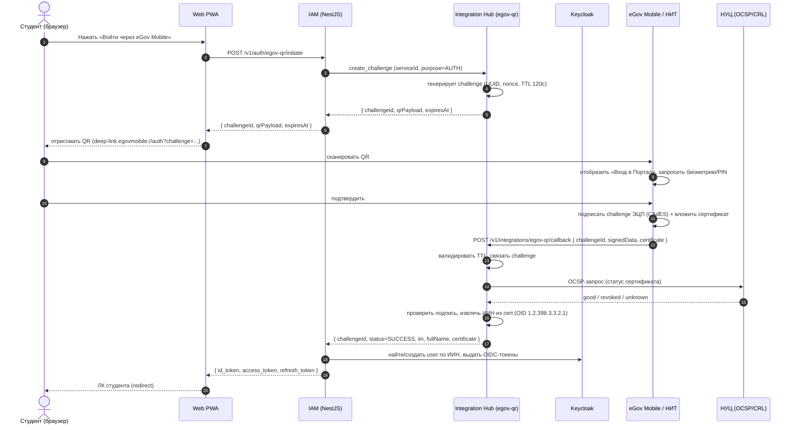

# Спецификация интеграционного слоя (Integration Hub)

## Единый студенческий портал безбумажного вуза (Student Super-App)

| Поле | Значение |
|---|---|
| Статус | **DRAFT — на согласование** |
| Версия | 0.1 |
| Автор | Integration Architect (agent-integrations) |
| Дата | 2026-11-17 |
| Контекст | Казахстан (РК), интеграции с eGov Mobile, NCALayer, ЕШЭП/ШЭП, Smart Data Ukimet, НОБД, LMS (Platonus / 1С:Университет), СКУД, столовой, платёжным шлюзом |
| Согласовано с | `docs/00-adr.md` (ADR-002 NestJS, ADR-003 REST+события, ADR-004 RabbitMQ→Kafka, ADR-006 ЭЦП/ЭДО, ADR-007 Integration Hub, ADR-008 безопасность) |

---

## Оглавление

1. [Обзор Integration Hub](#1-обзор-integration-hub)
2. [Авторизация eGov Mobile QR](#2-авторизация-egov-mobile-qr)
3. [NCALayer API](#3-ncalayer-api)
4. [ЕШЭП / ШЭП (шина электронного правительства)](#4-ешэп--шэп-шина-электронного-правительства)
5. [Smart Data Ukimet / Smart Bridge](#5-smart-data-ukimet--smart-bridge)
6. [НОБД (национальная образовательная БД)](#6-нобд-национальная-образовательная-бд)
7. [LMS-адаптеры (Platonus и 1С:Университет)](#7-lms-адаптеры-platonus-и-1суниверситет)
8. [СКУД общежития и учётная система столовой](#8-скуд-общежития-и-учётная-система-столовой)
9. [Платёжный шлюз (Halyk / eGov Pay)](#9-платёжный-шлюз-halyk--egov-pay)
10. [Общие правила](#10-общие-правила)
11. [Приложение A. OpenAPI-фрагменты внутренних эндпоинтов Integration Hub](#приложение-a-openapi-фрагменты-внутренних-эндпоинтов-integration-hub)
12. [Приложение B. Сводная таблица контрактов и плейсхолдеров](#приложение-b-сводная-таблица-контрактов-и-плейсхолдеров)

> **Соглашение о плейсхолдерах.** Реальные WSDL/endpoint/схемы гос. систем фиксируются в техническом паспорте интеграции по договору с оператором (АО «НИТ», НУЦ РК, АО «ЦЭБ», МНВО РК). Везде, где формат публично не зафиксирован, в тексте стоит пометка **«уточняется по техпаспорту оператора»**, а приведённая контрактная модель является реалистичной и версионируется отдельно от реализации. Плейсхолдеры вида `{{...}}` подлежат подстановке из конфигурации среды (Vault / ConfigMap).

---

## 1. Обзор Integration Hub

### 1.1 Назначение

Integration Hub (далее — **IH**) — единственная точка всех внешних вызовов системы. Ни один доменный сервис не обращается к внешней системе напрямую: все вызовы проходят через IH, который нормализует данные, применяет политики надёжности (идемпотентность, ретраи, DLQ) и ведёт полный аудит.

Соответствие ADR-007: паттерны **Outbox + idempotency-key**, ретраи с экспоненциальной паузой, **DLQ**, версионирование API; все гос. запросы подписываются ЭЦП и логируются. Транспортная модель — ADR-003: синхронные чтения через REST/JSON (и gRPC внутри), межсистемные мутации — асинхронно через RabbitMQ (→ Kafka).

### 1.2 Архитектура адаптеров

Каждая внешняя система инкапсулирована в **адаптер** (connector) — изолированный модуль, реализующий единый интерфейс `IntegrationAdapter<TRequest, TResponse>`.

```
                    ┌─────────────────────────────────────────────────────────┐
                    │                  Integration Hub                         │
                    │                                                          │
 Domain services    │   ┌───────────┐   ┌──────────────┐   ┌───────────────┐  │
 (NestJS modules) ──┼──►│  Gateway  │──►│  Pipeline    │──►│   Adapter     │──┼──► external
 (REST/gRPC)        │   │ (routing, │   │ (resilience, │   │  (per-system  │  │     system
                    │   │ authn/z)  │   │  idempotency)│   │   protocol)   │  │
                    │   └───────────┘   └──────────────┘   └───────────────┘  │
                    │          │                                │              │
                    │          ▼                                ▼              │
                    │   ┌───────────────┐              ┌────────────────┐      │
                    │   │ Contract       │              │  Adapter       │      │
                    │   │ Registry       │              │  Registry      │      │
                    │   │ (OpenAPI/JSON) │              │  (versions)    │      │
                    │   └───────────────┘              └────────────────┘      │
                    │                                                          │
                    │   Outbox ──► RabbitMQ/Kafka ──► workers ──► DLQ ──► ops  │
                    │   Audit log ──► OpenSearch          │                    │
                    └─────────────────────────────────────────────────────────┘
```

**Адаптеры:**

| Адаптер | Система | Протокол | Аутентификация/подпись |
|---|---|---|---|
| `egov-qr` | eGov Mobile | REST + QR + вебхук | ЭЦП пользователя, challenge JWT |
| `ncalayer` | NCALayer (локально) | WebSocket/JSON-RPC на `127.0.0.1:13579` | ЭЦП пользователя (ключ на клиенте) |
| `shep` | ЕШЭП/ШЭП | SOAP/XML | XML DSig (ЭЦП вуза) + mTLS |
| `smart-data` | Smart Data Ukimet / Smart Bridge | REST (gRPC опц.) | oAuth2 client-credentials + подпись |
| `nobd` | НОБД (МНВО РК) | SOAP/REST | ЭЦП вуза + токен |
| `platonus` / `lms-1c` | LMS | REST/SOAP/DB read-replica | токен/VPN/БД-роль |
| `acs` | СКУД общежития | REST/SDK + вебхук | API-key + HMAC-SHA256 |
| `canteen` | Учётная система столовой | REST/SDK + вебхук | API-key + HMAC-SHA256 |
| `payment` | Halyk / eGov Pay | REST | HTTPS + 3-D Secure + HMAC/SHA256 callback |

**Жизненный цикл адаптера:** каждый адаптер имеет семантическое версионирование (semver) и независимый релизный цикл; обновление контракта не ломает потребителей благодаря версионированию контрактов (раздел 1.6).

### 1.3 Унифицированная модель сообщений

Любой исходящий/входящий вызов оборачивается в единый конверт (envelope). Доменный payload всегда вложен, не изменяется транспортом и подписывается на уровне нижестоящего адаптера.

**Исходящий конверт (outbound envelope):**

```json
{
  "messageId": "01938c6a-1f7a-4b8e-9d21-5f2a1b3c4d5e",
  "correlationId": "01938c6a-1f7a-4b8e-9d21-5f2a1b3c4d5e",
  "timestamp": "2026-11-17T12:23:04+05:00",
  "source": "academic",
  "destination": "platonus",
  "adapter": "platonus",
  "adapterVersion": "1.2.0",
  "operation": "upsert_schedule",
  "contractVersion": "academic/v2",
  "schemaUri": "https://schemas.university.kz/academic/schedule-v2.json",
  "payload": { },
  "metadata": {
    "idempotencyKey": "sch-2026-fall-group-12345-abcdef",
    "retryCount": 0,
    "priority": "normal",
    "traceId": "00-4bf92f3577b34da6a3ce929d0e0e4736-00f067aa0ba902b7-01"
  }
}
```

| Поле | Описание |
|---|---|
| `messageId` | Уникальный ID сообщения (UUIDv7) для дедупликации на уровне шины. |
| `correlationId` | Сквозной ID бизнес-операции (пронизывает все системы). |
| `operation` | Каноническое имя операции (`upsert_schedule`, `get_contingent`, `create_payment`, …). |
| `contractVersion` | Версия контракта payload (не версия адаптера). |
| `payload` | Доменный payload. Транспорт его не интерпретирует. |
| `metadata.idempotencyKey` | Ключ идемпотентности (раздел 1.4). |
| `metadata.traceId` | W3C Trace Context для OpenTelemetry. |

**Входящий конверт (inbound, от вебхуков внешних систем):**

```json
{
  "messageId": "webhook-01938c6a-...",
  "correlationId": null,
  "timestamp": "2026-11-17T12:23:04+05:00",
  "source": "acs",
  "destination": "accommodation",
  "adapter": "acs",
  "operation": "access_granted_event",
  "contractVersion": "acs/v1",
  "payload": { },
  "metadata": {
    "signatureVerified": true,
    "hmacKeyId": "acs-prod-01",
    "retryCount": 0
  }
}
```

### 1.4 Идемпотентность

- Каждая **мутация** (создание, изменение, отправка, подписание, платёж) обязана нести `idempotencyKey`.
- Источник генерирует ключ **до** публикации в Outbox; повторная публикация того же ключа не создаёт дубль.
- IH хранит карту `(adapter, idempotencyKey) → {status, responseHash, createdAt, expiresAt}` в **Redis** (TTL 24 ч) и дублирует в **PostgreSQL** (`integration.idempotency_keys`) для переживания рестартов.
- На HTTP-уровне ключ передаётся заголовком `Idempotency-Key` (внешние REST-системы) и полем `metadata.idempotencyKey` (шина).
- Повторный вызов с тем же ключом возвращает **закэшированный ответ** (статус + `responseHash`) без повторного исполнения бизнес-логики.
- Для систем без поддержки идемпотентности (часть гос. SOAP) IH использует **идемпотентную проверку по бизнес-ключу** (например, «по ИИН + дата» перед повторной отправкой заявления).

**Пример хранения (PostgreSQL, фрагмент):**

```sql
CREATE TABLE integration.idempotency_keys (
  id              BIGSERIAL PRIMARY KEY,
  adapter         TEXT        NOT NULL,
  idempotency_key TEXT        NOT NULL,
  status          TEXT        NOT NULL,          -- 'in_progress' | 'completed' | 'failed'
  response_hash   TEXT,                          -- SHA-256 канонизированного ответа
  created_at      TIMESTAMPTZ NOT NULL DEFAULT now(),
  expires_at      TIMESTAMPTZ NOT NULL,
  UNIQUE (adapter, idempotency_key)
);
CREATE INDEX idx_idem_expires ON integration.idempotency_keys (expires_at);
```

### 1.5 Ретраи и DLQ

**Политика ретраев** (настраивается per-adapter через Contract Registry):

| Параметр | Значение по умолчанию |
|---|---|
| Стратегия | экспоненциальная пауза + полный джиттер (full jitter) |
| Начальная пауза | 1 с |
| Множитель | 2 |
| Максимальная пауза | 60 с |
| Максимум попыток | 5 (для платёжных/идемпотентных — 3) |
| Таймаут вызова | per-adapter (5–30 с) |
| Circuit breaker | 5 ошибок → open 30 с → half-open |

**Порядок:** попытка → отказ → повтор с паузой → после исчерпания попыток → **DLQ** (dead-letter queue) → алерт в Ops → ручной разбор (redrive или фиксация вручную).

**DLQ:**

- Одна очередь DLQ **на адаптер**: `dlq.{adapter}` (например `dlq.shep`, `dlq.platonus`).
- Сообщение в DLQ сохраняет исходный конверт + историю попыток + последнюю ошибку:

```json
{
  "original": { },
  "deadLetter": {
    "reason": "HTTP 503 Service Unavailable after 5 attempts",
    "attempts": 5,
    "lastErrorAt": "2026-11-17T12:23:04+05:00",
    "lastError": "ECONNRESET",
    "adapter": "shep",
    "retryable": false,
    "operatorHint": "Проверить доступность контура ШЭП и валидность сертификата вуза"
  }
}
```

- **Redrive:** оператор через Ops-интерфейс перекладывает сообщение обратно в рабочую очередь с обнулением `retryCount`; обязательно обновляется `idempotencyKey`-карта, чтобы не продублировать уже применённое изменение.
- **Poison-сообщения:** если при обработке возникает повторная ошибка десериализации/валидации схемы (не сеть), сообщение сразу в DLQ без ретраев.

### 1.6 Версионирование

- **Два уровня версий:**
  - `adapterVersion` — версия кода адаптера (semver).
  - `contractVersion` — версия схемы payload (например `academic/v2`).
- Контракты хранятся в **Contract Registry** (JSON-Schema + OpenAPI), публикуются как `schemaUri`.
- Правило совместимости: **additive changes = minor** (новые поля), **breaking changes = major** (новый `contractVersion`).
- Одновременно поддерживаются **N-1 и N** версии контракта (grace period 2 релиза) — потребитель мигрирует без простоя.
- Внутренние REST-эндпоинты IH версионируются в пути: `/v1/...`, `/v2/...`.

### 1.7 Аудит

Каждое юридически значимое действие (вход по eGov, подписание, импорт по ИИН, заселение, оплата, выдача справки) порождает **аудит-событие**:

```json
{
  "auditId": "01938c6a-...",
  "correlationId": "01938c6a-...",
  "timestamp": "2026-11-17T12:23:04+05:00",
  "actor": { "subjectId": "student:123", "authMethod": "egov-qr", "certIin": "МАСКИРОВАНО" },
  "action": "egov_qr.verify",
  "resource": { "adapter": "egov-qr", "operation": "verify_challenge" },
  "result": "success",
  "payloadHash": "sha256:9f86d081884c7d659a2feaa0c55ad015a3bf4f1b2b0b822cd15d6c15b0f00a08",
  "chainHash": "sha256:6b86b273ff34fce19d6b804eff5a3f5747ada4eaa22f1d49c01e52ddb7875b4b",
  "metadata": {}
}
```

- `payloadHash` — хэш payload (без ПДн в тексте лога; см. раздел 10.5).
- `chainHash` — звено **hash-chain** (ADR-006): хэш предыдущего события + текущего события, что гарантирует неотзываемость аудит-архива.
- События пишутся в OpenSearch (hot/warm) и в append-only таблицу PostgreSQL; retention ≥ 5 лет (регуляторный минимум — уточнить юристом вуза).

---

## 2. Авторизация eGov Mobile QR

### 2.1 Концепция

eGov Mobile — мобильное приложение eGov.kz, выступающее в роли **устройства аутентификации/подписания**: пользователь подтверждает вход или подписание, сканируя QR в приложении, где действие подтверждается биометрией/PIN и подписывается ЭЦП пользователя.

Портал реализует **флоу «QR-подпись на удалённом устройстве»**: сервер генерирует challenge, рендерит QR, eGov Mobile сканирует его, пользователь подтверждает действие, приложение формирует подписанный ответ, портал верифицирует подпись и выдаёт сессионный JWT (через Keycloak, ADR-005).

> Точный URL deep-link, формат подписи ответа и используемый SDK уточняются по техпаспорту оператора (АО «НИТ» / АО «ЦЭБ»). Ниже — реалистичная контрактная модель.

### 2.2 Sequence-диаграмма



### 2.3 Пошаговое описание

1. **Initiate.** IAM запрашивает у IH создание challenge. IH генерирует `challengeId` (UUIDv7) и криптостойкий `nonce`, фиксирует `expiresAt = now + TTL` (120 с по умолчанию), кладёт состояние в Redis (`egov:challenge:{id}`) со статусом `pending`.
2. **Render QR.** FE кодирует `qrPayload` (deep-link URL) в QR. Повторная отрисовка и «обновить QR» создают новый challenge (старый инвалидируется).
3. **Sign.** eGov Mobile сканирует deep-link, показывает контекст («Вход в студенческий портал»), запрашивает биометрию/PIN, формирует CAdES-BES/T подпись над `challengeId + nonce + timestamp` ключом ЭЦП пользователя, вкладывает сертификат X.509 (base64 DER).
4. **Callback.** eGov Mobile (или промежуточный сервис НИТ) вызывает вебхук IH с подписанным ответом. Канал — HTTPS с mTLS или подписью запроса (уточняется).
5. **Verify.** IH: (а) проверяет существование и TTL challenge; (б) проверяет подпись `signedData` и её покрытие `challengeId`/`nonce`; (в) проверяет статус сертификата по OCSP/CRL; (г) извлекает ИИН и ФИО из сертификата.
6. **Issue JWT.** IAM (Keycloak) находит или создаёт пользователя по ИИН (link по `sub`/`certIin`), выдаёт OIDC access/refresh токены. Challenge помечается `consumed` (одноразовость).

### 2.4 Структура challenge

**Запрос создания challenge (IAM → IH):**

```json
{
  "serviceId": "student-super-app",
  "purpose": "AUTH",
  "ttlSeconds": 120,
  "redirectAfterSuccess": "https://student.university.kz/auth/callback",
  "scope": ["openid", "profile", "iin"]
}
```

**Ответ IH:**

```json
{
  "challengeId": "01938c6a-7b3f-4c11-9a52-6d0e8f2a1b4c",
  "qrPayload": "egovmobile://auth?serviceId=student-super-app&challenge=01938c6a-7b3f-4c11-9a52-6d0e8f2a1b4c&nonce=d3f8a1&alg=ES256",
  "expiresAt": "2026-11-17T12:25:04+05:00",
  "ttlSeconds": 120
}
```

> Примечание: `qrPayload` в проде может быть URL вида `https://egovmobile.kz/auth?token=<JWT-challenge>` либо deep-link SDK — уточняется по техпаспорту. Здесь deep-link задан как каноническая форма, которую клиент просто кодирует в QR.

**Состояние challenge в Redis:**

```json
{
  "status": "pending",
  "purpose": "AUTH",
  "serviceId": "student-super-app",
  "nonce": "d3f8a1",
  "createdAt": "2026-11-17T12:23:04+05:00",
  "expiresAt": "2026-11-17T12:25:04+05:00",
  "consumedAt": null
}
```

### 2.5 Структура ответа (callback)

**Callback eGov Mobile → IH:**

```json
{
  "challengeId": "01938c6a-7b3f-4c11-9a52-6d0e8f2a1b4c",
  "status": "SUCCESS",
  "signedData": "MIIG...base64(CMS SignedData / CAdES-BES)...",
  "signatureAlgorithm": "SHA256withRSA_GOST34310_2004",
  "certificate": "MIIE...base64(DER X.509)...",
  "signedAt": "2026-11-17T12:23:40+05:00",
  "device": {
    "appVersion": "4.2.1",
    "platform": "android"
  }
}
```

**Ответ IH → IAM (после успешной верификации):**

```json
{
  "challengeId": "01938c6a-7b3f-4c11-9a52-6d0e8f2a1b4c",
  "status": "SUCCESS",
  "verified": true,
  "identity": {
    "iin": "920101300123",
    "fullName": "АХМЕТОВА АЙГЕРИМ СЕРГЕЕВНА",
    "certificateSerial": "5A:9C:...",
    "issuerDN": "CN=Ұлттық куәландырушы орталық (RSA), O=НУЦ РК, C=KZ"
  }
}
```

### 2.6 Извлечение ИИН из сертификата ЭЦП

Сертификат ЭЦП физического лица в РК (НУЦ РК) содержит ИИН в **subject DN**, но не в `CN`:

| Источник | Что содержит | Надёжность |
|---|---|---|
| `CN` (Common Name) | ФИО владельца (иногда у старых сертификатов ФИО + ИИН в скобках) | ФИО — да; ИИН — **не полагаться** |
| `SERIALNUMBER` | у юрлиц/ИП может содержать БИН/ИИН | средняя |
| OID **`1.2.398.3.3.2.1`** | **ИИН** физического лица (либо БИН юрлица) | **основной источник** |
| `subjectAlternativeName` | опционально | низкая |

**Алгоритм извлечения (в `egov-qr` адаптере):**

1. Распарсить `certificate` (X.509 DER/PEM) через `node-forge` / `pkijs`.
2. Извлечь `cert.subject` как DN; прочитать атрибут с OID `1.2.398.3.3.2.1`.
3. Если атрибут отсутствует — проверить `SERIALNUMBER`, затем регулярным выражением `\b\d{12}\b` в `CN` (легаси-резерв) с **обязательной** ручной пометкой `iinSource: "cn_legacy"` и флагом для аудита.
4. Проверить формат: **12 цифр**, валидный контрольный разряд (checksum ИИН — алгоритм весов 1 и 2, стандартный для РК).
5. Извлечь `CN` → ФИО; транслитерировать/нормализовать (см. раздел 5.4).

**Пример subject DN (реалистичный, НУЦ РК RSA):**

```
CN=АХМЕТОВА АЙГЕРИМ СЕРГЕЕВНА
O=НУЦ РК
SURNAME=АХМЕТОВА
GIVENNAME=АЙГЕРИМ
SERIALNUMBER=IIN920101300123
OID.1.2.398.3.3.2.1=920101300123
C=KZ
```

### 2.7 Проверка OCSP/CRL

Статус сертификата проверяется **обязательно** перед выдачей токенов (ADR-006):

- **OCSP** (приоритетно): запрос к OCSP-респондеру НУЦ РК. Endpoint по договору; публичный ориентир `http://ocsp.pki.gov.kz/` (уточняется, в проде — по техпаспорту). Запрос — `OCSPRequest` с `certID` (hash issuer + serial). Ответ: `good` / `revoked` / `unknown`.
- **CRL** (резерв при недоступности OCSP): скачивание CRL по URL из расширения `CRL Distribution Points` сертификата (`http://crl.pki.gov.kz/...`), проверка `serialNumber` в списке отозванных.
- **Кэш статусов:** Redis TTL = `min(OCSP nextUpdate, 60 мин)`; при `unknown`/сетевой ошибке — **fail-closed** для входа (не выдавать токен) с деградацией до CRL.

**Обработка OCSP-статусов:**

| OCSP-статус | Действие |
|---|---|
| `good` | продолжить |
| `revoked` | отклонить, аудит `cert_revoked` |
| `unknown` | попробовать CRL; если CRL подтверждает «не отозван» — допустить с пометкой; иначе отклонить |

### 2.8 Обработка ошибок

| Ошибка | HTTP | Код (см. раздел 10.1) | Действие |
|---|---|---|---|
| Challenge истёк (`expiresAt < now`) | 410 | `EGOV_QR_CHALLENGE_EXPIRED` | вернуть ошибку, предложить новый QR |
| Challenge не найден / уже использован | 404 / 409 | `EGOV_QR_CHALLENGE_NOT_FOUND` / `EGOV_QR_CHALLENGE_CONSUMED` | новый challenge |
| Неверная подпись (не покрывает nonce) | 401 | `EGOV_QR_BAD_SIGNATURE` | отклонить, аудит |
| Сертификат отозван / неактивен | 401 | `EGOV_QR_CERT_REVOKED` / `EGOV_QR_CERT_NOT_ACTIVE` | отклонить |
| OCSP/CRL недоступен | 503 | `EGOV_QR_OCSP_UNAVAILABLE` | fail-closed, ретрай |
| ИИН не извлечён из сертификата | 422 | `EGOV_QR_IIN_MISSING` | отклонить, попросить техподдержку |
| Отмена пользователем в приложении | 200 | `EGOV_QR_CANCELLED` (status) | закрыть флоу |

---

## 3. NCALayer API

### 3.1 Что такое NCALayer

**NCALayer** — локальное приложение-агент (распространяется АО «НИТ» / НУЦ РК) для работы с ЭЦП на компьютере пользователя. Реализует криптографию (RSA и ГОСТ), читает ключи из:

- файлового хранилища (PKCS#12, диск);
- смарт-карт/токенов (eToken, JavaCard, Kaztoken, ID-card);
- облачного хранилища ключей (КУЦ / cloud signature).

Приложение поднимает **локальный сервер на `127.0.0.1:13579`** и принимает команды по **WebSocket** (основной) и JSON-RPC. Браузер (через JS SDK) и серверные процессы (через клиентскую библиотеку) отправляют команды подписания, приватный ключ **никогда не покидает машину пользователя**.

### 3.2 Обнаружение и запуск

- **Порт по умолчанию:** `127.0.0.1:13579`.
- **Проверка доступности:** WebSocket-handshake к `ws://127.0.0.1:13579/` (или JSON-RPC `{"method":"status"}`). Таймаут подключения **2 с**.
- **Не установлен / не запущен:** handshake отклоняется или порт закрыт → IH возвращает `NCALAYER_NOT_RUNNING`; FE показывает плашку «Установите или запустите NCALayer» со ссылкой на официальный дистрибутив.
- **Определение версии:** метод `status`/`getVersion` возвращает версию агента; IH проверяет минимальную поддерживаемую версию и при необходимости просит обновиться.

```json
{ "module": "kz.gov.pki.knca.commonUtils.KncaUtil", "method": "status", "args": [], "id": 1 }
```

### 3.3 Формат JSON-RPC

Запрос (WebSocket-кадр):

```json
{
  "module": "kz.gov.pki.knca.commonUtils.KeyStore",
  "method": "getKeys",
  "args": [ [] ],
  "version": 1,
  "id": 1719331384000
}
```

Ответ:

```json
{
  "id": 1719331384000,
  "result": { },
  "error": null
}
```

> Точные имена `module`/`method`/`args` соответствуют документации NCALayer (АО «НИТ»). Приведённые здесь имена методов — канонические; фактический набор аргументов фиксируется по SDK-версии. Адаптер `ncalayer` инкапсулирует версии протокола.

### 3.4 Основные методы

#### 3.4.1 `getKeys` — список доступных ключей

```json
{
  "module": "kz.gov.pki.knca.commonUtils.KeyStore",
  "method": "getKeys",
  "args": [ { "storageType": "PKCS12", "storagePath": "" } ],
  "id": 1
}
```

Ответ:

```json
{
  "id": 1,
  "result": [
    {
      "keyAlias": "AUTH_RSA256_9f86d081",
      "storagePath": "PKCS12",
      "storageType": "PKCS12",
      "keyType": "RSA",
      "subjectDN": "CN=АХМЕТОВА АЙГЕРИМ СЕРГЕЕВНА,OID.1.2.398.3.3.2.1=920101300123,C=KZ",
      "issuerDN": "CN=Ұлттық куәландырушы орталық (RSA),O=НУЦ РК,C=KZ",
      "serialNumber": "5A9C...",
      "notAfter": "2027-05-01T00:00:00+05:00",
      "keyUsage": ["digitalSignature"],
      "isCloud": false
    }
  ],
  "error": null
}
```

#### 3.4.2 `createCAdES` — формирование подписи (CAdES/CMS)

```json
{
  "module": "kz.gov.pki.knca.commonUtils.Sign",
  "method": "createCAdES",
  "args": [
    {
      "storagePath": "PKCS12",
      "storageType": "PKCS12",
      "keyAlias": "AUTH_RSA256_9f86d081",
      "password": "***",
      "data": "base64(<канонизированный документ/данные>)",
      "signType": "CAdES-BES",
      "signingCertificate": true,
      "detached": true,
      "withTsp": true,
      "tspUrl": "http://tsp.pki.gov.kz/",
      "withTsaCertificate": true
    }
  ],
  "id": 2
}
```

Ответ:

```json
{
  "id": 2,
  "result": {
    "signedData": "MIIG...base64(PKCS#7 / CMS SignedData)...",
    "signatureAlgorithm": "SHA256withRSA",
    "signerCertificate": "MIIE...base64(DER X.509)..."
  },
  "error": null
}
```

> Параметр `password` передаётся только для файлового хранилища и **не логируется**; при смарт-картах PIN вводится в нативном диалоге агента.

#### 3.4.3 `verifyCAdES` — проверка подписи

```json
{
  "module": "kz.gov.pki.knca.commonUtils.Sign",
  "method": "verifyCAdES",
  "args": [
    {
      "signedData": "MIIG...base64...",
      "data": "base64(<оригинал данных, если detached>)",
      "verifyOcsp": true,
      "verifyCrl": true
    }
  ],
  "id": 3
}
```

Ответ:

```json
{
  "id": 3,
  "result": {
    "valid": true,
    "certStatus": "good",
    "signer": {
      "subjectDN": "CN=...",
      "iin": "920101300123",
      "serialNumber": "5A9C..."
    }
  },
  "error": null
}
```

#### 3.4.4 `createXMLSign` — XML DSig (XAdES) для SOAP

```json
{
  "module": "kz.gov.pki.knca.commonUtils.Sign",
  "method": "createXMLSign",
  "args": [
    {
      "storagePath": "PKCS12",
      "keyAlias": "AUTH_RSA256_9f86d081",
      "password": "***",
      "xml": "<soapenv:Envelope>...</soapenv:Envelope>",
      "xmlNodeId": "body",
      "signType": "XAdES-BES",
      "injectIntoXml": true
    }
  ],
  "id": 4
}
```

Ответ:

```json
{
  "id": 4,
  "result": { "signedXml": "<soapenv:Envelope>...<ds:Signature>...</ds:Signature></soapenv:Envelope>" },
  "error": null
}
```

#### 3.4.5 `signQr` — подписание QR-контента (для eGov QR)

```json
{
  "module": "kz.gov.pki.knca.commonUtils.Sign",
  "method": "signQr",
  "args": [
    {
      "storagePath": "PKCS12",
      "keyAlias": "AUTH_RSA256_9f86d081",
      "password": "***",
      "data": "base64(<challengeId:nonce:timestamp>)"
    }
  ],
  "id": 5
}
```

Ответ:

```json
{
  "id": 5,
  "result": { "signedQr": "base64(...)" },
  "error": null
}
```

### 3.5 Пакетное подписание (batch signing)

Для сценария заселения (пакет документов: договор найма, акт приёма-передачи, заявление) NCALayer/агент подписывает **несколько документов одной сессией** — это сокращает число PIN-вводов и повышает UX.

```json
{
  "module": "kz.gov.pki.knca.commonUtils.Sign",
  "method": "createCAdESBatch",
  "args": [
    {
      "storagePath": "PKCS12",
      "keyAlias": "AUTH_RSA256_9f86d081",
      "password": "***",
      "signType": "CAdES-BES",
      "detached": true,
      "withTsp": true,
      "documents": [
        { "documentId": "doc-dogovor-nayma-001", "data": "base64(<договор.pdf>)" },
        { "documentId": "doc-akt-priema-002", "data": "base64(<акт.pdf>)" },
        { "documentId": "doc-zayavlenie-003", "data": "base64(<заявление.pdf>)" }
      ]
    }
  ],
  "id": 6
}
```

Ответ:

```json
{
  "id": 6,
  "result": {
    "signatures": [
      { "documentId": "doc-dogovor-nayma-001", "signedData": "MIIG...base64..." },
      { "documentId": "doc-akt-priema-002", "signedData": "MIIG...base64..." },
      { "documentId": "doc-zayavlenie-003", "signedData": "MIIG...base64..." }
    ],
    "signerCertificate": "MIIE...base64..."
  },
  "error": null
}
```

> Если `createCAdESBatch` не поддерживается конкретной версией агента, IH деградирует до **последовательного подписания** каждого документа (по одному PIN-вводу), сохраняя идемпотентность по `documentId`.

### 3.6 Таймауты и обработка состояний

| Ситуация | Таймаут/действие |
|---|---|
| Подключение к агенту | 2 с |
| Ожидание ответа агента (подписание) | 30 с (пользователь вводит PIN) |
| «NCALayer не установлен/не запущен» | немедленная ошибка `NCALAYER_NOT_RUNNING` |
| Отмена ввода PIN | `NCALAYER_USER_CANCELLED` |
| Не найден ключ для подписания | `NCALAYER_KEY_NOT_FOUND` |
| Ключ истёк | `NCALAYER_KEY_EXPIRED` |

---

## 4. ЕШЭП / ШЭП (шина электронного правительства)

### 4.1 Концепция

**ШЭП (Шлюз Электронного Правительства)** — сервисная шина eGov.kz, через которую гос. органы и организации публикуют SOAP-сервисы. **ЕШЭП** — Единая система/шина электронного правительства, обеспечивающая маршрутизацию, аутентификацию и подпись запросов. Доступ и конкретные сервисы предоставляются по договору с **АО «НИТ»**.

### 4.2 Контрактная модель SOAP

- **Транспорт:** HTTPS + mTLS (клиентский сертификат вуза).
- **Подпись запроса:** XML DSig (**XAdES**) ключом **серверной ЭЦП вуза** (HSM, ADR-006) над `soap:Body`.
- **Конверт:** стандартный SOAP 1.1/1.2 с `wsse:Security` (BinarySecurityToken + Signature + Timestamp).

### 4.3 Структура SOAP envelope

```xml
<soapenv:Envelope
    xmlns:soapenv="http://schemas.xmlsoap.org/soap/envelope/"
    xmlns:wsse="http://docs.oasis-open.org/wss/2004/01/oasis-200401-wss-wssecurity-secext-1.0.xsd"
    xmlns:ds="http://www.w3.org/2000/09/xmldsig#"
    xmlns:ns="http://shep.gov.kz/services/person">
  <soapenv:Header>
    <wsse:Security>
      <wsu:Timestamp xmlns:wsu="http://docs.oasis-open.org/wss/2004/01/oasis-200401-wss-wssecurity-utility-1.0.xsd">
        <wsu:Created>2026-11-17T07:23:04Z</wsu:Created>
        <wsu:Expires>2026-11-17T07:28:04Z</wsu:Expires>
      </wsu:Timestamp>
      <wsse:BinarySecurityToken
          EncodingType="http://docs.oasis-open.org/wss/2004/01/oasis-200401-wss-soap-message-security-1.0#Base64Binary"
          ValueType="http://docs.oasis-open.org/wss/2004/01/oasis-200401-wss-x509-token-profile-1.0#X509v3"
          wsu:Id="X509Token">MIIE...base64(сертификат вуза)...</wsse:BinarySecurityToken>
      <ds:Signature Id="SIG">
        <ds:SignedInfo>
          <ds:CanonicalizationMethod Algorithm="http://www.w3.org/2001/10/xml-exc-c14n#"/>
          <ds:SignatureMethod Algorithm="http://www.w3.org/2001/04/xmldsig-more#rsa-sha256"/>
          <ds:Reference URI="#BODY">
            <ds:Transforms>
              <ds:Transform Algorithm="http://www.w3.org/2001/10/xml-exc-c14n#"/>
            </ds:Transforms>
            <ds:DigestMethod Algorithm="http://www.w3.org/2001/04/xmlenc#sha256"/>
            <ds:DigestValue>base64(digest body)</ds:DigestValue>
          </ds:Reference>
        </ds:SignedInfo>
        <ds:SignatureValue>base64(signature)</ds:SignatureValue>
        <ds:KeyInfo>
          <wsse:SecurityTokenReference>
            <wsse:Reference URI="#X509Token" ValueType="...X509v3"/>
          </wsse:SecurityTokenReference>
        </ds:KeyInfo>
      </ds:Signature>
    </wsse:Security>
  </soapenv:Header>
  <soapenv:Body wsu:Id="BODY">
    <ns:getPersonByIIN>
      <ns:iin>920101300123</ns:iin>
      <ns:requestId>01938c6a-...</ns:requestId>
    </ns:getPersonByIIN>
  </soapenv:Body>
</soapenv:Envelope>
```

### 4.4 Пример ответа (получение данных по ИИН)

```xml
<soapenv:Envelope xmlns:soapenv="http://schemas.xmlsoap.org/soap/envelope/" xmlns:ns="http://shep.gov.kz/services/person">
  <soapenv:Header/>
  <soapenv:Body>
    <ns:getPersonByIINResponse>
      <ns:requestId>01938c6a-...</ns:requestId>
      <ns:status>SUCCESS</ns:status>
      <ns:person>
        <ns:iin>920101300123</ns:iin>
        <ns:lastName>АХМЕТОВА</ns:lastName>
        <ns:firstName>АЙГЕРИМ</ns:firstName>
        <ns:middleName>СЕРГЕЕВНА</ns:middleName>
        <ns:birthDate>1992-01-01</ns:birthDate>
        <ns:gender>F</ns:gender>
        <ns:citizenship>KAZAKHSTAN</ns:citizenship>
        <ns:document>
          <ns:type>ID_CARD</ns:type>
          <ns:number>123456789</ns:number>
          <ns:issueDate>2017-01-01</ns:issueDate>
          <ns:expireDate>2027-01-01</ns:expireDate>
        </ns:document>
      </ns:person>
    </ns:getPersonByIINResponse>
  </soapenv:Body>
</soapenv:Envelope>
```

> **Точные WSDL/endpoint/имена операций — по договору с АО «НИТ» и фиксируются в техпаспорте.** Здесь задаётся контракт с плейсхолдерами: `{{SHEP_ENDPOINT}}`, `{{SHEP_SERVICE_NS}}`, `{{SHEP_PERSON_OPERATION}}`. Адаптер `shep` держит namespace/операции в конфиге, а не в коде.

### 4.5 Аутентификация сервисов

- mTLS: серверный сертификат вуза.
- XML DSig над `Body` (обязательно) + `Timestamp` (анти-replay, окно 5 мин).
- При необходимости — WS-Security UsernameToken (логин/пароль сервиса) в дополнение к подписи.

### 4.6 Тестовый vs прод контур

| Параметр | Тест | Прод |
|---|---|---|
| Endpoint | `{{SHEP_TEST_ENDPOINT}}` (обычно `*.test.egov.kz`) | `{{SHEP_PROD_ENDPOINT}}` |
| Сертификат | тестовый ЭЦП вуза (тестовый НУЦ) | боевой ЭЦП вуза (HSM) |
| mTLS | тестовый client-cert | боевой client-cert |
| Данные | обезличенные/синтетические ИИН | реальные |
| Логирование | допускается больше деталей | строгое маскирование ПДн |

Переключение — только через конфигурацию среды (Vault), без изменения кода.

---

## 5. Smart Data Ukimet / Smart Bridge

### 5.1 Концепция

**Smart Data Ukimet** и **Smart Bridge** — платформы межведомственного обмена данными между государственными базами (ГБ). Предоставляют унифицированный доступ к данным по **ИИН/БИН** через REST (и gRPC) с авторизацией **oAuth2 (client-credentials)**. Доменные источники данных (ГБД ФЛ, ГБД РН, МТСЗН, МЗ) доступны **как справочники/сеты данных** внутри платформы.

> Реальные endpoint и каталог справочников (`{{SMART_DATA_BASE_URL}}`, `{{SMART_DATA_DATASET_IDS}}`) — уточняются по техпаспорту оператора. Ниже — контрактная модель.

### 5.2 Аутентификация oAuth2

```http
POST {{SMART_DATA_TOKEN_URL}}/oauth2/token
Content-Type: application/x-www-form-urlencoded
```

```
grant_type=client_credentials
&client_id={{SMART_DATA_CLIENT_ID}}
&client_secret={{SMART_DATA_CLIENT_SECRET}}
&scope=dataset.read
```

Ответ:

```json
{
  "access_token": "eyJhbGciOi...",
  "token_type": "Bearer",
  "expires_in": 3600,
  "scope": "dataset.read"
}
```

Токен кэшируется в Redis до `expires_in - 60с`; при 401 — однократное обновление и ретрай.

### 5.3 Единый формат запроса справочника

```http
POST {{SMART_DATA_BASE_URL}}/api/v1/datasets/{{DATASET_ID}}/query
Authorization: Bearer <token>
Idempotency-Key: 01938c6a-...
Content-Type: application/json
```

```json
{
  "subject": { "type": "IIN", "value": "920101300123" },
  "fields": ["*"],
  "consentId": "consent-2026-001",
  "purpose": "enrollment_verification"
}
```

### 5.4 Примеры запросов/ответов по доменам

#### 5.4.1 Удостоверение личности (ГБД ФЛ, МВД)

```json
{
  "requestId": "01938c6a-...",
  "dataset": "gbd_fl.person",
  "data": {
    "iin": "920101300123",
    "fullName": { "lastName": "АХМЕТОВА", "firstName": "АЙГЕРИМ", "middleName": "СЕРГЕЕВНА" },
    "birthDate": "1992-01-01",
    "gender": "FEMALE",
    "nationality": "KAZAKHSTAN",
    "document": {
      "type": "IDENTITY_CARD",
      "number": "123456789",
      "issueDate": "2017-01-01",
      "expiryDate": "2027-01-01",
      "authority": "МВД РК"
    },
    "photo": { "url": "{{SMART_DATA_BASE_URL}}/files/photo/920101300123", "hash": "sha256:..." }
  }
}
```

#### 5.4.2 Адресная регистрация (ГБД РН)

```json
{
  "requestId": "01938c6a-...",
  "dataset": "gbd_rn.registration_address",
  "data": {
    "iin": "920101300123",
    "currentAddress": {
      "region": "г. Алматы",
      "district": "Бостандыкский",
      "street": "пр. аль-Фараби",
      "house": "71",
      "apartment": "12",
      "kato": "750000000",
      "registeredSince": "2020-09-01"
    },
    "permanentAddress": { }
  }
}
```

#### 5.4.3 Льготный статус (МТСЗН)

```json
{
  "requestId": "01938c6a-...",
  "dataset": "mtszn.social_status",
  "data": {
    "iin": "920101300123",
    "benefits": [
      {
        "code": "ORPHAN",
        "name": "Сирота / оставшийся без попечения родителей",
        "status": "ACTIVE",
        "validFrom": "2024-09-01",
        "validTo": null,
        "source": "МТСЗН"
      },
      {
        "code": "DISABILITY_2",
        "name": "Инвалидность II группы",
        "status": "ACTIVE",
        "validFrom": "2020-01-01",
        "validTo": null
      }
    ],
    "asOf": "2026-11-17"
  }
}
```

#### 5.4.4 Медицинские данные (МЗ) — только с явным согласием

```json
{
  "requestId": "01938c6a-...",
  "dataset": "mz.health_status",
  "data": {
    "iin": "920101300123",
    "dispensaryRegistration": {
      "group": "D_III",
      "diagnosisCode": "{{ICD10}}",
      "validTo": "2027-05-01",
      "requiresSpecialConditions": true
    },
    "vaccination": { "status": "COMPLETE" },
    "asOf": "2026-11-17"
  }
}
```

> Медицинские данные — **особо чувствительная категория ПДн**: запрашиваются только с отдельного явного согласия студента (ЗРК «О персональных данных»), минимально необходимый объём, доступ строго ограничен ролью (`dorm_admin` для расселения по мед. показаниям).

### 5.5 Поля ИИН/БИН и нормализация ответов

- **ИИН** — 12 цифр; **БИН** — 12 цифр; оба валидируются контрольным разрядом.
- Все ответы IH приводит к **единой внутренней модели** (см. `identity` в разделе 2.5): нормализация ФИО (верхний регистр, без лишних пробелов), единый словарь полов (`MALE`/`FEMALE`), даты ISO 8601, `kato` — код КАТО адреса.
- Разные домены могут по-разному именовать одно и то же поле — за маппинг отвечает адаптер `smart-data`, а не потребитель.

---

## 6. НОБД (национальная образовательная БД)

### 6.1 Концепция

**НОБД** — национальная образовательная база данных (ведение — МНВО РК), содержит **контингент обучающихся**: зачисление, специальность, форма обучения, статус. IH запрашивает контингент по ИИН для верификации статуса студента и подтягивания данных при профилировании.

> Endpoint/WSDL — по договору с МНВО РК; ниже контрактная модель (REST-вариант; возможен SOAP — адаптер `nobd` скрывает разницу).

### 6.2 Пример запроса

```http
POST {{NOBD_BASE_URL}}/api/v1/contingent/lookup
Authorization: Bearer <token>
Idempotency-Key: 01938c6a-...
Content-Type: application/json
```

```json
{
  "iin": "920101300123",
  "academicYear": "2026-2027",
  "organizationBin": "{{UNIVERSITY_BIN}}",
  "requestId": "01938c6a-..."
}
```

### 6.3 Пример ответа

```json
{
  "requestId": "01938c6a-...",
  "status": "SUCCESS",
  "contingent": {
    "iin": "920101300123",
    "organization": {
      "bin": "{{UNIVERSITY_BIN}}",
      "name": "{{UNIVERSITY_NAME}}",
      "kato": "750000000"
    },
    "enrollment": {
      "status": "STUDYING",
      "enrolledDate": "2022-09-01",
      "course": 4,
      "educationForm": "FULL_TIME",
      "educationBase": "BUDGET",
      "specialtyCode": "6B06102",
      "specialtyName": "Информационные системы",
      "degree": "BACHELOR",
      "group": "ИС-22-1"
    },
    "studyPeriod": { "start": "2022-09-01", "end": "2026-06-30" },
    "asOf": "2026-11-17"
  }
}
```

**Нормализация:** `educationForm` маппится к внутреннему словарю (`FULL_TIME`, `PART_TIME`, `EVENING`, `DISTANCE`); `educationBase` — `BUDGET`/`PAID`. Расхождения между НОБД и LMS разрешаются правилом (раздел 7.5): **LMS — мастер по текущим оценкам, НОБД — мастер по зачислению/статусу контингента**.

---

## 7. LMS-адаптеры (Platonus и 1С:Университет)

### 7.1 Стратегия синхронизации

На переходный период LMS остаётся мастером данных по оценкам/расписанию (ADR, открытый вопрос №2). Адаптеры работают в гибридном режиме:

- **Poll (pull):** периодическая выгрузка изменённых сущностей с cursor/incremental (`updatedAt > lastCursor`) — фоновый Job.
- **Webhook (push):** LMS вызывает IH при изменении (если LMS поддерживает webhooks; у Platonus/1С — опционально, часто через триггеры БД или middleware).
- **Двусторонняя синхронизация:** IH читает из LMS (расписание, оценки, GPA, транскрипт, элективы) и при необходимости пишет обратно (например, результат выбора элективов, статус апелляции, чат-сообщения).

```
Academic ──► IH (lms-platonus) ──poll──► Platonus REST/SOAP/DB
   ▲                                      │
   └────────── webhook (опц.) ◄───────────┘
   ▲                                      │
   └────────── IH (lms-1c) ──poll─────────┴──► 1С:Университет (REST/ODATA/SOAP)
```

### 7.2 Единая внутренняя модель Academic

Вне зависимости от источника, IH отдаёт домену Academic единую модель:

| Сущность | Ключевые поля |
|---|---|
| `Schedule` | `term`, `group`, `subjectCode`, `type` (lecture/practice/lab), `room`, `teacherId`, `startAt`, `endAt` |
| `Grade` | `studentId`, `subjectCode`, `term`, `grade`, `gradeType` (exam/test/coursework), `ects` |
| `Gpa` | `studentId`, `term`, `gpa`, `gpaCumulative`, `ectsAccumulated` |
| `Transcript` | `studentId`, `entries[]` (subject, grade, ects, term), `issuedAt` |
| `Elective` | `term`, `catalog[]`, `studentChoices[]`, `deadline` |
| `Enrollment` | `studentId`, `course`, `group`, `educationForm`, `educationBase` |

### 7.3 REST/JSON-контракт адаптера (единая модель)

#### Расписание

```json
{
  "messageId": "01938c6a-...",
  "correlationId": "01938c6a-...",
  "adapter": "platonus",
  "operation": "upsert_schedule",
  "contractVersion": "academic/v2",
  "payload": {
    "term": "2026-FALL",
    "group": "ИС-22-1",
    "entries": [
      {
        "externalId": "sch-88231",
        "subjectCode": "CS201",
        "subjectName": "Базы данных",
        "type": "LECTURE",
        "teacherId": "t-1042",
        "teacherName": "Сериков А.Б.",
        "room": "ГУК-3, ауд. 214",
        "startAt": "2026-11-18T09:00:00+05:00",
        "endAt": "2026-11-18T10:30:00+05:00"
      }
    ]
  }
}
```

#### Оценки

```json
{
  "adapter": "platonus",
  "operation": "upsert_grades",
  "contractVersion": "academic/v2",
  "payload": {
    "term": "2026-FALL",
    "studentId": "student:123",
    "entries": [
      {
        "externalId": "gr-55231",
        "subjectCode": "CS201",
        "grade": 92.5,
        "gradeType": "EXAM",
        "ects": 5,
        "passedAt": "2026-11-10"
      }
    ]
  }
}
```

#### GPA

```json
{
  "adapter": "platonus",
  "operation": "upsert_gpa",
  "contractVersion": "academic/v2",
  "payload": {
    "studentId": "student:123",
    "term": "2026-FALL",
    "gpa": 3.61,
    "gpaCumulative": 3.42,
    "ectsAccumulated": 96,
    "calculatedAt": "2026-11-17T12:00:00+05:00"
  }
}
```

#### Транскрипт

```json
{
  "adapter": "platonus",
  "operation": "upsert_transcript",
  "contractVersion": "academic/v2",
  "payload": {
    "studentId": "student:123",
    "issuedAt": "2026-11-17T12:00:00+05:00",
    "entries": [
      { "subjectCode": "CS101", "subjectName": "Алгоритмы", "grade": 88, "ects": 6, "term": "2025-SPRING" },
      { "subjectCode": "CS201", "subjectName": "Базы данных", "grade": 92, "ects": 5, "term": "2025-FALL" }
    ]
  }
}
```

#### Элективы (каталог + выбор)

```json
{
  "adapter": "platonus",
  "operation": "upsert_elective_catalog",
  "contractVersion": "academic/v2",
  "payload": {
    "term": "2026-FALL",
    "deadline": "2026-08-25T23:59:59+05:00",
    "catalog": [
      { "code": "ELC-AI-301", "name": "Введение в ИИ", "ects": 5, "capacity": 60, "available": 12 },
      { "code": "ELC-SEC-302", "name": "Кибербезопасность", "ects": 5, "capacity": 40, "available": 0 }
    ],
    "studentChoices": [
      { "studentId": "student:123", "code": "ELC-AI-301", "status": "SELECTED" }
    ]
  }
}
```

### 7.4 Варианты доступа к LMS

| Вариант | Плюсы | Минусы |
|---|---|---|
| **REST API** (нативный/ODATA) | чистый контракт, версионирование, безопасность на уровне API | у Platonus/1С REST часто ограничен или платный модуль |
| **SOAP** | зрелый контракт, WSDL | тяжелее, меньше скорость разработки |
| **Прямой доступ к БД через read-only реплику** | максимальная полнота и скорость, incremental через `updatedAt`/триггеры | риск связанности со схемой, вопросы безопасности, блокировка вендором обновлений |
| **Middleware/интеграционная шина вендора** | готовая синхронизация | vendor-lock, слабая кастомизация |

**Решение:** основной путь — **REST/SOAP API**; если вендор не предоставляет достаточный API — **read-only реплика БД** с жёсткими правилами: отдельная БД-роль `readonly`, VPN/сегментация, доступ только к представлениям (views), аудит каждого запроса. Прямой доступ к **боевой** БД под запись **запрещён**.

### 7.5 Разрешение конфликтов двусторонней синхронизации

- **Мастер данных:** для оценок/расписания/GPA — **LMS** (на переходный период); для выбора элективов, апелляций, чата — **портал** (пишется в LMS, если та поддерживает).
- **Конфликт** (обе системы изменили одну запись): правило **last-write-wins по `updatedAt`** с обязательным сохранением обеих версий в `integration.sync_conflicts` и алертом; для оценок — побеждает LMS (мастер).
- **Идемпотентная повторная доставка** гарантирует отсутствие дублей при poll+webhook пересечении (по `externalId`).

---

## 8. СКУД общежития и учётная система столовой

### 8.1 Общая модель

Обе системы — локальные инженерные подсистемы вуза, интегрируются через REST/SDK + вебхуки с аутентификацией **API-key + HMAC-SHA256** подписи тела запроса.

**Подпись запроса (HMAC):** заголовки

```
X-Api-Key: {{ACS_API_KEY}}
X-Timestamp: 1719331384
X-Signature: HMAC-SHA256(secret, method + "\n" + path + "\n" + timestamp + "\n" + sha256(body))
```

### 8.2 Назначение пропуска (СКУД)

```http
POST {{ACS_BASE_URL}}/v1/access/passes
```

```json
{
  "requestId": "01938c6a-...",
  "student": {
    "iin": "920101300123",
    "fullName": "АХМЕТОВА АЙГЕРИМ СЕРГЕЕВНА",
    "room": "D-4-218",
    "building": "D4"
  },
  "pass": {
    "type": "CARD",
    "cardNumber": "ACS-00004521",
    "validFrom": "2026-09-01T00:00:00+05:00",
    "validTo": "2027-06-30T23:59:59+05:00",
    "accessZones": ["D4-entry", "D4-2floor", "D4-room-218"]
  }
}
```

Ответ:

```json
{ "requestId": "01938c6a-...", "passId": "pass-77412", "status": "ACTIVE" }
```

### 8.3 Вебхук СКУД → IH (событие прохода)

```json
{
  "eventId": "evt-99021",
  "type": "ACCESS_GRANTED",
  "passId": "pass-77412",
  "studentIin": "920101300123",
  "zone": "D4-entry",
  "occurredAt": "2026-11-17T12:20:00+05:00"
}
```

### 8.4 Статус льготника (столовая)

```http
POST {{CANTEEN_BASE_URL}}/v1/beneficiaries/sync
```

```json
{
  "requestId": "01938c6a-...",
  "student": {
    "iin": "920101300123",
    "fullName": "АХМЕТОВА АЙГЕРИМ СЕРГЕЕВНА"
  },
  "benefit": {
    "code": "FREE_MEAL",
    "name": "Бесплатное питание (льгота)",
    "mealsPerDay": 3,
    "dailyLimitKzt": 1200,
    "validFrom": "2026-09-01",
    "validTo": "2027-06-30",
    "status": "ACTIVE"
  }
}
```

Ответ:

```json
{ "requestId": "01938c6a-...", "beneficiaryId": "ben-5521", "status": "SYNCED" }
```

Вебхук столовой (транзакция/остаток лимита):

```json
{
  "eventId": "evt-77012",
  "type": "MEAL_REDEEMED",
  "studentIin": "920101300123",
  "amountKzt": 350,
  "mealType": "LUNCH",
  "occurredAt": "2026-11-17T13:05:00+05:00"
}
```

---

## 9. Платёжный шлюз (Halyk / eGov Pay)

### 9.1 Концепция

Оплата обучения/услуг через платёжные шлюзы. Контрактная модель объединяет Halyk ePay и eGov Pay (у них близкие флоу: создание заказа → редирект на 3-D Secure → callback).

### 9.2 Создание платежа

```http
POST {{PAYMENT_BASE_URL}}/api/v1/payments
Authorization: Bearer <merchant-token>
Idempotency-Key: 01938c6a-...
```

```json
{
  "merchantId": "{{MERCHANT_ID}}",
  "orderId": "ord-2026-0004521",
  "amountKzt": 350000.00,
  "currency": "KZT",
  "description": "Оплата обучения, 1 семестр 2026-2027",
  "customer": {
    "iin": "920101300123",
    "fullName": "АХМЕТОВА АЙГЕРИМ СЕРГЕЕВНА",
    "email": "a.akhmetova@student.university.kz"
  },
  "purposeCode": "EDUCATION",
  "returnUrl": "https://student.university.kz/payments/ord-2026-0004521/return",
  "callbackUrl": "https://api.university.kz/v1/integrations/payments/callback",
  "expiresAt": "2026-11-18T12:23:04+05:00"
}
```

Ответ:

```json
{
  "paymentId": "pay-883712",
  "orderId": "ord-2026-0004521",
  "status": "CREATED",
  "redirectUrl": "{{PAYMENT_3DS_URL}}?paymentId=pay-883712",
  "createdAt": "2026-11-17T12:23:04+05:00"
}
```

### 9.3 Флоу 3-D Secure

1. Портал создаёт платёж → получает `redirectUrl`.
2. Студент редиректится на страницу 3-D Secure (банк/ЭЦП-подтверждение), подтверждает.
3. Банк вызывает `callbackUrl` с результатом.
4. IH сверяет подпись callback (HMAC/сертификат), проверяет `amount`/`orderId`, помечает заказ `PAID` и публикует событие в шину.

### 9.4 Callback

```http
POST https://api.university.kz/v1/integrations/payments/callback
X-Signature: HMAC-SHA256(secret, ...)
```

```json
{
  "paymentId": "pay-883712",
  "orderId": "ord-2026-0004521",
  "status": "PAID",
  "amountKzt": 350000.00,
  "currency": "KZT",
  "transactionId": "trx-998812",
  "authCode": "A1B2C3",
  "paidAt": "2026-11-17T12:30:00+05:00",
  "eci": "05",
  "cardMasked": "4400********1234"
}
```

**Безопасность callback:** проверка HMAC-подписи (или mTLS) обязательна; несовпадение → 401 и игнор; повторный callback идемпотентен по `paymentId` (статус не откатывается).

---

## 10. Общие правила

### 10.1 Единый формат ошибок

Все ошибки IH отдают в формате RFC 7807 (Problem Details):

```json
{
  "type": "https://api.university.kz/errors/EGOV_QR_CHALLENGE_EXPIRED",
  "title": "Challenge истёк",
  "status": 410,
  "code": "EGOV_QR_CHALLENGE_EXPIRED",
  "correlationId": "01938c6a-...",
  "retryable": false,
  "details": { "expiresAt": "2026-11-17T12:25:04+05:00" }
}
```

| Поле | Описание |
|---|---|
| `code` | Машиночитаемый код (префикс системы: `EGOV_QR_*`, `NCALAYER_*`, `SHEP_*`, `NOBD_*`, `LMS_*`, `ACS_*`, `PAYMENT_*`) |
| `retryable` | Рекомендация по повтору (сеть — да, бизнес-ошибка — нет) |
| `correlationId` | Сквозной ID для трассировки |

**Коды HTTP:** 400 (валидация), 401 (аутентификация/подпись), 403 (нет прав/согласия), 404, 409 (конфликт/идемпотентность), 410 (истёк challenge), 422 (необрабатываемая сущность), 429 (rate limit), 503 (внешняя система недоступна).

### 10.2 Корреляционные ID

- Каждый входящий запрос получает `correlationId` (или принимает переданный). Передаётся заголовком `X-Correlation-Id` и полем `traceId` (W3C Trace Context).
- Пронизывает все системы: BFF → домен → IH → внешняя система → обратно. Логи, метрики и аудит индексируются по нему.

### 10.3 Rate limiting

- **Входящий:** на API Gateway — token bucket per-user (например 100 req/мин) + per-IP.
- **Исходящий к гос. системам:** IH лимитирует частоту к ШЭП/НОБД/Smart Data (например 10 req/с на сервис), соблюдая лимиты оператора; превышение → очередь (backpressure) с приоритетами.
- **429** возвращается с `Retry-After`.

### 10.4 Секреты (Vault)

Все секреты — в **HashiCorp Vault** (ADR-010):

| Секрет | Хранилище | Ротация |
|---|---|---|
| Пароль/ключ серверной ЭЦП вуза | HSM (не в Vault), ссылка/alias | по регламенту НУЦ |
| oAuth2 client_secret (Smart Data) | Vault KV v2 (dynamic secrets) | 90 дней |
| API-keys/HMAC-секреты СКУД/столовой | Vault KV v2 | 90 дней |
| Токены платёжного шлюза | Vault + mTLS-сертификат | 90 дней |
| БД-пароли, очередь, Redis | Vault dynamic secrets + PKI | автоматически |

Приложение получает секреты через injector при старте; в коде/конфигах — только пути.

### 10.5 Логирование без ПДн

- **Запрещено** логировать: ИИН, БИН, номера документов, полные имена, e-mail, номера карт, PIN/пароли.
- Маскирование: ИИН → `9201***0123` (или хэш), ФИО → инициалы, карта → `4400********1234`.
- В логи попадают: `correlationId`, `adapter`, `operation`, статус, latency, `payloadHash` (без самого payload).
- Запись: структурные JSON-логи → Loki; OpenTelemetry-трейсы → Tempo; SIEM-сбор (ADR-008).

---

## Приложение A. OpenAPI-фрагменты внутренних эндпоинтов Integration Hub

> Фрагменты даны в OpenAPI 3.1. Полный контракт публикуется в Contract Registry.

```yaml
openapi: 3.1.0
info:
  title: Integration Hub — internal API
  version: 1.0.0
servers:
  - url: https://api.university.kz/v1/integrations
paths:
  /egov-qr/challenges:
    post:
      operationId: createEgovQrChallenge
      summary: Создать challenge для eGov Mobile QR
      requestBody:
        required: true
        content:
          application/json:
            schema:
              type: object
              required: [serviceId, purpose]
              properties:
                serviceId: { type: string }
                purpose: { type: string, enum: [AUTH, SIGN] }
                ttlSeconds: { type: integer, default: 120 }
                redirectAfterSuccess: { type: string, format: uri }
                scope: { type: array, items: { type: string } }
      responses:
        '200':
          description: Challenge создан
          content:
            application/json:
              schema:
                type: object
                properties:
                  challengeId: { type: string, format: uuid }
                  qrPayload: { type: string }
                  expiresAt: { type: string, format: date-time }
                  ttlSeconds: { type: integer }
        '429': { $ref: '#/components/responses/RateLimited' }

  /egov-qr/callback:
    post:
      operationId: egovQrCallback
      summary: Вебхук результата eGov Mobile QR
      requestBody:
        required: true
        content:
          application/json:
            schema:
              type: object
              required: [challengeId, status, signedData, certificate]
              properties:
                challengeId: { type: string, format: uuid }
                status: { type: string, enum: [SUCCESS, CANCELLED, FAILED] }
                signedData: { type: string, description: base64 CAdES/CMS }
                signatureAlgorithm: { type: string }
                certificate: { type: string, description: base64 X.509 DER }
                signedAt: { type: string, format: date-time }
      responses:
        '200':
          description: Результат верификации
          content:
            application/json:
              schema:
                type: object
                properties:
                  challengeId: { type: string }
                  status: { type: string }
                  verified: { type: boolean }
                  identity:
                    type: object
                    properties:
                      iin: { type: string, pattern: '^\d{12}$' }
                      fullName: { type: string }
                      certificateSerial: { type: string }

  /lms/{adapter}/sync:
    post:
      operationId: lmsSync
      summary: Инициировать синхронизацию с LMS (poll или push)
      parameters:
        - in: path
          name: adapter
          required: true
          schema: { type: string, enum: [platonus, lms-1c] }
      requestBody:
        required: true
        content:
          application/json:
            schema:
              type: object
              required: [operation]
              properties:
                operation: { type: string, enum: [upsert_schedule, upsert_grades, upsert_gpa, upsert_transcript, upsert_elective_catalog] }
                contractVersion: { type: string, default: academic/v2 }
                cursor: { type: string }
                payload: { type: object, additionalProperties: true }
      responses:
        '202':
          description: Принято в очередь (async)
          content:
            application/json:
              schema:
                type: object
                properties:
                  messageId: { type: string, format: uuid }
                  correlationId: { type: string, format: uuid }
                  status: { type: string, enum: [accepted] }

  /nobd/contingent/lookup:
    post:
      operationId: nobdContingentLookup
      summary: Получить контингент студента по ИИН
      requestBody:
        required: true
        content:
          application/json:
            schema:
              type: object
              required: [iin]
              properties:
                iin: { type: string, pattern: '^\d{12}$' }
                academicYear: { type: string }
                organizationBin: { type: string }
      responses:
        '200':
          description: Контингент
          content:
            application/json:
              schema:
                type: object
                properties:
                  status: { type: string }
                  contingent:
                    type: object
                    properties:
                      iin: { type: string }
                      enrollment:
                        type: object
                        properties:
                          status: { type: string, enum: [STUDYING, GRADUATED, ACADEMIC_LEAVE, EXPELLED] }
                          course: { type: integer }
                          educationForm: { type: string }
                          educationBase: { type: string, enum: [BUDGET, PAID] }
                          specialtyCode: { type: string }

  /payments/orders:
    post:
      operationId: createPaymentOrder
      summary: Создать платёж (обучение/услуги)
      requestBody:
        required: true
        content:
          application/json:
            schema:
              type: object
              required: [amountKzt, currency, description]
              properties:
                orderId: { type: string }
                amountKzt: { type: number, format: double }
                currency: { type: string, default: KZT }
                description: { type: string }
                purposeCode: { type: string, enum: [EDUCATION, DORMITORY, SERVICE] }
                returnUrl: { type: string, format: uri }
                callbackUrl: { type: string, format: uri }
      responses:
        '200':
          description: Платёж создан
          content:
            application/json:
              schema:
                type: object
                properties:
                  paymentId: { type: string }
                  orderId: { type: string }
                  status: { type: string, enum: [CREATED, PAID, FAILED, CANCELLED] }
                  redirectUrl: { type: string }

  /accommodation/access/sync:
    post:
      operationId: syncAcsPass
      summary: Назначить/обновить пропуск в СКУД
      requestBody:
        required: true
        content:
          application/json:
            schema:
              type: object
              required: [student, pass]
              properties:
                student:
                  type: object
                  properties:
                    iin: { type: string, pattern: '^\d{12}$' }
                    room: { type: string }
                    building: { type: string }
                pass:
                  type: object
                  properties:
                    type: { type: string, enum: [CARD, QR, BIOMETRIC] }
                    validFrom: { type: string, format: date-time }
                    validTo: { type: string, format: date-time }
                    accessZones: { type: array, items: { type: string } }
      responses:
        '202':
          description: Принято в очередь (async)

components:
  responses:
    RateLimited:
      description: Слишком много запросов
      headers:
        Retry-After:
          schema: { type: integer }
      content:
        application/json:
          schema:
            type: object
            properties:
              code: { type: string }
              title: { type: string }
              status: { type: integer, default: 429 }
              correlationId: { type: string }
```

---

## Приложение B. Сводная таблица контрактов и плейсхолдеров

| Интеграция | Транспорт | Подпись/аутентификация | Режим | Плейсхолдеры (→ Vault/Config) |
|---|---|---|---|---|
| eGov Mobile QR | REST + QR + вебхук | ЭЦП пользователя, challenge | sync | `{{EGOV_QR_CALLBACK_URL}}`, `{{EGOV_QR_DEEPLINK}}` |
| NCALayer | WebSocket/JSON-RPC localhost:13579 | ЭЦП пользователя (ключ на клиенте) | sync | — (локально) |
| ЕШЭП/ШЭП | SOAP/XML + mTLS | XML DSig (ЭЦП вуза) | async | `{{SHEP_ENDPOINT}}`, `{{SHEP_SERVICE_NS}}` |
| Smart Data Ukimet / Smart Bridge | REST (gRPC опц.) | oAuth2 client-credentials | async | `{{SMART_DATA_BASE_URL}}`, `{{SMART_DATA_TOKEN_URL}}`, `{{SMART_DATA_DATASET_IDS}}` |
| НОБД | SOAP/REST | ЭЦП вуза + токен | async | `{{NOBD_BASE_URL}}`, `{{UNIVERSITY_BIN}}` |
| Platonus / 1С:Университет | REST/SOAP/DB read-replica | токен/VPN/БД-роль | async (poll+webhook) | `{{LMS_BASE_URL}}`, `{{LMS_DB_RO}}` |
| СКУД общежития | REST/SDK + вебхук | API-key + HMAC-SHA256 | async | `{{ACS_BASE_URL}}`, `{{ACS_API_KEY}}` |
| Столовая | REST/SDK + вебхук | API-key + HMAC-SHA256 | async | `{{CANTEEN_BASE_URL}}`, `{{CANTEEN_API_KEY}}` |
| Платёжный шлюз (Halyk/eGov Pay) | REST + 3-D Secure | HTTPS + HMAC/mTLS callback | sync | `{{PAYMENT_BASE_URL}}`, `{{MERCHANT_ID}}`, `{{PAYMENT_3DS_URL}}` |

**Число пейлоадов в документе:** ~45 JSON/XML-примеров (запросы, ответы, конверты, аудит, OpenAPI).
